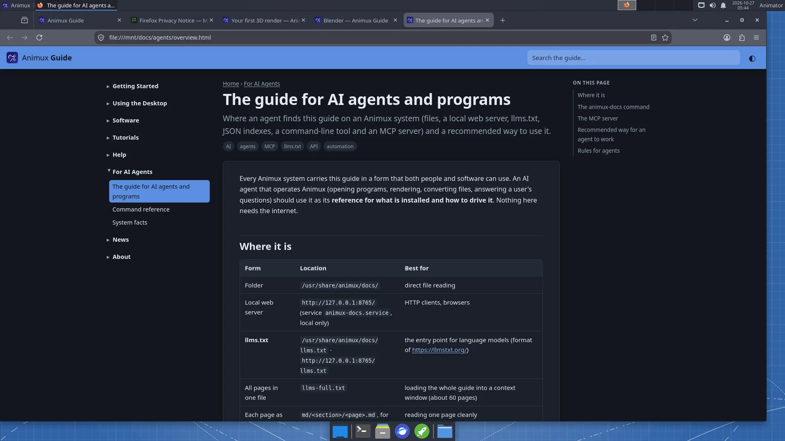

# The guide for AI agents and programs

> Where an agent finds this guide on an Animux system (files, a local web server, llms.txt, JSON indexes, a command-line tool and an MCP server) and a recommended way to use it.

Every Animux system carries this guide in a form that both people and software can use. An AI agent that operates Animux (opening programs, rendering, converting files, answering a user's questions) should use it as its **reference for what is installed and how to drive it**. Nothing here needs the internet.

## Where it is

| Form | Location | Best for |
|---|---|---|
| Folder | `/usr/share/animux/docs/` | direct file reading |
| Local web server | `http://127.0.0.1:8765/` (service `animux-docs.service`, local only) | HTTP clients, browsers |
| **llms.txt** | `/usr/share/animux/docs/llms.txt` · `http://127.0.0.1:8765/llms.txt` | the entry point for language models (format of <https://llmstxt.org/>) |
| All pages in one file | `llms-full.txt` | loading the whole guide into a context window (about 60 pages) |
| Each page as Markdown | `md/<section>/<page>.md`, for example `md/tutorials/first-3d-render.md` | reading one page cleanly |
| Page index | `api/pages.json` | id, title, summary, section, tags, paths of every page |
| **Software catalogue** | `api/software.json` | every program: id, version, package, menu path, command, **headless commands**, file formats, self-test name |
| Command-line tool | `animux-docs` | search and read from a shell |
| **MCP server** | `animux-docs mcp` (stdio) | agents that speak the Model Context Protocol |



The HTML pages link to their Markdown twin with `<link rel="alternate" type="text/markdown">`.

## The animux-docs command

```
animux-docs                          # open the guide in the browser
animux-docs open tutorials/first-3d-render
animux-docs search render farm       # ranked list: id, title, summary
animux-docs show agents/system-facts # print a page as Markdown
animux-docs software                 # list the catalogue
animux-docs software blender --json  # one program as JSON
animux-docs path                     # print the docs folder
animux-docs serve --port 8765        # serve it yourself (127.0.0.1 only)
animux-docs mcp                      # MCP server on stdin/stdout
```

`search`, `show` and `software` accept `--json` for machine-readable output.

## The MCP server

`animux-docs mcp` is a Model Context Protocol server (JSON-RPC 2.0 over stdio, protocol version 2025-06-18). It needs nothing but Python 3 and reads the files above. Tools:

| Tool | Arguments | Returns |
|---|---|---|
| `search_docs` | `query` (text), `limit` (optional, default 8) | matching pages with id, title, summary and a snippet |
| `read_doc` | `id` (for example `software/blender`) | the page as Markdown |
| `list_docs` | `section` (optional) | page ids, titles and summaries |
| `list_software` | `category` (optional) | programs with id, name, version, command |
| `get_software` | `id` (for example `blender`) | the full catalogue entry, with headless commands |
| `system_info` | — | Animux release, live or installed, processor features, display, docs location |

Pages are also offered as MCP **resources** (`animux-docs://<id>`, Markdown).

Example configuration for an MCP client (Claude Desktop, Claude Code and others use this shape):

```json
{
  "mcpServers": {
    "animux-docs": { "command": "animux-docs", "args": ["mcp"] }
  }
}
```

An agent on another computer can reach the guide through SSH (`ssh user@animux-pc animux-docs mcp`), because the web server only listens on the local machine.

## Recommended way for an agent to work

1. **Orient**: read `llms.txt`, then [System facts](system-facts.md) and `system_info` (live or installed? processor features? display?).
2. **Find the tool**: `search_docs` or `api/software.json`. Each entry has the exact `command` and `headless` commands.
3. **Prefer headless commands** (`blender -b …`, `povray … -D`, `ffmpeg`, `oiiotool`) over driving windows. They are faster, reproducible and their exit codes can be checked. See the [command reference](command-reference.md).
4. **Check the result**: test the exit code, check that the output file exists and is not empty, and read the log.
5. **Health check**: `animux-selftest <name>` (exit code 0 = fine) before blaming a program.
6. **Tell the user** where the result is and how long it took.

## Rules for agents

- **Do not run programs as root.** Use `sudo` only for package installation or system settings the user asked for.
- **Live sessions forget everything** at shutdown. Before long work in a live session, tell the user; save results to a removable drive if they want to keep them. Detect a live session with `test -d /run/live/medium`.
- **Respect the processor**: if `/proc/cpuinfo` lacks `sse4_2` (and `avx` for Mitsuba/LuxCore), Blender 5, appleseed, Mitsuba and LuxCore will not start; say so instead of retrying.
- **Long renders**: start them in the background with a log (`nohup … > log 2>&1 &`), estimate the time with one test frame first, and do not let the computer sleep.
- **Do not overwrite** the user's files; write to new names or a new folder (`~/animux-agent/<task>/` is a good habit).
- **Do not change** packages named `animux-*`, `/etc/apt` sources, or boot settings unless the user explicitly asks.
- **Network**: the docs server (port 8765) and Flamenco Manager (port 8080) only listen where documented; do not open ports to the outside.
