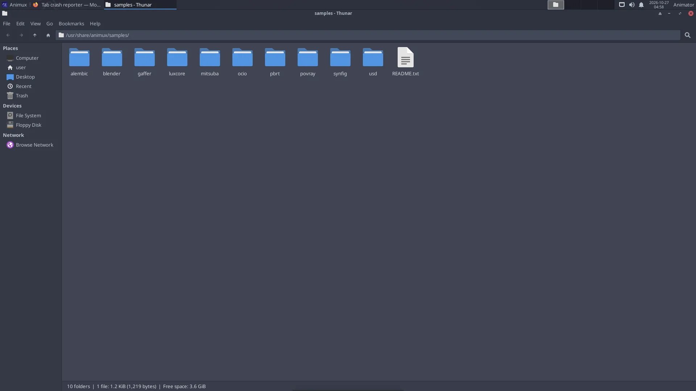

# Files, folders and drives

> Where your work is stored, how to use the file manager, USB drives and network shares, and a sensible folder layout for animation projects.

## Your Home folder

Every user has a **Home** folder (`/home/your-login-name`, written `~` for short). It is like *My Documents* on Windows: everything of yours goes here.

| Folder | Use |
|---|---|
| `Desktop` | files shown on the desktop |
| `Documents` | scripts, notes, storyboards |
| `Pictures` | images, textures, renders (POV-Ray GUI saves to `Pictures/povray`) |
| `Videos` | finished films |
| `Music` | soundtracks |
| `Downloads` | what Firefox downloads |
| `animux-selftest` | results of the [self-test](../help/self-test.md) |

## The file manager

Click the **grey filing drawer** in the dock, or the **Home** icon on the desktop.



- **Left side**: places (Home, Desktop, Trash), drives and network.
- **Double-click** a file to open it; **right-click → Open With** to choose another program.
- **Copy and paste**: Ctrl+C, Ctrl+V. **Rename**: F2. **Delete**: Delete key (goes to the Trash).
- **Show hidden files** (their names start with a dot, for example settings folders): **Ctrl+H**.
- **New folder**: right-click on empty space → **Create Folder**.
- **Open a terminal here**: right-click → **Open Terminal Here**.

## USB sticks and disks

Plug them in: an icon appears on the desktop and the drive is listed on the left in the file manager. **Always eject before unplugging**: right-click the drive → **Eject** (or **Safely Remove**), and wait until the icon disappears. Otherwise files can be damaged.

Drives formatted for Windows (NTFS, exFAT, FAT32) and Mac (exFAT) work. For drives used only with Linux, **ext4** is best; you can format a drive with **System → Disks** (this erases it).

## Network folders

In the file manager, click **Network** on the left, or type an address in the location bar (Ctrl+L):

| Kind | Address |
|---|---|
| Windows share / NAS | `smb://server-name/share` |
| Another Linux computer over SSH | `sftp://user@computer/home/user` |
| NFS (render farm) | `nfs://server/path` |

## A folder layout for an animation project

Studios keep every project in the same shape so everybody (and every render node) finds things. A simple version:

```
~/Projects/my-short/
├── 01-story/        script, storyboard (Scribus, Krita), animatic
├── 02-design/       character and set designs
├── 03-assets/       models, textures, rigs (.blend, .png, .exr)
├── 04-shots/        one .blend per shot: sh010.blend, sh020.blend …
├── 05-renders/      sh010/0001.png … one folder per shot
├── 06-sound/        dialogue, effects, music
└── 07-edit/         Kdenlive project and final MP4
```

- Use **lower-case names without spaces** (`sh010-walk.blend`, not `Shot 10 Walk.blend`). Command-line tools and render farms like them better.
- Use **relative paths** in Blender (*File → External Data → Make Paths Relative*) so the project still works when copied to another computer.

## Back up

Copy your project folder to an external drive regularly. On an installed system, **Timeshift** (*Digital Asset Managers → Timeshift*) can also snapshot the system before big changes. See [System tools](../software/system-tools.md).
