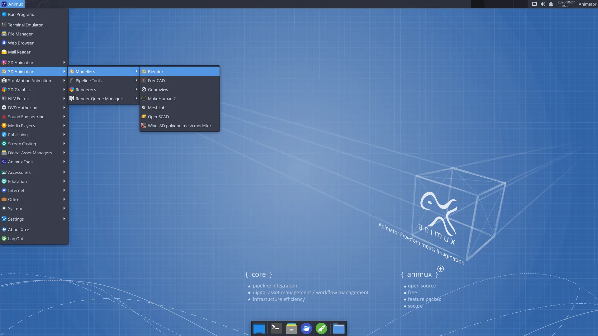

# The Animux menu

> A map of every menu category, so you know where to find the program for each job in an animation production.

Click **Animux** at the top left. The menu is sorted by **production job**, the way the original Animux was, not by program type.

| Category | Inside | Most useful |
|---|---|---|
| **2D Animation** | 2D animation programs | [Pencil2D](../software/pencil2d.md), [Synfig Studio](../software/synfig.md), TupiTube |
| **3D Animation → Modellers** | 3D modelling and character programs | [Blender](../software/blender.md), [MakeHuman 2](../software/makehuman.md), FreeCAD, Wings 3D, MeshLab |
| **3D Animation → Pipeline Tools** | Studio scene and format tools | [Gaffer](../software/gaffer.md), USD View |
| **3D Animation → Renderers** | Renderers with a window | POV-Ray, appleseed (others: see [Renderers](../software/renderers.md)) |
| **3D Animation → Render Queue Managers** | Render farm | [Flamenco Manager](../software/flamenco.md), Farmerjoe |
| **StopMotion Animation** | Frame-by-frame camera capture | [Stopmotion](../software/stopmotion.md) |
| **2D Graphics → Bitmap Editors** | Painting and photo editing | [Krita](../software/krita.md), [GIMP](../software/gimp-inkscape.md), MyPaint, mtPaint, GrafX2 |
| **2D Graphics → Vector Editors** | Drawing with shapes | [Inkscape](../software/gimp-inkscape.md) |
| **2D Graphics → Image Viewers** | Look at pictures and renders | Ristretto, Image Viewer, DJV |
| **2D Graphics → Ancillary Tools** | Other graphics tools | [Upscayl](../software/upscayl.md), colour calibration, scanning |
| **NLV Editors** | Video editing | [Kdenlive](../software/kdenlive.md), OpenShot, Cinelerra-GG, Avidemux |
| **DVD Authoring → Production** | Converting and finishing video | HandBrake, MKVToolNix, subtitle editors |
| **DVD Authoring → Backup** | Burning discs | K3b |
| **Sound Engineering** | Recording, music, audio setup | [Audacity, Ardour, LMMS, Hydrogen, MuseScore](../software/audio.md), QjackCtl, volume control |
| **Media Players** | Watch and listen | VLC, Parole |
| **Publishing** | Storyboards, PDF, print | [Scribus](../software/storyboard-publishing.md), PDF Arranger, Document Viewer |
| **Screen Casting** | Screenshots | Screenshot |
| **Digital Asset Managers** | Find and manage files and backups | File manager, Catfish search, Disk Usage Analyzer, Timeshift |
| **Animux Tools** | Animux's own tools | Animux Guide, Self-Test, Sample Scenes, Install DaVinci Resolve |
| Accessories, Education, Internet, Office, System, Settings | The usual desktop programs | Calculator, text editor, Firefox, Synaptic, Settings Manager |

!!! tip "Can't find a program?"
    Press **Alt+F2** and type part of its name, or use the [software list](../software/index.md), which says where each program is in the menu.
