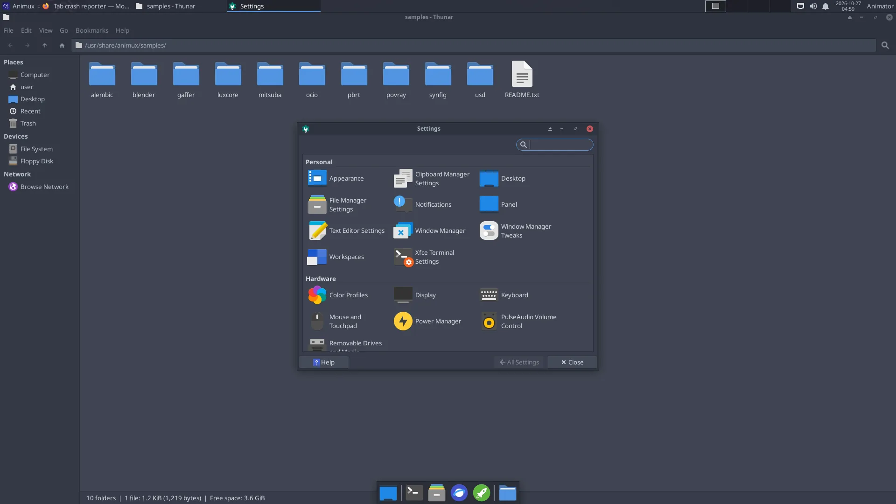
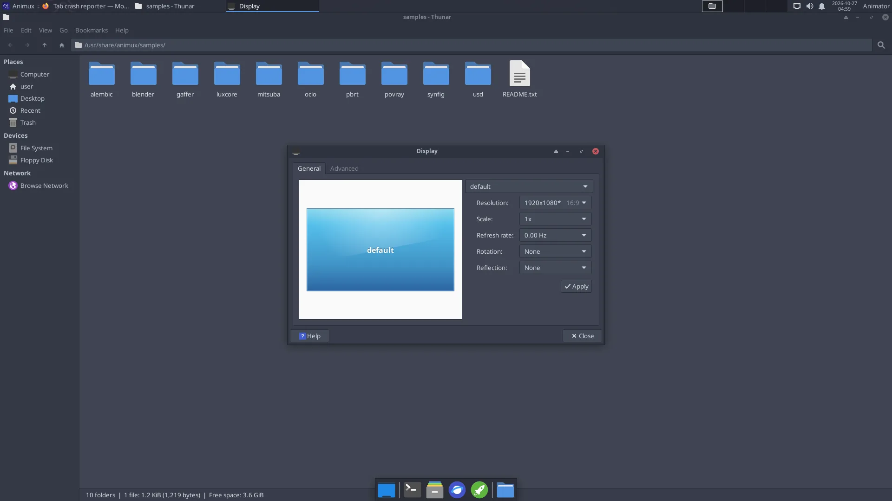

# Settings

> Screen resolution, several monitors, keyboard layout, mouse and tablet, sound, language, Wi-Fi, printers and power.

All settings are in **Animux → Settings → Settings Manager**.

## Screen resolution and several monitors

**Settings → Display**. Choose the **Resolution** and click **Apply**; keep it if the picture is good (otherwise it returns after a few seconds). With two monitors, drag them into the right positions and choose which one is the **Primary Display**.

!!! note "Only a few resolutions in a VM or on a new graphics card?"
    The normal start entry uses a simple, safe graphics mode on BIOS computers. Start with **Workstation (KMS / no nomodeset)** in the [boot menu](../start/boot-menu.md) to use the graphics card's own driver, which offers every resolution. An installed system uses the card's driver automatically.

**Colour accuracy** (for painting and grading): calibrate with a colorimeter and **DisplayCAL** (*2D Graphics → Ancillary Tools*).

## Keyboard layout

**Settings → Keyboard → Layout**: untick **Use system defaults**, click **+ Add** and choose your layout. Several layouts can be switched with the key combination chosen there.

## Mouse, touchpad and drawing tablet

**Settings → Mouse and Touchpad**: speed, left-handed buttons, tap-to-click. A three-button mouse is strongly recommended for Blender. On a laptop, tick *Emulate 3 Button Mouse* in Blender's preferences.

Drawing tablets work with pressure in Krita, GIMP, MyPaint and Blender. Set the pressure curve inside each program (Krita: *Settings → Configure Krita → Tablet settings*).

## Sound

The speaker icon in the panel changes the volume. **Sound Engineering → Sound Server Configuration → PulseAudio Volume Control** chooses which output (speakers, HDMI, headphones) and input (microphone) are used, per program. Audio for recording is explained in [Sound and music](../software/audio.md#how-audio-works-on-animux).

## Language, time and region

- Time zone: right-click the clock → **Properties**, or on an installed system run `sudo dpkg-reconfigure tzdata`.
- Language of the menus: on an installed system run `sudo dpkg-reconfigure locales`, choose your language (for example `de_DE.UTF-8`), then log out and in.

## Network and Wi-Fi

Click the **network icon** at the top right, choose the Wi-Fi network and type its password. **Edit Connections** there for fixed addresses (useful for render farm computers).

## Printers and scanners

**Settings → Print Settings** adds printers (most network printers are found automatically). Scanners work with **Simple Scan** (*Graphics → Document Scanner*).

## Power, screen saver and lock

**Settings → Power Manager**: when the screen turns off and when the computer sleeps. **Tip for long renders:** set *Put to sleep when inactive* to **Never** on the *System* tab, otherwise the computer may sleep in the middle of a render.

## Appearance

**Settings → Appearance** (theme, icons, fonts) and right-click the desktop → **Desktop Settings** for the wallpaper. Animux comes with its own wallpapers in `/usr/share/backgrounds/animux`.
