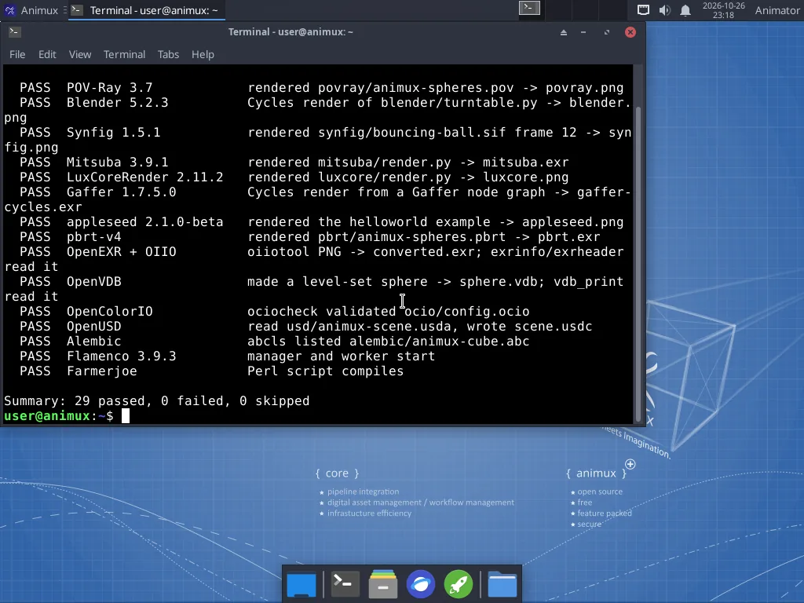

# The terminal, gently

> The twelve commands an animator actually needs, how to copy and paste them, and how sudo works.

The **terminal** is a window where you type instructions instead of clicking. You can do almost everything on Animux without it. It is useful for a few jobs: rendering in the background, converting many files at once, and fixing problems. This guide always gives the full command; you can copy and paste it.

Open it with the **`>_` icon** in the dock, or **Animux → Terminal Emulator**.



## Copy and paste

| | In the terminal | Elsewhere |
|---|---|---|
| Copy | **Ctrl+Shift+C** | Ctrl+C |
| Paste | **Ctrl+Shift+V** (or the middle mouse button) | Ctrl+V |

Press **Enter** to run a command. **Ctrl+C** stops a running command. The **Up arrow** brings back the previous command. **Tab** completes file names.

## The twelve useful commands

| Command | What it does | Example |
|---|---|---|
| `ls` | list the files here | `ls ~/Pictures` |
| `cd` | go into a folder | `cd ~/Projects/my-short` |
| `pwd` | show where you are | `pwd` |
| `cp` | copy | `cp shot.blend shot-backup.blend` |
| `mv` | move or rename | `mv render.png final.png` |
| `mkdir` | make a folder | `mkdir -p ~/Projects/my-short/05-renders` |
| `rm` | delete for good (no Trash!) | `rm old-test.png` |
| `xdg-open` | open a file with its usual program | `xdg-open final.mp4` |
| `df -h` | how full the disks are | `df -h` |
| `free -h` | how much memory is used | `free -h` |
| `htop` | live list of running programs (q quits) | `htop` |
| `man` | the manual of a command (q quits) | `man ffmpeg` |

## Programs from the terminal

Every program in the menu can be started by name, for example `blender`, `krita` or `kdenlive`. Add `&` to keep using the terminal: `krita &`. The [software list](../software/index.md) shows each program's command.

Rendering without opening a window is the most useful trick:

```
blender -b ~/Projects/my-short/04-shots/sh010.blend -a
```

See [Command-line rendering](../tutorials/command-line-rendering.md).

## sudo: doing things as administrator

Installing software and changing the system need administrator rights. Put `sudo` in front:

```
sudo apt update
```

On an installed system it asks for **your** password (nothing appears while you type; that is normal). In the live session it does not ask.

!!! warning
    Only use `sudo` with commands you understand or that come from this guide. As administrator you can damage the system.

## Paths, quickly

- `~` is your Home folder; `~/Pictures` is the Pictures folder in it.
- `.` is "here", `..` is "one folder up".
- Names with spaces need quotes: `cd "~/My Projects"` – or avoid spaces.
- Upper and lower case are different: `Render.png` and `render.png` are two files.
