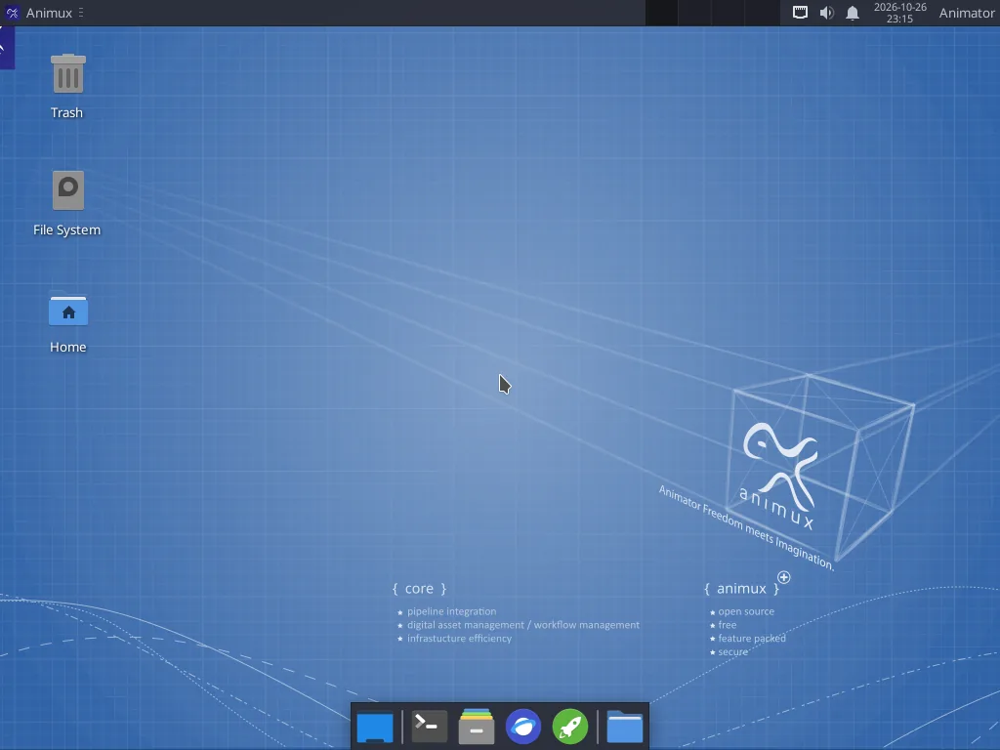
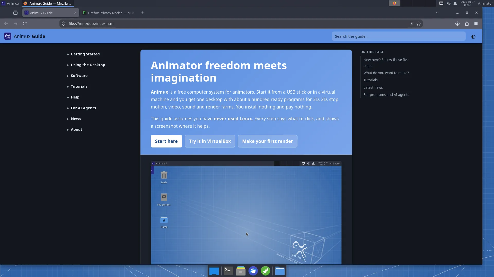

# Desktop tour

> The top panel, the Animux menu, the dock and the desktop icons, explained one by one.

Animux uses the **Xfce** desktop. If you know Windows, most things work the same way: windows, a menu, double-click to open, right-click for more options.

## The top panel

| Where | What | How to use it |
|---|---|---|
| Top left: **Animux** | The **menu** with every program | Click it, then move the mouse over a category. See [The Animux menu](menu.md). |
| Next to it | Open windows | Click a window's name to bring it to the front or hide it. |
| Middle right | Workspaces (four small boxes) | Four separate desktops. Click one to switch; handy to keep Blender on one and the browser on another. |
| Right | Network, volume, notifications | Click the network icon for Wi-Fi, the speaker for volume. |
| Right | Date and time | Click for a calendar. |
| Far right: **Animator** | Your user name | Log out, restart, shut down, lock the screen. |

## The dock (bottom)

| Icon | What it does |
|---|---|
| Blue rectangle | **Show desktop**: hides all windows (click again to bring them back). |
| Black box with `>_` | **Terminal**: type commands ([how](terminal.md)). |
| Grey filing drawer | **File manager**: your files and drives ([how](files.md)). |
| Blue globe | **Web browser** (Firefox). |
| Green rocket | **Application finder**: type a few letters of a program's name and press Enter. |
| Blue folder | **Folder menu**: shows the folders in your Home as a menu, so you can open one quickly. |

## Desktop icons

- **Trash**: deleted files go here first. Right-click → **Empty Trash** to delete them for good.
- **File System**: the whole system. You rarely need it.
- **Home**: your personal folder with Documents, Pictures, Videos and so on.
- USB sticks and disks appear here when you plug them in.

## Starting programs: three ways

1. **The menu**: Animux → category → program.
2. **Search**: press **Alt+F2** or click the green rocket, type for example `blender`, press **Enter**.
3. **Double-click a file**: a `.blend` file opens in Blender, a picture in the image viewer, a video in VLC.

## Windows

- Drag a window by its title bar. Double-click the title bar to make it fill the screen.
- The buttons at the top right of each window: **minimise** (_), **maximise** (□), **close** (×).
- **Alt+Tab** switches between windows.
- Drag a window to the left or right edge of the screen to give it half the screen.

## Shutting down

Click **Animator** at the top right (or **Animux → Log Out**) and choose **Shut Down** or **Restart**.

!!! warning "Live session"
    In the live session, files are lost when you shut down. See [The live session](../start/live-session.md).

## This guide on Animux

The guide is installed on Animux and works without internet: **Animux → Animux Tools → Animux Guide**. It also opens in the web browser at `http://127.0.0.1:8765/`, and it opens by itself the first time you log in.

