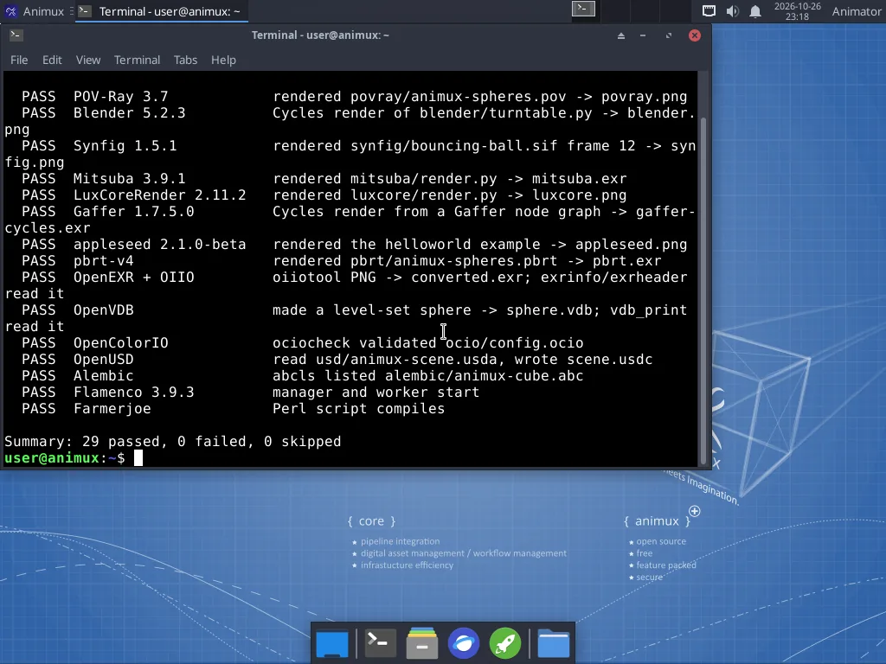

# The self-test and sample scenes

> Check in a few minutes that every renderer and the main programs work on your computer, read the results, and use the sample scenes to learn.

**Animux Tools → Animux Self-Test** renders a small scene with every renderer, opens the most important file formats and checks that the main programs start. It takes 2–10 minutes.



## Reading the results

| Result | Means | Do |
|---|---|---|
| **PASS** | the program ran and produced a correct result | nothing |
| **FAIL** | the program is installed but did not work | open the log file named in the line (see below) |
| **SKIP** | not installed, or this processor is too old for it | "this processor has no SSE4.2/AVX": see [Requirements](../start/requirements.md) |

All pictures, files and logs are kept in **`~/animux-selftest/<date-time>/`**; the menu entry opens that folder at the end. `summary.txt` there has the result list. Attach that folder when you [ask for help](getting-help.md).

## The tests

| Test name | Program | What it checks |
|---|---|---|
| `blender` | [Blender](../software/blender.md) | Cycles renders a small scene |
| `apps` | [MakeHuman II](../software/makehuman.md) | the program and its Qt libraries load |
| `povray` | [POV-Ray](../software/renderers.md) | renders samples/povray/animux-spheres.pov |
| `appleseed` | [appleseed](../software/renderers.md) | renders the bundled helloworld project |
| `luxcore` | [LuxCoreRender](../software/renderers.md) | renders samples/luxcore/render.py |
| `mitsuba` | [Mitsuba 3](../software/renderers.md) | renders samples/mitsuba/render.py |
| `pbrt` | [pbrt-v4](../software/renderers.md) | renders samples/pbrt/animux-spheres.pbrt |
| `gaffer` | [Gaffer](../software/gaffer.md) | Cycles render from a Gaffer node graph |
| `usd` | [OpenUSD tools (usdview, usdcat …)](../software/pipeline-formats.md) | reads samples/usd/animux-scene.usda, writes .usdc |
| `alembic` | [Alembic tools (abcls, abctree …)](../software/pipeline-formats.md) | lists samples/alembic/animux-cube.abc |
| `exr` | [OpenEXR and OpenImageIO tools](../software/pipeline-formats.md) | converts PNG to EXR and reads the header |
| `ocio` | [OpenColorIO tools](../software/pipeline-formats.md) | validates samples/ocio/config.ocio |
| `vdb` | [OpenVDB tools](../software/pipeline-formats.md) | makes a level-set sphere and reads it back |
| `flamenco` | [Flamenco](../software/flamenco.md) | manager and worker start |
| `farmerjoe` | [Farmerjoe](../software/flamenco.md) | the Perl script compiles |
| `opentoonz` | [OpenToonz](../software/opentoonz.md) | renders samples/opentoonz/animux-lines with tcomposer |
| `synfig` | [Synfig Studio](../software/synfig.md) | renders frame 12 of samples/synfig/bouncing-ball.sif |
| `apps` | [DJV](../software/video-tools.md) | the program starts |


The `apps` test also checks that MakeHuman 2, DJV, Avidemux and Cinelerra-GG start.

## From the terminal

```
animux-selftest                 # everything
animux-selftest --list          # list the test names
animux-selftest blender povray  # only these
animux-selftest --open          # open the results folder at the end
```

The exit code is 0 when nothing failed, 1 otherwise, so scripts and [AI agents](../agents/overview.md) can use it as a health check.

## Sample scenes

**Animux Tools → Animux Sample Scenes** opens `/usr/share/animux/samples`:

| Folder | File | Open or run with |
|---|---|---|
| `povray/` | `animux-spheres.pov` | menu *Renderers → POV-Ray*, or `povray +Ianimux-spheres.pov +O/tmp/out.png +W800 +H600` |
| `blender/` | `turntable.py` | `blender -b -P turntable.py -- /tmp/out.png` |
| `synfig/` | `bouncing-ball.sif` | Synfig Studio (**File → Open**), or `synfig bouncing-ball.sif -t gif -o /tmp/ball.gif` |
| `mitsuba/` | `render.py` | `animux-vfx-python render.py /tmp/out.exr` |
| `luxcore/` | `render.py` | `animux-vfx-python render.py /tmp/out.png` |
| `gaffer/` | `render.py` | `gaffer env python render.py /tmp/out.exr` |
| `pbrt/` | `animux-spheres.pbrt` | `pbrt --outfile /tmp/out.exr animux-spheres.pbrt` |
| `usd/` | `animux-scene.usda` | `usdview animux-scene.usda` |
| `alembic/` | `animux-cube.abc` | Blender: *File → Import → Alembic*; `abcls -r animux-cube.abc` |
| `ocio/` | `config.ocio` | `ociocheck --iconfig config.ocio` |

The sample files are read-only. Copy one to your Home folder before changing it: `cp -r /usr/share/animux/samples ~/samples`.

More examples: `/usr/share/povray-3.7/scenes` (hundreds of POV-Ray scenes), `/opt/animux/gaffer/resources` (Gaffer), `/opt/animux/appleseed/examples` (appleseed), and the tutorial files on this guide: [first-render.blend](../../files/first-render.blend), [turntable.blend](../../files/turntable.blend).
