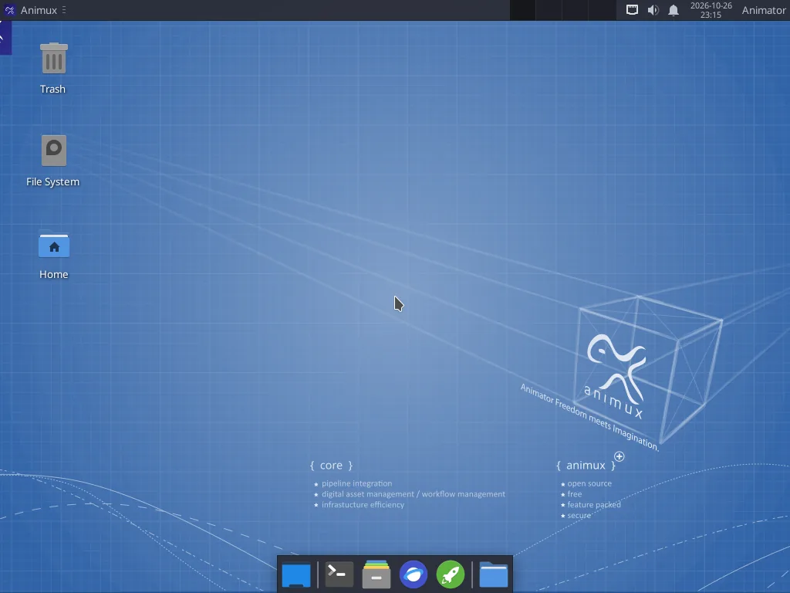

# Animux Guide

> Everything you need to make animation on Animux, from your first boot to a finished film.

# Animator freedom meets imagination

**Animux** is a free computer system for animators. Start it from a USB stick or in a virtual machine and you get one desktop with about a hundred ready programs for 3D, 2D, stop motion, video, sound and render farms. You install nothing and pay nothing.

This guide assumes you have **never used Linux**. Every step says what to click, and shows a screenshot where it helps.

<a class="btn primary" href="start/what-is-animux.md">Start here</a> <a class="btn" href="start/virtualbox.md">Try it in VirtualBox</a> <a class="btn" href="tutorials/first-3d-render.md">Make your first render</a>

## New here? Follow these five steps

1. **[What is Animux?](start/what-is-animux.md)**: what you get and what you need.
2. **[Try it safely in VirtualBox](start/virtualbox.md)**, or **[make a USB stick](start/usb-stick.md)** to start a real computer from it.
3. **[Take the desktop tour](desktop/tour.md)**: the menu, files and settings.
4. **[Run the self-test](help/self-test.md)** to check that everything works on your computer.
5. **[Make your first 3D render](tutorials/first-3d-render.md)** with Blender, then continue with the other tutorials.

When you like it, **[install Animux on the hard disk](start/install.md)** so your work and settings are kept.

## What do you want to make?

<a class="card" href="software/blender.md"><strong>3D animation</strong>Blender 5.2 with Cycles and EEVEE, plus characters from MakeHuman.</a>
<a class="card" href="software/pencil2d.md"><strong>Hand-drawn 2D</strong>Pencil2D, Krita and TupiTube for frame-by-frame drawing.</a>
<a class="card" href="software/synfig.md"><strong>Cut-out and vector 2D</strong>Synfig Studio: automatic in-betweens and bone rigs.</a>
<a class="card" href="software/stopmotion.md"><strong>Stop motion</strong>Clay, LEGO or paper, shot with a webcam.</a>
<a class="card" href="software/kdenlive.md"><strong>Edit the film</strong>Kdenlive: shots, music, titles, export to MP4.</a>
<a class="card" href="software/audio.md"><strong>Sound and music</strong>Audacity, Ardour, LMMS and more.</a>
<a class="card" href="software/renderers.md"><strong>Rendering</strong>Cycles, POV-Ray, LuxCore, Mitsuba, appleseed, pbrt.</a>
<a class="card" href="software/flamenco.md"><strong>Render farm</strong>Many computers rendering one film with Flamenco.</a>

## Tutorials

<a class="card" href="tutorials/first-3d-render.md"><strong>Your first 3D render</strong>In Blender, replace the default cube with a monkey head, give it shiny red paint, add a floor, light it and render a picture. About 30 minutes, no experience needed.</a><a class="card" href="tutorials/turntable-animation.md"><strong>A turntable animation</strong>Make Suzanne spin once around in four seconds with two keyframes, then render the animation straight to an MP4 video. About 20 minutes.</a><a class="card" href="tutorials/character-makehuman.md"><strong>A character with MakeHuman</strong>Create a human character with MPFB inside Blender, give it a skeleton, pose it and set a keyframe, or design it in MakeHuman II and bring it over. About 30 minutes.</a><a class="card" href="tutorials/bouncing-ball-synfig.md"><strong>A bouncing ball in Synfig</strong>The classic first animation exercise. Make a ball fall, squash and bounce with waypoints and ease in and out, then export a GIF. About 30 minutes.</a><a class="card" href="tutorials/hand-drawn-pencil2d.md"><strong>Hand-drawn animation in Pencil2D</strong>Draw a short flip-book animation frame by frame with onion skin, play it back and export it as GIF or MP4. About 30 minutes, perfect for beginners and children.</a><a class="card" href="tutorials/krita-animation.md"><strong>Paint an animation in Krita</strong>Use Krita&#x27;s animation workspace to paint a short loop, such as a flickering candle flame, with onion skins, then render it to a video. About 40 minutes.</a><a class="card" href="tutorials/stop-motion-webcam.md"><strong>Stop motion with a webcam</strong>Set up a tiny studio, capture a clay or LEGO animation with Stopmotion&#x27;s onion skin, and turn it into a video with sound.</a><a class="card" href="tutorials/edit-video-kdenlive.md"><strong>Edit your film in Kdenlive</strong>Put rendered shots, a title and music together on a timeline and export an MP4 ready for YouTube. Uses the turntable video from the earlier tutorial. About 30 minutes.</a><a class="card" href="tutorials/command-line-rendering.md"><strong>Command-line rendering and batch jobs</strong>Render Blender, Synfig and POV-Ray without opening them, keep renders running after you log out, render overnight, join frames into a video and convert hundreds of images at once.</a><a class="card" href="tutorials/short-film-workflow.md"><strong>From idea to finished short film</strong>The stages of an animated film production and which Animux program to use at each one, with a realistic plan for a first 30-second film.</a>

## Latest news

- **2026-10-30** — [Animux Genesis64 r16.3](news/2026-10-30-r16-3-release.md): OpenToonz 1.8, the studio 2D animation program, and the Maya Workflow Kit for Blender.
- **2026-10-29** — [Animux Genesis64 r16.2](news/2026-10-29-r16-2-release.md): Claude Code in one step from the menu, and a boot menu without syntax errors.
- **2026-10-27** — [Introducing the Animux Guide](news/2026-10-27-animux-guide.md): A complete, illustrated guide for animators who have never used Linux, installed on every Animux system and readable by AI agents.
- **2026-10-26** — [Animux Genesis64 r16 is here](news/2026-10-26-r16-release.md): Blender 5.2 LTS, Gaffer, five new renderers, MakeHuman II, a signed Animux package repository and a self-test that checks it all.

## For programs and AI agents

This guide is also built for software. On Animux the guide is in `/usr/share/animux/docs` and is served at `http://127.0.0.1:8765/`. Every page is also available as Markdown, and [llms.txt](../llms.txt), [a JSON index](../api/pages.json), [a software catalogue](../api/software.json), the `animux-docs` command and an MCP server come with it. See **[For AI agents](agents/overview.md)**.
