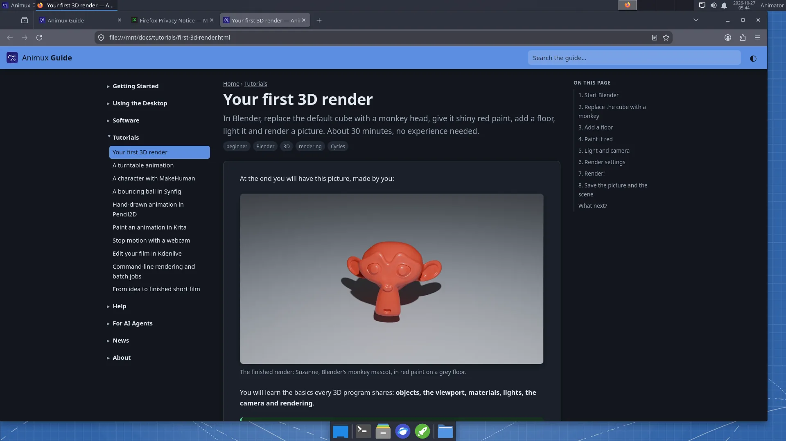

# Introducing the Animux Guide

> A complete, illustrated guide for animators who have never used Linux, installed on every Animux system and readable by AI agents.

Animux now comes with its own documentation: **the Animux Guide**, the site you are reading.

- **For people new to Linux**: from downloading the ISO and trying it in VirtualBox, to installing, the desktop, and every program, with screenshots taken on Animux itself.
- **Tutorials** that build on each other: a first render, a turntable animation, a MakeHuman character, a Synfig bouncing ball, hand-drawn animation in Pencil2D, a Krita loop, stop motion, editing in Kdenlive, command-line rendering, and a plan for a first short film.

- **Offline**: on Animux it is under *Animux Tools → Animux Guide* and at `http://127.0.0.1:8765/`.
- **For AI agents**: every page also exists as Markdown, with `llms.txt`, JSON indexes of the pages and of all software (with headless commands), a command-line tool and an MCP server. See [For AI agents](../agents/overview.md).

The guide is published under CC BY-SA 4.0. Corrections and translations are welcome.
