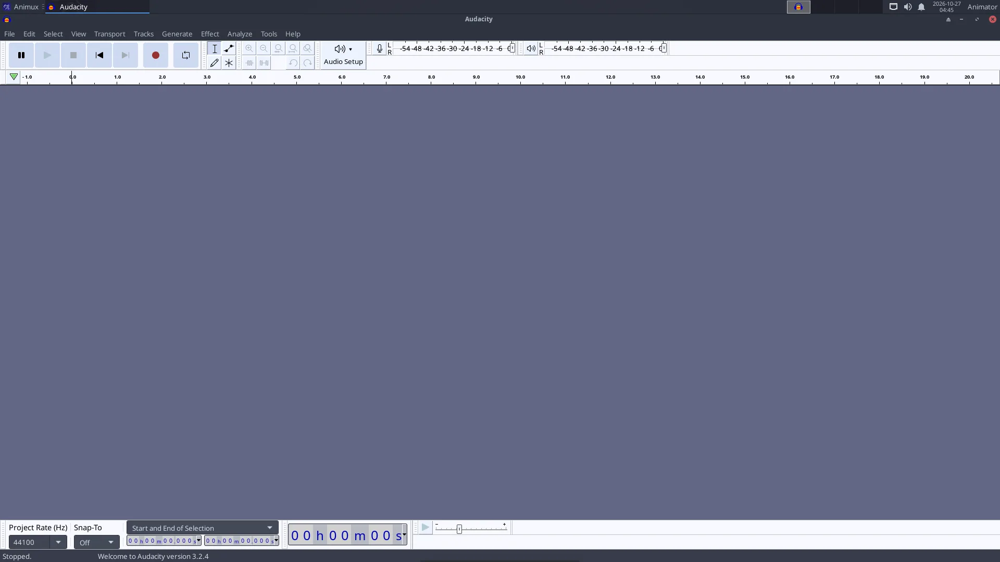
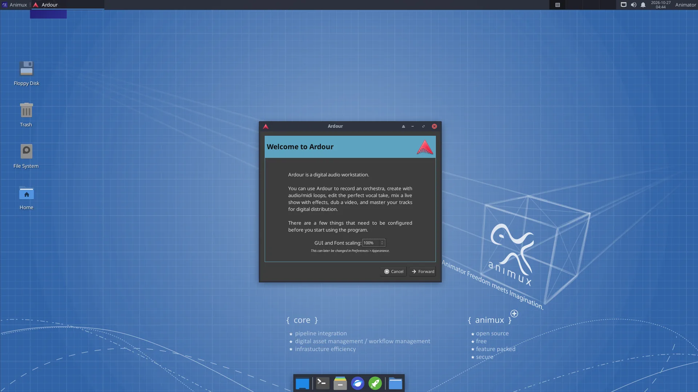
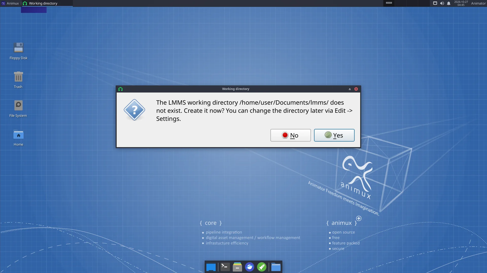

# Sound and music

> Record voices with Audacity, mix the soundtrack in Ardour, compose with LMMS, Hydrogen and MuseScore, and understand how audio works on Animux.

| Program | Use it to | Start |
|---|---|---|
| **Audacity** 3.2 | record and clean up dialogue and sound effects (easiest) | `audacity` |
| **Ardour** 7.3 | record and mix many tracks, the full soundtrack of a film, with effects and automation | `ardour` |
| **LMMS** 1.2 | compose music with built-in synthesizers, beats and samples | `lmms` |
| **Hydrogen** 1.2 | program drum rhythms | `hydrogen` |
| **MuseScore 3** | write sheet music and play it back | `mscore3` |
| **Rosegarden** | MIDI sequencing and scoring | `rosegarden` |
| **ZynAddSubFX, Yoshimi, Qsynth, Guitarix, VMPK** | software instruments, guitar amp, on-screen keyboard | menu |
| **Sonic Visualiser, Praat** | look at sound; Praat analyses speech (useful for lip sync timing) | menu |
| **SoundConverter, SoX** | convert sound files | `soundconverter`, `sox` |

All are in **Sound Engineering**.

## Audacity: record a voice-over

1. Plug in a microphone (a USB microphone or headset is easiest). Choose it in the **microphone** list on the toolbar.
2. Click the red **Record** button, speak, click **Stop**.
3. Clean it: select a quiet part → **Effect → Noise Removal and Repair → Noise Reduction → Get Noise Profile**; select everything (Ctrl+A) → Noise Reduction → **OK**. Then **Effect → Volume and Compression → Normalize**.
4. **File → Export → Export as WAV** (best for editing) or MP3.

## Ardour: mix the soundtrack

When Ardour starts it asks for a **session** (project) and the **audio system**: choose **JACK/PipeWire** or **ALSA** (see below). Add tracks with **Track → Add Track, Bus or VCA**, import the dialogue, music and effects with **Session → Import**, and set levels in the **Mixer** window (Alt+M). **Session → Export → Export to Audio File(s)** writes the final mix.

To line up sound with picture inside Ardour, **Session → Open Video** needs the extra programs *harvid* and *xjadeo*, which are not included. The easier way: edit the final mix against the picture in [Kdenlive](kdenlive.md).

## LMMS and Hydrogen: make music

In **LMMS**, drag an instrument (for example *TripleOscillator*) from the left into the **Song Editor**, double-click its pattern to open the **Piano Roll** and draw notes. The **Beat+Bassline Editor** is for drum patterns. **File → Export** writes WAV or OGG.

In **Hydrogen**, click squares in the pattern grid to place drum hits; chain patterns in the song editor.

## How audio works on Animux

Animux uses **PipeWire**, which plays the roles of PulseAudio (normal desktop sound) and JACK (professional low-latency audio) at once. Normally you do nothing.

- **Volume and devices**: the speaker icon on the panel, and **PulseAudio Volume Control** (*Sound Engineering → Sound Server Configuration*): choose the output (speakers, HDMI, headphones) and input (microphone) on the *Output Devices*, *Input Devices* and *Configuration* tabs.
- **JACK programs** (Ardour, Hydrogen, Qsynth…) connect to PipeWire's JACK service automatically. If a program cannot find JACK, start it with `pw-jack`, for example `pw-jack hydrogen`.
- **QjackCtl** shows and changes connections between audio programs (the **Graph** button).

!!! tip "Crackling sound while recording"
    Close other programs. In Ardour choose a larger buffer size (512 or 1024 samples). In a virtual machine audio is often unreliable; record on a real computer if you can.

## Sound for animation: tips

- Record dialogue **before** animating, then animate to it (lip sync). Import the WAV in Blender's timeline (*Add → Sound* in the Video Sequencer) or in Pencil2D's sound layer.
- Use **48 kHz WAV** files throughout; it is the film and video standard.
- Free sound effects and music: <https://freesound.org/>, <https://opengameart.org/>, <https://freemusicarchive.org/>. Check each licence.
