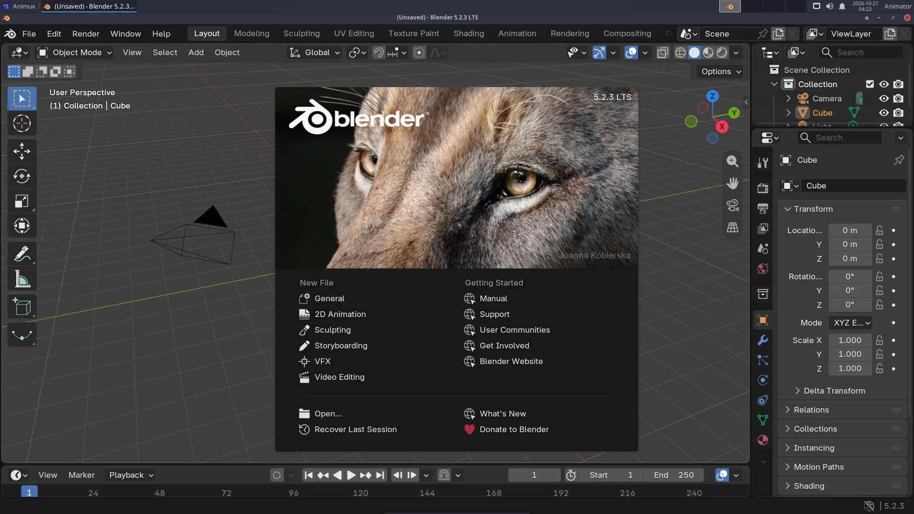
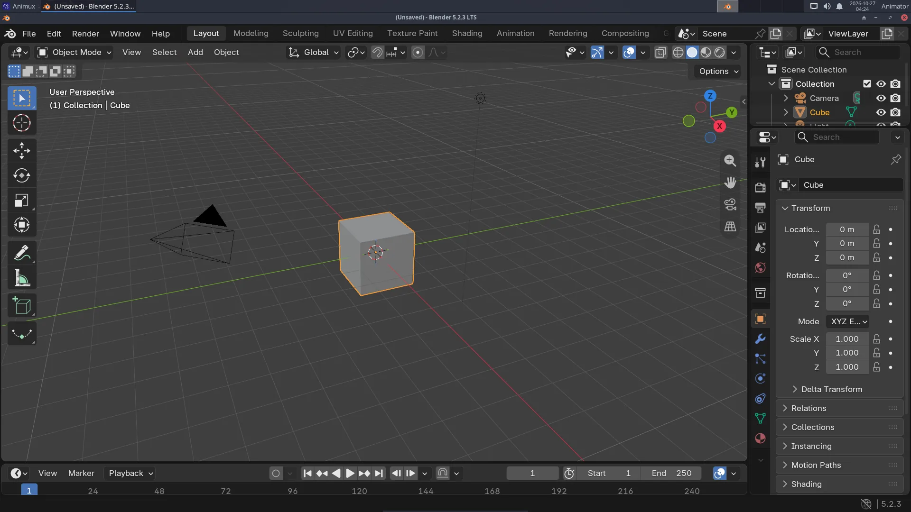

# Blender

> The 3D studio at the heart of Animux. Blender 5.2 LTS with Cycles, EEVEE, Grease Pencil and the MPFB character add-on, and how to find your way around it.

<div class="factbox" markdown="1">

| Blender | |
|---|---|
| Menu | 3D Animation → Modellers → Blender |
| Version | 5.2.3 LTS |
| Command | `blender` |
| Good for | Beginner to professional |
| Files | .blend; imports/exports FBX, OBJ, glTF, USD, Alembic, STL, PLY, SVG |
| Licence | GPL-3.0-or-later |
| Website | [blender.org](https://www.blender.org/) |
| Self-test | `animux-selftest blender` |

</div>


Blender does almost everything in a 3D film: **modelling, sculpting, texturing, rigging, animation, physics (cloth, smoke, fluids), rendering, compositing and even video editing**. It is used for feature films, TV series, games and advertising. Animux includes the official **Blender 5.2.3 LTS** from blender.org ("LTS" = long-term support, with bug fixes until 2028), not the old Blender 3.4 that Debian 12 ships.

## Start Blender

**Animux → 3D Animation → Modellers → Blender**, or type `blender`. The first time, a welcome screen (the *splash*) appears; click anywhere outside it to close it.



## The screen



| Part | Where | What for |
|---|---|---|
| **Top bar** | top | menus (*File*, *Render*…) and **workspaces** (*Layout*, *Modeling*, *Animation*, *Shading*…): ready-made screen layouts for each job |
| **3D Viewport** | middle | your scene. Middle mouse button to orbit, wheel to zoom |
| **Toolbar** | left of the viewport | select, move, rotate, scale… |
| **Outliner** | top right | every object in the scene (camera, light, cube) |
| **Properties** | bottom right | settings, in tabs: render, output, object, modifiers, materials… |
| **Timeline** | bottom | frames, play button, keyframes |

## Your first hour

Follow the tutorials in order:

1. [Your first 3D render](../tutorials/first-3d-render.md): object, material, light, camera, render, save.
2. [A turntable animation](../tutorials/turntable-animation.md): keyframes and a video file.
3. [A character with MakeHuman](../tutorials/character-makehuman.md): a human with a skeleton, in Blender.
4. [From idea to finished film](../tutorials/short-film-workflow.md): how the steps fit together.

## Render engines

| Engine | Use it for | Speed |
|---|---|---|
| **EEVEE** | previews, stylised and cartoon looks, motion graphics | seconds per frame on a good graphics card |
| **Cycles** | realistic light, glass, reflections | seconds to minutes per frame |
| **Workbench** | quick clay previews | instant |

Choose in **Properties → Render → Render Engine**. On computers without a strong graphics card (and in virtual machines), **Cycles on the CPU** is the most reliable choice. EEVEE needs OpenGL 4.3; in a VM it runs through software emulation and is slow.

**GPU rendering in Cycles** needs NVIDIA's driver (CUDA/OptiX) or AMD's HIP. See [Adding software](../desktop/add-software.md#nvidia-driver), then **Edit → Preferences → System**.

## Grease Pencil: 2D inside Blender

**File → New → 2D Animation** gives a drawing canvas with layers, onion skin and a timeline. Draw with a tablet, animate frame by frame, and combine with 3D objects.

## Add-ons included

- **MPFB 2.0.18** (MakeHuman Plugin for Blender): the **MPFB** tab in the side panel (press **N** in the viewport) creates human characters. It is switched on automatically. See [MakeHuman and MPFB](makehuman.md).
- **Maya Workflow Kit 0.7.0** (new in r16.3, **off** until you switch it on): see [Coming from Maya](#coming-from-maya) below.
- Blender's own extensions (*Edit → Preferences → Get Extensions*) can be installed from extensions.blender.org when you are online.

## Coming from Maya

Trained on Autodesk Maya? The **Maya Workflow Kit** (by ohnsk, free, GPL-3.0) makes Blender work like Maya: Maya hotkeys and **Alt+mouse** navigation, **QWER** tools, the **Space** hotbox and marking menus, the **shelf**, the **Channel Box**, the **Outliner** with persp/top/front/side, the time slider and a Maya-style command line. It contains no Autodesk code.

It is installed but **off**, because it changes Blender's keys and layout. To switch it on:

1. Close Blender.
2. Menu **Animux Tools → Blender: Maya Workflow Kit on/off**, answer **y** (or type `animux-blender-maya on` in a [terminal](../desktop/terminal.md)).
3. Start Blender. The kit's welcome window says that nothing has changed yet; click **Make Blender feel like Maya**.

In Blender, the **Maya | Blender** switch at the top right (or **Ctrl+Alt+Shift+M**) changes between the Maya layout and Blender's own. To remove the kit from Blender completely, close Blender and run the menu entry again (or `animux-blender-maya off`). `animux-blender-maya status` says whether it is on.

The kit's help is in **Edit → Preferences → Add-ons → Maya Workflow Kit**. Blender tutorials and this guide use Blender's own keys: switch back with the **Maya | Blender** switch when you follow them.

## Rendering without opening Blender

Great for long renders, render farms and scripts:

```
blender -b shot.blend -a                          # whole animation, settings from the file
blender -b shot.blend -o //frames/f_#### -F PNG -s 1 -e 48 -a   # frames 1–48 as PNG
blender -b shot.blend -f 10                       # just frame 10
blender -b --python make_scene.py                 # run a Python script
```

`-b` (background) must come first. `//` means "next to the .blend file". See [Command-line rendering](../tutorials/command-line-rendering.md) and [Flamenco](flamenco.md) for many computers.

## Files

- Blender saves **.blend** files. **File → Save** (Ctrl+S). Blender keeps `.blend1` backups next to them.
- **File → Import / Export**: FBX, OBJ, glTF (games and the web), USD and Alembic (studio pipelines), STL (3D printing), SVG.
- Rendered pictures are not saved automatically: in the render window use **Image → Save As**.

## Learn more

- The official manual: <https://docs.blender.org/manual/en/5.2/> (also *Help → Manual*).
- Blender Studio's free courses: <https://studio.blender.org/training/>.
- The sample file `/usr/share/animux/samples/blender/turntable.py` builds a small scene by script.
