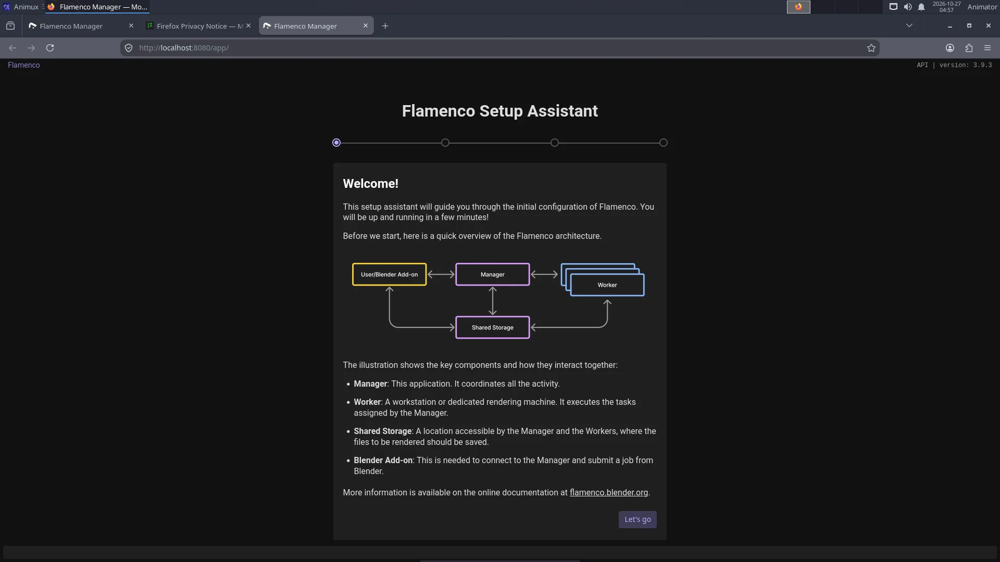

# Flamenco render farm

> Let several computers render one Blender animation together, using Flamenco Manager, Workers and shared storage, and the Animux render farm boot roles.

<div class="factbox" markdown="1">

| Flamenco | |
|---|---|
| Menu | 3D Animation → Render Queue Managers → Flamenco Manager |
| Version | 3.9.3 |
| Command | `animux-flamenco-manager` |
| Good for | Intermediate |
| Files | Blender jobs |
| Licence | GPL-3.0 |
| Website | [flamenco.blender.org](https://flamenco.blender.org/) |
| Self-test | `animux-selftest flamenco` |

</div>


A **render farm** is a group of computers that share the rendering of an animation: each computer renders different frames. **Flamenco** is Blender's official, free render farm software.

| Part | Runs on | Job |
|---|---|---|
| **Manager** | one computer (it can also render) | keeps the list of jobs and hands out frames; has a web page to watch progress |
| **Worker** | every computer that renders | asks the Manager for work, runs Blender, reports back |
| **Blender add-on** | the artist's computer | sends a `.blend` file to the Manager as a job |
| **Shared storage** | a network folder | all computers must see the project files and write the frames, at the same path |

## 1. Shared storage

Every computer must reach the project at the same place, for example `/mnt/farm`. The simplest way on an all-Animux farm is NFS from the Manager computer.

On the Manager, first create the folder:

```
sudo mkdir -p /srv/farm
```

**Only if the Manager runs from the USB stick (live session):** the live system disk lives in memory, and NFS cannot share folders on it. Put the folder on a real disk or USB drive (mount it on `/srv/farm`), or, for a test, on a RAM disk of 8 GB:

```
sudo mount -t tmpfs -o size=8G tmpfs /srv/farm
```

(A RAM disk uses memory and is emptied when the Manager switches off, so copy the finished frames away.)

Then share it (change `192.168.1.0/24` to your own network):

```
sudo chown $USER /srv/farm
echo '/srv/farm 192.168.1.0/24(rw,sync,no_subtree_check,fsid=0)' | sudo tee -a /etc/exports
sudo systemctl unmask nfs-kernel-server && sudo systemctl enable --now nfs-kernel-server
sudo exportfs -ra && sudo exportfs -v
sudo ln -s /srv/farm /mnt/farm
```

`sudo exportfs -v` must list `/srv/farm`. `fsid=0` makes `/srv/farm` the top of the share, so the Workers mount `manager-pc:/` (this also works in a live session, where the plain path does not).

On each Worker (replace `manager-pc` with the Manager's name or IP address):

```
sudo mkdir -p /mnt/farm
sudo mount -t nfs manager-pc:/ /mnt/farm
```

A Windows share or NAS works too, as long as every computer uses the same path.

## 2. Start the Manager

On the Manager computer: **3D Animation → Render Queue Managers → Flamenco Manager**. A terminal window opens (keep it open; closing it stops the Manager) and the browser shows the setup page at `http://localhost:8080/`:



The setup asks for:

1. **Shared storage**: `/mnt/farm`.
2. **Blender**: choose *Blender found on $PATH* (`/usr/bin/blender`, Blender 5.2.3).

Settings and the job database are kept in `~/flamenco`. Without a desktop (text login), start the Manager with the same command the menu uses: `animux-flamenco-manager`, and open `http://manager-pc:8080/` from another computer.

!!! danger "Only Animux r16 (`_21`): Workers get no work"
    Fixed in r16.1 (`_25`). On r16 the Manager accepts jobs, but no Worker ever starts them: the Manager tries to keep its task logs in `/opt/animux/flamenco/flamenco-manager-storage`, where it may not write (the web page shows the tasks as *queued* forever). Fix it once, **after** the setup page, in a terminal on the Manager:

    ```
    sed -i "s#^local_manager_storage_path:.*#local_manager_storage_path: $HOME/flamenco/flamenco-manager-storage#" ~/flamenco/flamenco-manager.yaml
    ```

    then close the Manager window and start it again. The package `animux-flamenco` 3.9.3-animux2 does this by itself.

## 3. Start the Workers

On every render computer (including the Manager, if it should render too), open a terminal:

```
flamenco-worker
```

Workers find the Manager on the local network by themselves. If not, tell them where it is:

```
flamenco-worker -manager http://manager-pc:8080/
```

The Manager's web page lists them under **Workers**.

## 4. Send a job from Blender

1. On the artist's computer open `http://manager-pc:8080/` in Firefox and download the **Blender add-on** from the Manager's web page (the link on the start page).
2. In Blender: **Edit → Preferences → Add-ons → Install from Disk** (in the menu at the top right of the add-ons list) → choose the downloaded `flamenco-addon.zip`, and tick it. Enter the Manager URL and click **Check**.
3. Save your `.blend` file **inside the shared storage** (`/mnt/farm/my-short/sh010.blend`).
4. In **Properties → Output → Flamenco**, choose the job type **Simple Blender Render**, then **Submit to Flamenco**.

The frames appear in the shared storage as they are finished; watch progress on the web page.

## Animux render farm roles

The [boot menu](../start/boot-menu.md) has two farm entries for computers started from the ISO:

| Entry | What Animux does |
|---|---|
| **Render Farm Master** | unmasks the NFS and DHCP server services, so the steps above work |
| **Render Farm Slave** | a render node |

!!! warning "Known problems in r16 (`_21`), fixed in r16.1 (`_25`)"
    - Both entries still **start the desktop** (with automatic login); they were meant to start to a text login. This does no harm: open a terminal and follow the steps above.
    - Every computer started this way is called **animux**, so the Manager lists all Workers under the same name. Before starting `flamenco-worker` for the first time, give each computer its own name, for example `sudo hostnamectl set-hostname node1` (the Worker registers under the computer name).

    Both are fixed in r16.1 (`_25`, package `animux-roles` 1.0.19): text login and names like `animux-slave-3f2a`.

The DHCP server needs your own `/etc/dhcp/dhcpd.conf` before it is useful, and **must not run on a network that already has a router handing out addresses**.

## Farmerjoe

**Farmerjoe** is the small render farm from the original Animux, kept for old projects (`/opt/farmerjoe`, its README opens from the menu). Use Flamenco for new work.

## Tips

- All computers should run the **same Blender version** (all Animux r16 computers do).
- Use **relative paths** and *File → External Data → Pack Resources* or keep textures in the shared storage.
- Render to **image sequences** (PNG or EXR), never directly to a video file: a crashed frame can be re-rendered, and every Worker writes its own frames.
- Wired network (1 Gbit/s or faster) is much better than Wi-Fi.
- Documentation: <https://flamenco.blender.org/usage/>.

## Coming: OpenCue

<div class="films">

<article class="film">
<p class="kicker">Sony Pictures Imageworks and Google Cloud · open source since January 2019</p>
<h2 class="film-title">OpenCue</h2>
<p class="made">Render manager for large studios · planned for Animux r17</p>
<p>OpenCue grew out of <b>Cue 3</b>, the queuing system Sony Pictures Imageworks developed in-house over 15 years and used on more than a hundred feature films and visual-effects projects. Google Cloud and Imageworks released it as open source (Apache 2.0) on 24 January 2019; it is now a project of the Academy Software Foundation.</p>
<p>Recent Imageworks projects ran it on over 150,000 processor cores, split between their own data centre and Google Cloud. Flamenco is the simpler choice for a class or a small studio; OpenCue is made for studios with many render nodes and many shows at once.</p>
<p class="source">Sources: Google Cloud blog, "Introducing OpenCue: an open source render manager for media and entertainment", 24 January 2019 · TechCrunch, "Google partners with Sony Pictures Imageworks to launch an open-source VFX render manager", 24 January 2019</p>
</article>

</div>
