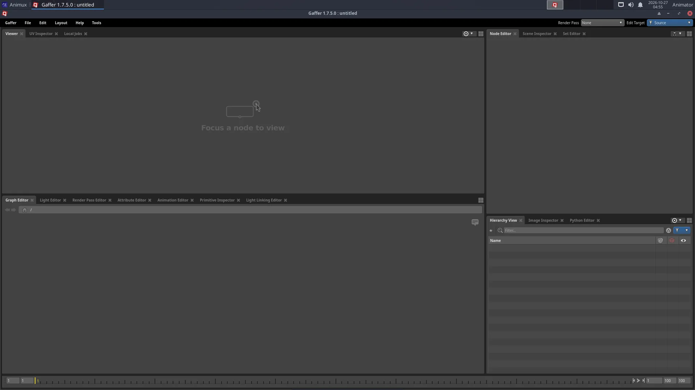

# Gaffer

> The node-based lighting and look-development tool used by film studios, included with Cortex, OSL, OpenUSD and Alembic, and rendering with Cycles.

<div class="factbox" markdown="1">

| Gaffer | |
|---|---|
| Menu | 3D Animation → Pipeline Tools → Gaffer |
| Version | 1.7.5.0 |
| Command | `gaffer` |
| Good for | Advanced |
| Files | .gfr; reads USD, Alembic, SceneCache |
| Licence | BSD-3-Clause |
| Website | [gafferhq.org](https://www.gafferhq.org/) |
| Self-test | `animux-selftest gaffer` |

</div>


**Gaffer** is a free tool from Image Engine, a visual-effects studio, for the work *after* modelling and animation: **assembling scenes, lighting, look development (materials) and sending renders**. Everything is a **node graph**: boxes connected by lines, each doing one step. Change an early node and everything after it updates. This makes it possible to light hundreds of shots the same way.

!!! note "Is Gaffer for me?"
    For a personal or school film, **Blender alone is enough**. Gaffer is worth learning if you want to work in a VFX or animation studio pipeline, or your project has many shots that share lighting.



## Start

**3D Animation → Pipeline Tools → Gaffer**, or `gaffer`. Gaffer's window has:

- **Viewer**: the 3D scene (or rendered image) produced by the selected node;
- **Graph Editor**: the nodes; press **Tab** in it to add a node by name;
- **Node Editor**: settings of the selected node;
- **Hierarchy / Scene Inspector**: the objects in the scene at that point of the graph.

## A first graph

Add nodes with **Tab** in the Graph Editor and connect an output (bottom of a node) to an input (top) by dragging. The sample scene uses this chain:

1. **Sphere**, **Plane**, **Camera** and two **CyclesLight** nodes (one `background_light` for the sky, one `distant_light` for the sun) → all into one **Group**.
2. **CyclesShader** (`principled_bsdf`, pick a base colour) + **PathFilter** (path `/group/sphere`) → **ShaderAssignment**: gives the sphere its material.
3. **StandardOptions**: switch on *Render Camera* (`/group/camera`) and *Resolution*.
4. **CyclesOptions**: samples and other Cycles settings.
5. **Outputs**: where the image is written (add an *Interactive* output for previews, a *Batch* output for files).
6. **InteractiveRender** (live preview in the Viewer) or **Render** (writes the files), renderer **Cycles**.

The sample `/usr/share/animux/samples/gaffer/render.py` builds such a graph by script and renders it:

```
gaffer env python /usr/share/animux/samples/gaffer/render.py ~/gaffer.exr
```

## Bringing in scenes

`SceneReader` nodes load **USD** (`.usd`, `.usda`, `.usdc`) and **Alembic** (`.abc`) files exported from Blender (**File → Export → Universal Scene Description** or **Alembic**). Lighting stays in Gaffer; when the animation changes, re-export and Gaffer picks it up.

## What comes with it

Gaffer on Animux includes the libraries studios use, with command-line tools you can run directly:

| Library | Tools | See |
|---|---|---|
| **Cortex** | Python libraries for VFX pipelines (`import IECore` inside `gaffer python`) | <https://github.com/ImageEngine/cortex> |
| **OpenUSD** | `usdview`, `usdcat`, `usdchecker`, `usdtree`, `usddiff`, `usdrecord`, `usdzip`, `usdresolve`, `usdedit`, `usdstitch` | [Pipeline formats](pipeline-formats.md#openusd) |
| **OSL** | `oslc`, `oslinfo`, `testshade` | [Pipeline formats](pipeline-formats.md#osl-open-shading-language) |
| **Alembic** | `abcls`, `abctree`, `abcecho`, `abcechobounds`, `abcconvert`, `abcstitcher` | [Pipeline formats](pipeline-formats.md#alembic) |
| **Cycles** | renders from Gaffer | |
| **OpenColorIO** | colour management | [Pipeline formats](pipeline-formats.md#opencolorio) |

## Command line and scripting

```
gaffer execute -script lighting.gfr -nodes CyclesRender -frames 1-100
gaffer python myscript.py
```

Learn more: <https://www.gafferhq.org/documentation/> and Gaffer's **Help** menu (examples and tutorials are built in).
