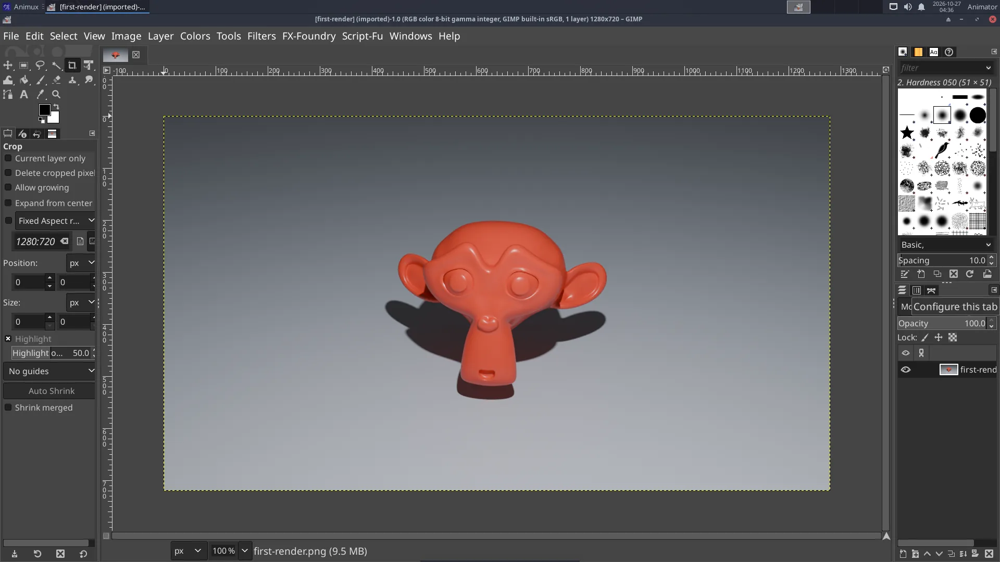
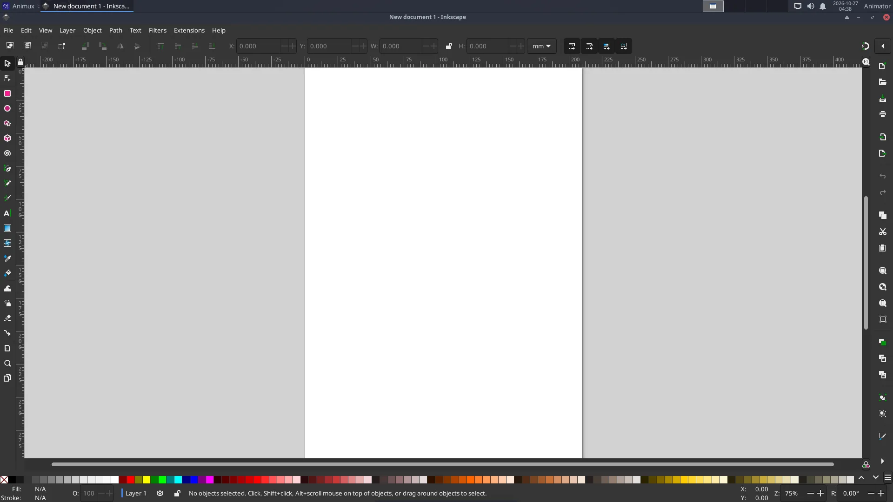
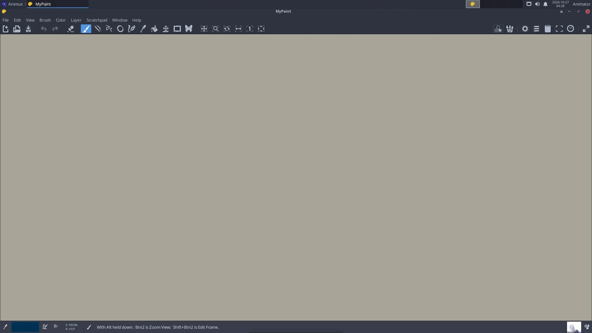

# GIMP, Inkscape and other image tools

> Photo editing with GIMP, vector drawing with Inkscape, sketching with MyPaint, pixel art with GrafX2 and mtPaint, and batch work with ImageMagick.

| Program | Best for | Start |
|---|---|---|
| **GIMP** 3.2 | fixing and retouching renders and photos, textures, cut-outs, batch editing | `gimp` |
| **Inkscape** 1.4 | logos, titles, clean character designs, backgrounds: shapes that stay sharp at any size (SVG) | `inkscape` |
| **MyPaint** 2.0 | fast sketching and concept painting on an endless canvas | `mypaint` |
| **GrafX2** 2.8 | pixel art and sprites with palettes | `grafx2` |
| **mtPaint** 3.40 | very quick pixel edits | `mtpaint` |
| **ImageMagick** | changing hundreds of images at once from the terminal | `convert`, `mogrify` |

## GIMP



Common jobs:

- **Adjust a render**: *Colors → Curves* or *Levels*; *Colors → Hue-Saturation*.
- **Cut out a background**: *Tools → Selection Tools → Foreground Select*, then *Layer → Transparency → Add Alpha Channel* and delete.
- **Make a texture tile seamlessly**: *Filters → Map → Tile Seamless*.
- **Resize**: *Image → Scale Image*. **Export**: *File → Export As* (GIMP's own format is `.xcf`; *Export* writes PNG/JPEG).
- **Non-destructive filters** (new in GIMP 3): filters stay editable on the layer; click the **fx** icon in the Layers panel to change or remove them.
- **G'MIC** (hundreds of extra effects: painterly looks, denoise, cartoon) is not available for GIMP 3.2 on Animux yet. The previous GIMP 2.10 with G'MIC is still installed: type `gimp.debian` in a terminal and use *Filters → G'MIC-Qt* there.

!!! note "GIMP 3.2, Krita 5.3 and Inkscape 1.4"
    Animux r16.1 (`_25`) includes them; Debian's Krita 5.1 and Inkscape 1.2 are no longer on the ISO, and GIMP 2.10 stays as `gimp.debian` for G'MIC. Animux r16 (`_21`) shipped only GIMP 2.10, Krita 5.1 and Inkscape 1.2 from Debian 12; there, the packages `animux-gimp`, `animux-krita` and `animux-inkscape` add the official current versions (the menu entries and the commands `gimp`, `krita` and `inkscape` then start the new versions). Install them like a [guide update](../about/guide-updates.md#how-to-get-a-newer-guide) (package files or, once online, `sudo apt install animux-gimp animux-krita animux-inkscape`).

!!! tip "AI assistants in GIMP, Krita and Inkscape"
    An AI assistant can work in the new GIMP, Krita and Inkscape through MCP: `animux-mcp gimp on`, `animux-mcp krita on`, `animux-mcp inkscape on`. See [AI agents](ai-agents.md#1b-switch-on-gimp-krita-or-inkscape).

## Inkscape



- Draw with the **rectangle, ellipse, star** and **Bézier pen** tools; colour with *Object → Fill and Stroke* (Ctrl+Shift+F).
- Text for titles: **T** tool; convert to shapes with *Path → Object to Path* before sharing the file.
- **Export** PNG at any size: *File → Export* (Ctrl+Shift+E). Inkscape files (SVG) also open in Blender (*File → Import → SVG*) and Synfig.

From the terminal: `inkscape title.svg --export-type=png --export-width=1920`.

GIMP also works without a window, for scripts and AI agents, with Python (GIMP 3 API):

```
gimp-console -i --batch-interpreter=python-fu-eval -b "exec(open('my_script.py').read())" --quit
```

## MyPaint



Press **Tab** to hide the panels and paint full screen. The canvas grows as you paint. Save as `.ora` (OpenRaster, opens in Krita and GIMP).

## ImageMagick: many images at once

```
mogrify -resize 50% *.png                         # make every PNG half size (overwrites!)
mogrify -format jpg *.png                         # convert all PNG to JPEG
convert in.png -gravity south -pointsize 48 -annotate +0+20 "Shot 10" out.png
montage frame_*.png -tile 6x -geometry 320x180+4+4 contact-sheet.png
```

Work on a **copy** of your files: `mogrify` changes them in place.
