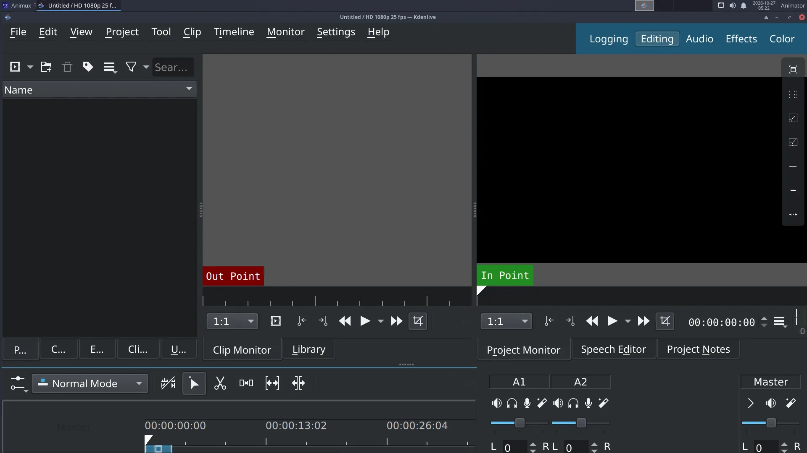

# Kdenlive

> The recommended video editor on Animux. Put shots and sound on a timeline, add titles and transitions, and export an MP4 for YouTube or a festival.

| Kdenlive | |
|---|---|
| Menu | NLV Editors → Kdenlive |
| Version | 22.12.3 |
| Command | `kdenlive` |
| Good for | Beginner |
| Files | .kdenlive projects; almost every video, audio and image format |
| Licence | GPL-3.0 |
| Website | [kdenlive.org](https://kdenlive.org/) |

When your shots are rendered, a **video editor** puts them together with dialogue, music and titles. **Kdenlive** is powerful and still easy to start with.

## The window

| Area | Use |
|---|---|
| **Project Bin** (top left) | all your clips: videos, image sequences, sound, titles |
| **Clip Monitor / Project Monitor** (top right) | play the selected clip / the whole edit |
| **Effects, Transitions** (tabs) | drag them onto clips |
| **Timeline** (bottom) | video tracks (V1, V2…) and audio tracks (A1, A2…) |

## Edit a film in six steps

1. **Project → Project Settings**: choose the format of your film, for example *HD 1080p 24 fps*. Do this first.
2. **Add clips**: right-click in the Project Bin → **Add Clip or Folder** (or drag files from the file manager). For a numbered **image sequence** (`0001.png`, `0002.png`…), tick **Import image sequence** in the file dialog.
3. **Drag clips to the timeline** in order. Trim a clip by dragging its ends; cut at the playhead with **Shift+R**.
4. **Sound**: drag music and dialogue onto the audio tracks. Change volume with the *Volume* effect or the clip's line.
5. **Titles**: right-click the Bin → **Add Title Clip**. **Transitions**: overlap two clips on different tracks and add a *Dissolve* (*Wipe*, …).
6. **Export**: **Project → Render** (Ctrl+Enter) → preset **MP4-H264/AAC** → choose the file name → **Render to File**.

!!! tip "Big projects run slowly?"
    Turn on **proxy clips** (*Project Settings → Proxy*). Kdenlive edits small copies and uses the originals only for the final render.

## Good export settings

| For | Settings |
|---|---|
| YouTube / Vimeo | MP4-H264/AAC, same resolution and frame rate as the project, quality 18–23 |
| Festival / archive | ProRes or DNxHR (in the render presets) or a PNG image sequence + WAV |
| Phone / messaging | MP4-H264, 1280×720 |

Kdenlive also renders from the command line using the `melt` program it is built on.

Learn more: <https://docs.kdenlive.org/> · Tutorial: [Edit your film in Kdenlive](../tutorials/edit-video-kdenlive.md).
