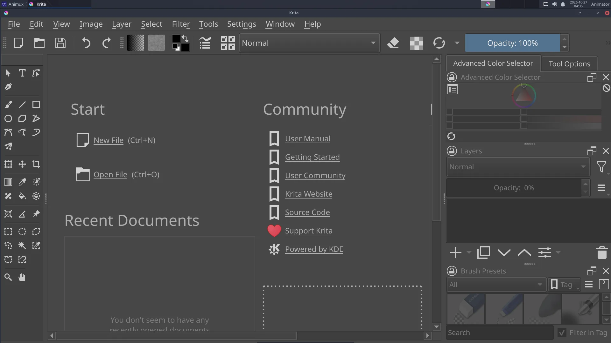

# Krita

> Professional digital painting with hundreds of brushes, layers, a drawing-tablet-friendly interface and a full frame-by-frame animation timeline.

| Krita | |
|---|---|
| Menu | 2D Graphics → Bitmap Editors → Krita |
| Version | 5.3.4.1 |
| Command | `krita` |
| Good for | Beginner to professional |
| Files | .kra; PSD, PNG, JPEG, EXR, TIFF; renders animation to video |
| Licence | GPL-3.0 |
| Website | [krita.org](https://krita.org/) |

Krita is made by artists for **painting**: concept art, character design, backgrounds, textures, comics and storyboards. It also has a complete **animation** workspace for hand-drawn animation with brushes.

## Start painting

1. **File → New** → choose a size (for film: *1920 × 1080*, 300 dpi for print) → **Create**.
2. Pick a brush in **Brush Presets** (right), a colour in the **Advanced Color Selector**.
3. Paint. **[ ]** change brush size, **E** switches to eraser mode, **Ctrl+Z** undoes.
4. Add layers with **Insert**, or the **+** in the Layers panel. Keep sketch, line art and colour on separate layers.
5. **File → Save** as `.kra` (keeps layers); **File → Export** to PNG or JPEG.

## Animation

1. **Window → Workspace → Animation**. The **Timeline** and **Animation** panels appear.
2. Draw on frame 0. In the timeline, click the next frame, right-click → **Create Blank Frame**, and draw.
3. **Onion Skins** panel: see the frames before and after.
4. Set the frame rate and start/end in the **Animation** panel; press **Play**.
5. **File → Render Animation**: choose **Video** (MP4, uses FFmpeg) or **Image Sequence**.

## Drawing tablets

Pressure works out of the box. Tune it in **Settings → Configure Krita → Tablet settings** (pressure curve). If the cursor is offset on a multi-monitor setup, set the tablet's area in Krita's tablet settings.

## Colour management

**Settings → Configure Krita → Color Management** selects the screen profile and OCIO configuration; important when you paint textures or matte paintings for 3D.

## Learn more

- Krita manual: <https://docs.krita.org/>
- Tutorial on this guide: [Paint an animation in Krita](../tutorials/krita-animation.md)
