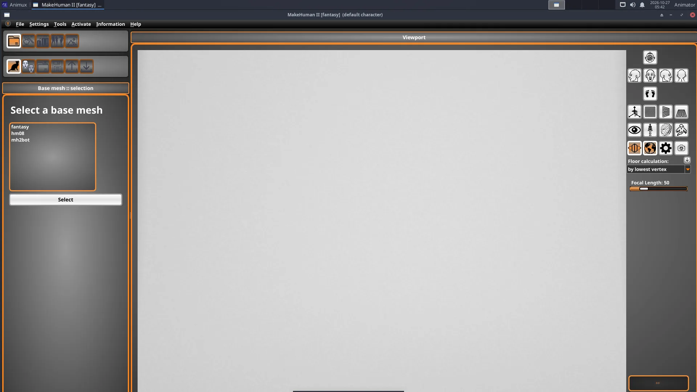
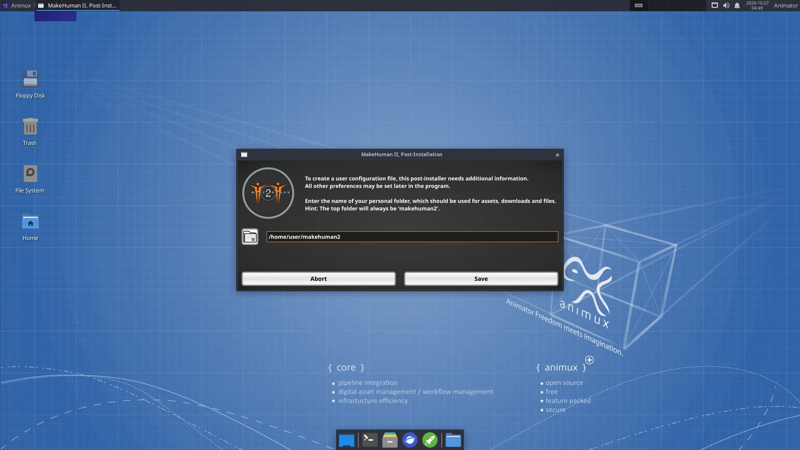
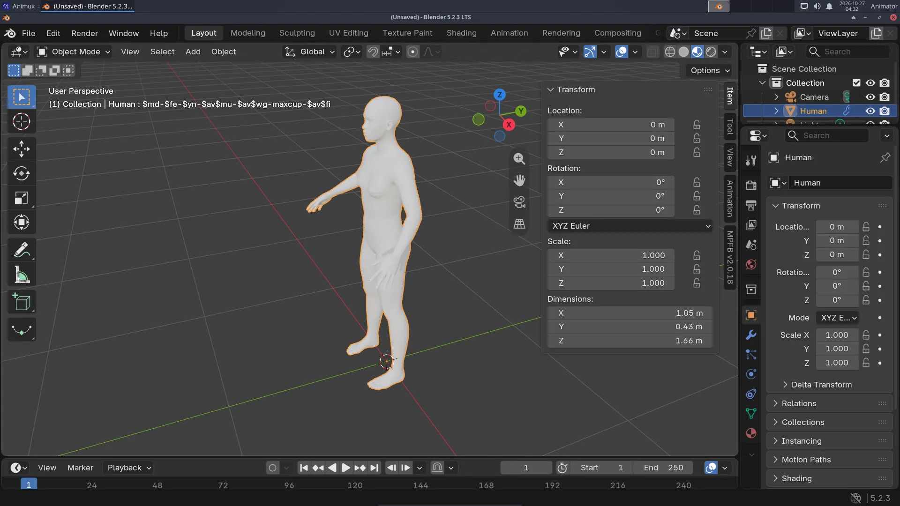

# MakeHuman II and MPFB

> Make realistic human characters with sliders, either in the stand-alone MakeHuman II or with the MPFB add-on directly inside Blender.

| MakeHuman II | |
|---|---|
| Menu | 3D Animation → Modellers → MakeHuman 2 |
| Version | 2.0.1 |
| Command | `makehuman2` |
| Good for | Beginner |
| Files | .mhm; exports GLB (glTF), OBJ, STL, MH2B (Blender), BVH (poses) |
| Licence | AGPL-3.0 |
| Website | [github.com/makehumancommunity/makehuman2](https://github.com/makehumancommunity/makehuman2) |
| Self-test | `animux-selftest apps` |

MakeHuman is the classic free character creator: you move **sliders** (age, gender, weight, height, face shape…) and get a clean, animation-ready human body. The project has two current tools, and Animux includes both:

| | MakeHuman II | MPFB |
|---|---|---|
| What | the stand-alone program | the same character system as a **Blender add-on** |
| Version on Animux | 2.0.1 ("Fantasy") | 2.0.18 |
| Start | *3D Animation → Modellers → MakeHuman 2* | in Blender: press **N** → tab **MPFB** |
| Best for | designing a character, exporting to games or other programs | characters you animate in Blender |

!!! note "About the name"
    The original **MakeHuman 1.x** (Python 2) is no longer developed. Its successor is **MakeHuman II** (`makehumancommunity/makehuman2` on GitHub). **MPFB** (*MakeHuman Plugin For Blender*) is maintained by the same community. Both use the same assets.

## MakeHuman II

1. Start **MakeHuman 2**. The very first time, it asks for a **personal folder** (suggested: `~/makehuman2`); click **Save**. Then it shows **Base mesh :: selection**: keep **fantasy** (the MakeHuman II body; *hm08* is the classic MakeHuman 1 body) and click **Select**.
2. Click the **modify character** icon. The left side lists categories (**Modify character :: categories**) such as main proportions, head, torso, arms and legs. Open one and move its sliders: gender, age, muscle and weight change the whole body. The summary at the bottom right shows age, muscle, weight and height.
3. Use the other icons to add **clothes, hair, eyebrows, eyes**, a **skeleton** and a **pose** or expression.
4. Use the camera buttons on the right of the viewport to look from the front, side or top, or to fit the face.
5. **Save** the character as `.mhm` (a small file you can change later). **Export** as **GLB** (glTF, for games, the web and Blender), **OBJ**, **STL** (3D printing), **MH2B** (for Blender with the included *io_makehuman* add-on) or a pose/animation as **BVH**.

!!! tip "Small screen"
    Some MakeHuman II dialogs are taller than 800 pixels. On a small screen, move a dialog by holding **Alt** and dragging it with the mouse.

## MPFB inside Blender

1. Start Blender, move the mouse over the 3D viewport and press **N**. Click the **MPFB** tab at the right edge.
2. Open **New human → From scratch** and click **Create human**.
3. Open **Model** and change the sliders, as in MakeHuman.
4. **Rigging → Standard rig → Add standard rig** (or **Rigify**) gives it a skeleton you can pose and animate.
5. **Apply assets** adds skin, eyes, eyebrows, hair and clothes from asset packs.

MPFB can also **load a .mhm file** saved by MakeHuman II (*New human → From save file*), or take the character straight from a running MakeHuman II (*New human → From MakeHuman*).

!!! info "Asset packs"
    MPFB and MakeHuman II include the base body and a few basic assets. Thousands of extra clothes, hair styles and skins (free, CC0 and CC-BY) can be downloaded from <http://www.makehumancommunity.org/> as *asset packs* and loaded with **MPFB → System and resources → Load pack from zip file**.

See the tutorial [A character with MakeHuman](../tutorials/character-makehuman.md).

## Licences of your characters

The program is AGPL-3.0, but **characters you export with the standard assets are yours to use, including commercially** (the base mesh and standard assets are CC0). Check the licence of extra community assets before you sell work.
