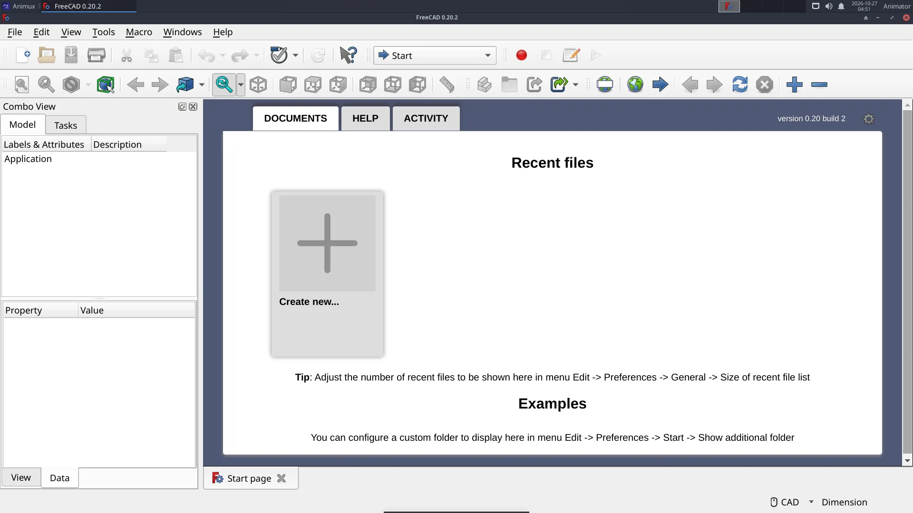
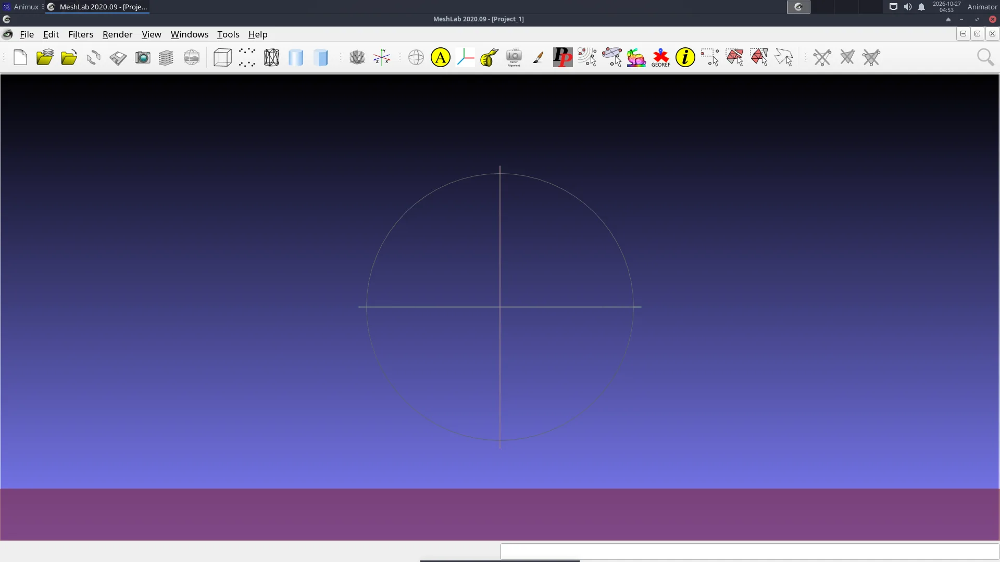
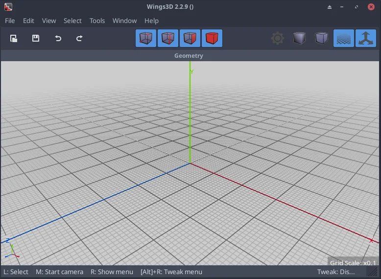

# FreeCAD, Wings 3D, MeshLab and OpenSCAD

> The other 3D modellers on Animux and when each one is the right tool next to Blender.

| Program | Use it when | Start |
|---|---|---|
| **FreeCAD** 0.20 | Props, sets and machines that need **exact measurements**, or parts for 3D printing. Parametric: change a number and the model updates. | `freecad` |
| **OpenSCAD** 2021.01 | You prefer to **describe** an object in a few lines of code (`cube`, `cylinder`, `difference`). Perfect for repeated parts. | `openscad` |
| **Wings 3D** 2.2 | You want a **small, simple polygon modeller** for low-poly models and learning box modelling. | `wings3d` |
| **MeshLab** 2020.09 | You need to **repair, clean or simplify** scans and heavy meshes (photogrammetry, 3D scanners). | `meshlab` |
| **Geomview** 1.9 | You view **mathematical surfaces** (OFF files). Mostly for teaching. | `geomview` |

All are in **3D Animation → Modellers**.



## Moving models into Blender

| From | Export as | In Blender |
|---|---|---|
| FreeCAD | **File → Export → OBJ** or STL (select the object first) | *File → Import → Wavefront (.obj)* |
| OpenSCAD | **File → Export → STL** (render with F6 first) | *File → Import → STL* |
| Wings 3D | **File → Export → glTF** or OBJ | *File → Import → glTF 2.0* |
| MeshLab | **File → Export Mesh As → PLY or OBJ** | *File → Import → Stanford PLY* |

Check the **scale** after importing: CAD programs work in millimetres, Blender in metres. Use the import dialog's *Scale* (0.001 for mm).

## OpenSCAD from the command line

```
openscad -o bracket.stl bracket.scad
```



## Wings 3D

Wings 3D opens with an empty scene. **Right-click** in the grid to get the menu, for example *Cube*; select faces, edges or vertices with the four red cube buttons at the top and right-click again for the tools (Extrude, Bevel, Smooth …).



!!! note "Wings 3D opens no window (r16 only)"
    Fixed in r16.1 (`_25`): the menu entry and the `wings3d` command start it safely. On Animux r16 (`_21` and earlier), Wings 3D opens **no window** on computers without a graphics-card OpenCL driver: the processor OpenCL driver breaks its start-up. Start it from a [terminal](../desktop/terminal.md) like this instead:

    ```
    OCL_ICD_VENDORS=/nonexistent wings3d
    ```

    The package `animux-menus` 1.0.17 fixes the menu entry (Wings 3D then always starts this way); see [Guide updates](../about/guide-updates.md#how-to-get-a-newer-guide) for installing a package file.
