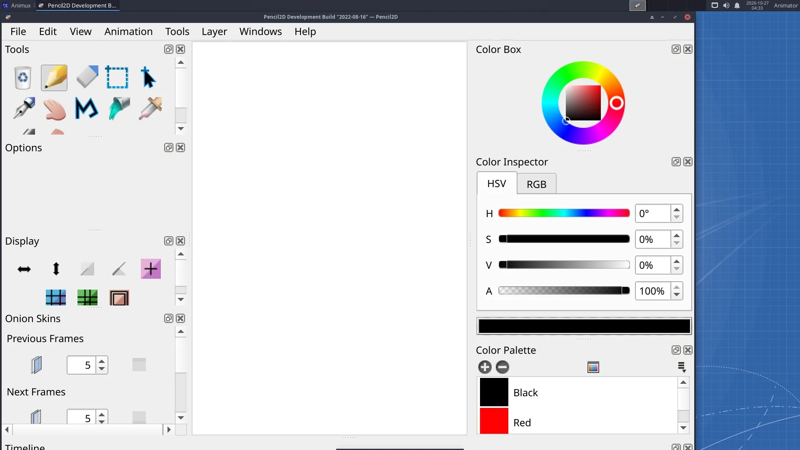
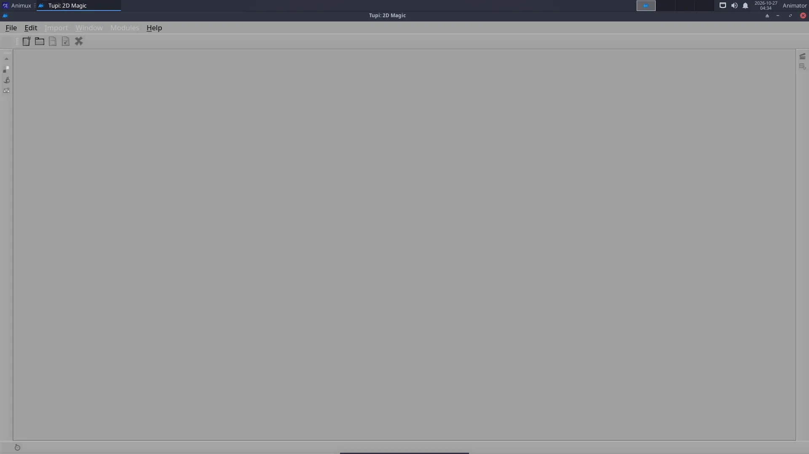

# Pencil2D and TupiTube

> Hand-drawn, frame-by-frame animation the traditional way, with onion skin, a timeline and export to video or GIF.

| Pencil2D | |
|---|---|
| Menu | 2D Animation → Pencil2D |
| Version | 0.6.6 |
| Command | `pencil2d` |
| Good for | Beginner |
| Files | .pclx; exports PNG sequence, GIF, MP4 |
| Licence | GPL-2.0 |
| Website | [pencil2d.org](https://www.pencil2d.org/) |

**Pencil2D** works like a flip book: you draw a picture on each frame and play them in a row. **Onion skin** shows the previous and next drawings faintly, so you can draw the in-betweens. It is simple enough for children and good enough for professional rough animation.

## Layer types

| Layer | For |
|---|---|
| **Bitmap** | pencil and brush drawing, like paper |
| **Vector** | clean lines you can still edit; fill areas with the bucket |
| **Camera** | pan and zoom over the drawing |
| **Sound** | dialogue or music to time your animation |

## A first animation

See the full tutorial: **[Hand-drawn animation in Pencil2D](../tutorials/hand-drawn-pencil2d.md)**. In short:

1. Draw on frame 1.
2. Click frame 3 in the timeline and click **+** (*Add Frame*); draw the next pose.
3. Switch on **onion skin** (the onion buttons above the timeline) to see the frame before.
4. Press **Play**. Change the speed with the **FPS** box (12 fps is common for hand-drawn animation, "on twos" at 24 fps).
5. **File → Export → Movie** for MP4 or GIF, or **Image Sequence** for PNG files.

Pencil2D saves projects as `.pclx`.

## TupiTube

**TupiTube** (Debian package `tupi`) is another beginner-friendly 2D animation program, made for schools: draw, tween objects between positions, and export. Start it from **2D Animation → TupiTube** or `tupi`.

## When to use something else

- Painting-style animation with brushes and textures: [Krita](krita.md).
- Animation by moving shapes and bones instead of drawing every frame: [Synfig](synfig.md).
- 2D drawing combined with 3D: Grease Pencil in [Blender](blender.md#grease-pencil-2d-inside-blender).
