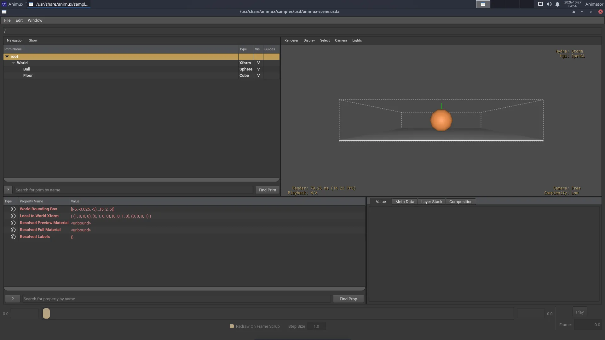

# Pipeline formats and tools

> OpenUSD, Alembic, OpenEXR, OpenColorIO, OpenVDB, OSL and MaterialX, what each studio format is for and the tools Animux has for it.

Studios pass work between many programs. These open formats, most of them from the *Academy Software Foundation*, make that possible. Blender reads and writes most of them; Animux adds the command-line tools to check and convert them. Who made each format and why, in one card each: [Studio formats](studio-formats.md).

| Format | Holds | File | Blender |
|---|---|---|---|
| **OpenUSD** | whole scenes: objects, materials, lights, cameras, layers | `.usd .usda .usdc .usdz` | File → Import/Export → USD |
| **Alembic** | baked moving geometry (animation caches) | `.abc` | File → Import/Export → Alembic |
| **OpenEXR** | high-quality images, many layers (passes) | `.exr` | Output file format OpenEXR |
| **OpenColorIO** | colour spaces and looks | `config.ocio` | Blender uses OCIO internally |
| **OpenVDB** | volumes: smoke, fire, clouds | `.vdb` | Add → Volume → Import OpenVDB |
| **OSL** | custom materials as code | `.osl` | Cycles → Script node (CPU) |
| **MaterialX** | materials shared between programs | `.mtlx` | via USD export |

## OpenUSD

Universal Scene Description, made by Pixar, is the scene format of modern pipelines (Blender, Houdini, Maya, Omniverse, Unreal).

```
usdview /usr/share/animux/samples/usd/animux-scene.usda   # look at a scene
usdcat scene.usda -o scene.usdc                          # text → binary
usdcat scene.usdc                                        # print a binary file as text
usdtree scene.usda                                       # list what is inside
usdchecker scene.usda                                    # check for errors
usdzip -a scene.usdz scene.usda                          # package for AR (iPhone)
```



Python: `animux-vfx-python -c "from pxr import Usd; print(Usd.Stage.Open('scene.usda').GetRootLayer().ExportToString())"`.

## Alembic

```
abcls -r /usr/share/animux/samples/alembic/animux-cube.abc   # list objects
abctree file.abc                                           # show the hierarchy
abcecho file.abc                                           # print details
```

The sample is a cube spinning over 24 frames. Import it in Blender with **File → Import → Alembic**.

## OpenEXR and OpenImageIO

EXR keeps real light values (brighter than white) and several **passes** in one file: diffuse, specular, depth, object IDs. Render to EXR, then grade and comp.

```
exrheader render.exr                       # what is inside (channels, compression)
oiiotool render.exr -o render.png          # convert
oiiotool render.exr --resize 50% -o half.exr
oiiotool a.exr b.exr --over -o comp.exr    # put a over b
iinfo -v render.exr
```

View EXR files with [DJV](video-tools.md#djv-review-renders-and-image-sequences).

## OpenColorIO

OCIO describes colour spaces (sRGB, ACEScg, Filmic/AgX…) so every program shows the same colours.

```
ociocheck --iconfig /usr/share/animux/samples/ocio/config.ocio
```

Point programs to a config with the `OCIO` environment variable: `OCIO=/path/config.ocio krita`.

## OpenVDB

```
vdb_print -l smoke.vdb
```

Blender writes VDB files from smoke simulations (*Physics → Fluid → Cache → Format: OpenVDB*).

## OSL (Open Shading Language)

```
oslc stripes.osl          # compile to stripes.oso
oslinfo stripes.oso       # list its parameters
```

In Blender: Cycles, **Device: CPU**, tick **Open Shading Language** in Render properties, then add a **Script** node in the shader editor.

## Animux VFX Python

`animux-vfx-python` is a Python 3.11 with all these libraries installed together, so scripts work without setup:

| Module | Import as |
|---|---|
| OpenUSD (usd-core 26.11) | `from pxr import Usd, UsdGeom` |
| OpenImageIO 3.2 | `import OpenImageIO as oiio` |
| OpenEXR 3.5 | `import OpenEXR` |
| OpenColorIO 2.6 | `import PyOpenColorIO as ocio` |
| MaterialX 1.39 | `import MaterialX` |
| Mitsuba 3.9 | `import mitsuba as mi` |
| LuxCoreRender 2.11 | `import pyluxcore` |
| NumPy 2.4 | `import numpy` |

It lives in `/opt/animux/vfx-env` and is managed by the `animux-vfx-python` package; do not install into it. For extra libraries make your own environment on top of it: `/opt/animux/vfx-env/bin/python -m venv --system-site-packages ~/myenv`, then `~/myenv/bin/pip install name`.
