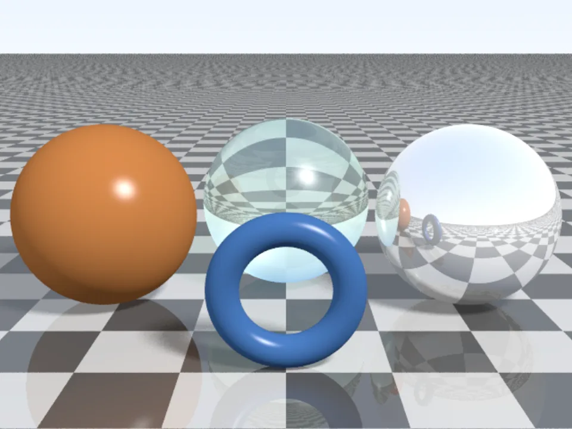
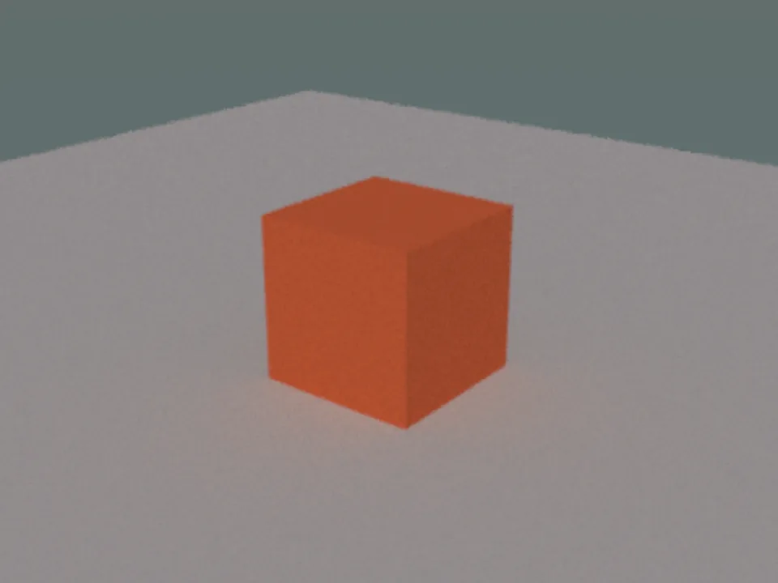
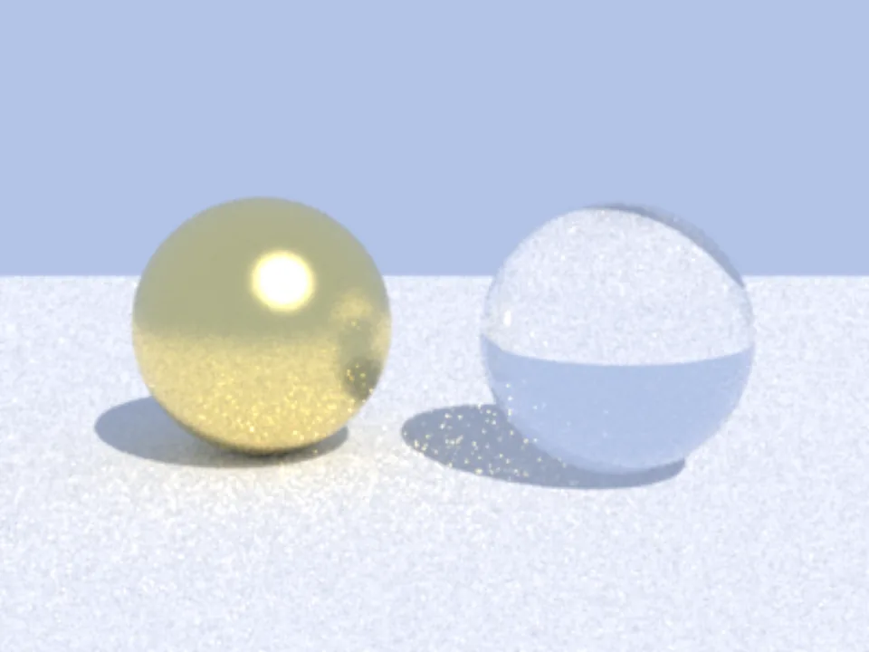
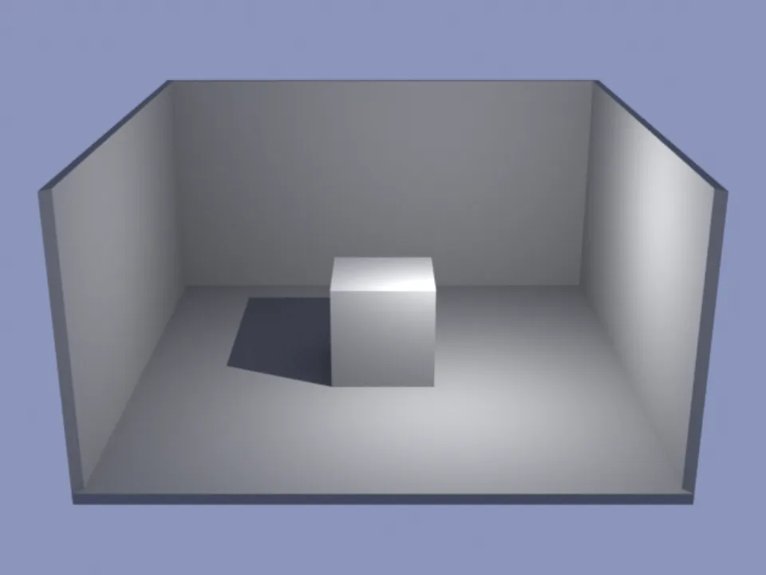
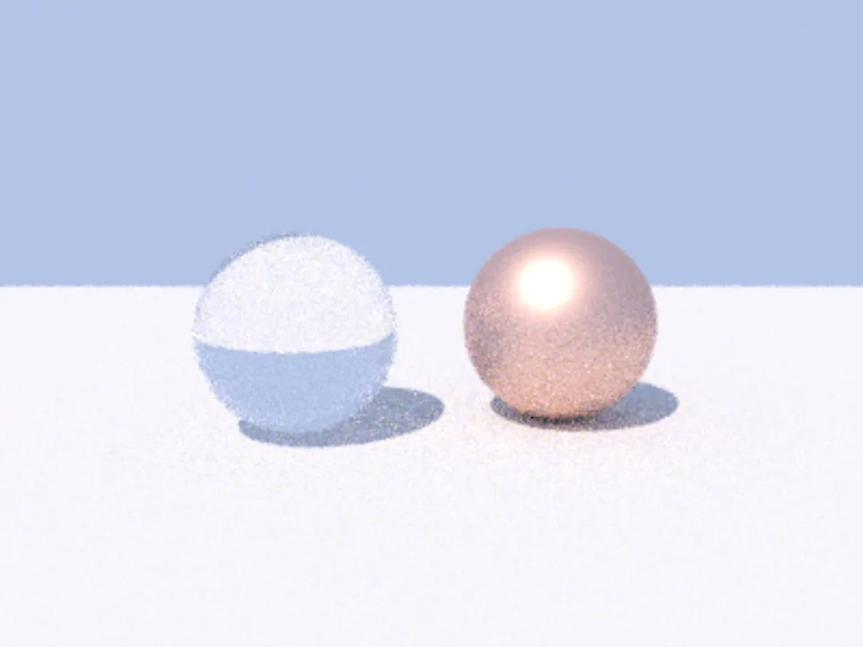
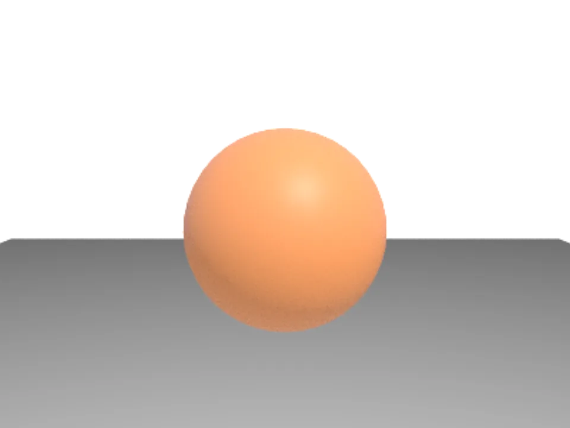
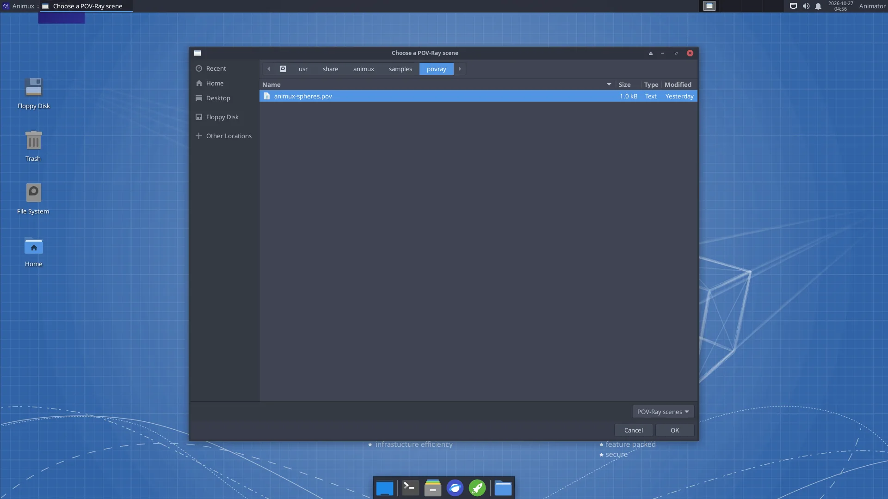

# Renderers

> Cycles, EEVEE, POV-Ray, LuxCoreRender, Mitsuba 3, appleseed and pbrt-v4. What each one is good at, how to run its sample scene, and which one to choose.

A **renderer** calculates the final picture from a 3D scene: how light bounces, how glass bends it, how shadows fall. Animux has seven, from very easy to research-grade.

## Which one should I use?

| Renderer | Choose it when | How you use it |
|---|---|---|
| **Cycles** (in Blender) | Almost always: realistic, fast enough, in the program you model in | Blender → Render Engine: Cycles |
| **EEVEE** (in Blender) | Fast previews, cartoons, motion graphics | Blender → Render Engine: EEVEE |
| **POV-Ray** 3.7 | You like describing scenes in text; classic CG, maths art, teaching | menu *Renderers → POV-Ray*, or `povray` |
| **LuxCoreRender** 2.11 | Very realistic light: caustics, glass, interiors | Python scripts (`animux-vfx-python`) |
| **Mitsuba 3** 3.9 | Research, spectral rendering, inverse rendering | Python or `mitsuba scene.xml` |
| **appleseed** 2.1 beta | Production-style physically based rendering of `.appleseed` projects | menu *Renderers → appleseed*, or `appleseed.cli` |
| **pbrt-v4** | Learning how renderers work, with the book *Physically Based Rendering* | `pbrt scene.pbrt` |

All seven side by side, with full names and what each does best: [Renderer comparison](renderer-comparison.md).

Beginners: **use Cycles**, explained in [Blender](blender.md#render-engines) and the [first-render tutorial](../tutorials/first-3d-render.md).

!!! warning "Processor features"
    Cycles (Blender 5) and appleseed need SSE4.2; Mitsuba and LuxCore also need AVX. See [Requirements](../start/requirements.md#does-my-processor-have-sse42-and-avx).

## Try every renderer in two minutes

Each renderer has a sample scene in `/usr/share/animux/samples`. The [self-test](../help/self-test.md) renders all of them and saves the pictures in `~/animux-selftest/<date>/`:

```
animux-selftest povray blender mitsuba luxcore appleseed pbrt gaffer
```

These are the pictures the self-test made on Animux (in a virtual machine, a few seconds each):

<div class="gallery" markdown="1">















</div>

## POV-Ray

POV-Ray reads a **text file** that describes the scene, and writes a picture.

```
#include "colors.inc"
camera { location <0, 2, -6> look_at <0, 1, 0> }
light_source { <-5, 10, -10> color White }
plane { y, 0 pigment { checker Gray White } }
sphere { <0, 1, 0>, 1 pigment { color Red } finish { phong 0.8 reflection 0.2 } }
```

Save that as `ball.pov`, then either choose **3D Animation → Renderers → POV-Ray** and pick the file (the picture opens by itself and is saved in `~/Pictures/povray/`), or type:

```
povray +Iball.pov +Oball.png +W1280 +H720 +A -D
```

`+A` turns on anti-aliasing (smooth edges), `-D` renders without a preview window. Hundreds of example scenes are in `/usr/share/povray-3.7/scenes`.



## LuxCoreRender

LuxCore is used here as a **Python module** in Animux's ready-made Python, `animux-vfx-python`:

```
animux-vfx-python /usr/share/animux/samples/luxcore/render.py ~/luxcore.png
```

Read `render.py` to see how a scene is described (camera, materials, lights) and how long it renders (a time or quality limit). LuxCore's Blender add-on (*BlendLuxCore*) is not included in r16.

!!! info
    On Animux LuxCore renders on the **processor**. It ignores the software OpenCL drivers that come with Debian, because they made it crash. On a computer with a real OpenCL GPU driver you can let it use the GPU by starting it with `ANIMUX_KEEP_ALL_OPENCL=1`.

## Mitsuba 3

```
mitsuba scene.xml -o out.exr
animux-vfx-python /usr/share/animux/samples/mitsuba/render.py ~/mitsuba.exr
```

Mitsuba writes **EXR** images; view them with [DJV](video-tools.md#djv-review-renders-and-image-sequences) or convert them: `oiiotool ~/mitsuba.exr -o ~/mitsuba.png`. Mitsuba 3 can render in RGB or **spectral** mode, and can compute how the picture changes when the scene changes (for research and machine learning). Documentation: <https://mitsuba.readthedocs.io/>.

## appleseed

Only the command-line renderer is included (the *appleseed.studio* editor needs Python 2.7, which Debian 12 no longer has). The menu entry asks for a `.appleseed` project, renders it and shows the result.

```
appleseed.cli "/opt/animux/appleseed/examples/cpp/helloworld/reference output/test.appleseed" --output ~/appleseed.png
```

## pbrt-v4

The renderer from the free online book *Physically Based Rendering* (<https://pbr-book.org/>). The book explains every line of its source code.

```
cd /usr/share/animux/samples/pbrt
pbrt --spp 64 --outfile ~/pbrt.exr animux-spheres.pbrt
imgtool convert ~/pbrt.exr ~/pbrt.png
```

`--spp` sets the samples per pixel (quality). The Animux build runs on the processor only. Large example scenes: <https://github.com/mmp/pbrt-v4-scenes>.

## Gaffer + Cycles

[Gaffer](gaffer.md) can also render with Cycles from a node graph, the way lighting artists work in studios.

## Render times, roughly

| What | Typical time per frame on a 4-core PC |
|---|---|
| EEVEE, 1080p, simple scene | 1–10 seconds (with a graphics card) |
| Cycles CPU, 1080p, 128 samples with denoising | 30 seconds – 5 minutes |
| POV-Ray, 1280×720, sample scene | a few seconds |
| LuxCore / Mitsuba / pbrt, sample scenes | under a minute |

A 2-minute film at 24 frames per second has **2,880 frames**. Several minutes per frame quickly means days. Test with small resolution and few samples, and use a [render farm](flamenco.md) or render overnight.
