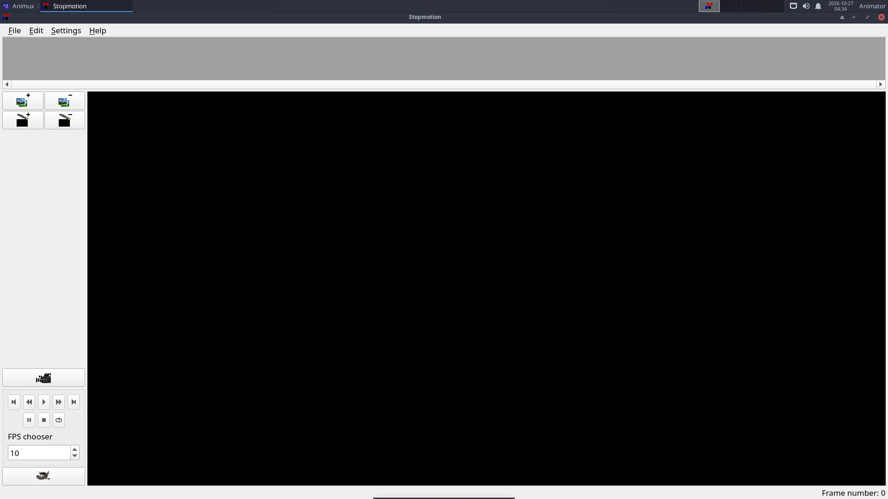

# Stopmotion

> Capture stop-motion animation with a webcam or import photos from a camera, check each pose with onion skin, and export a film.

<div class="factbox" markdown="1">

| Stopmotion (Linux Stopmotion) | |
|---|---|
| Menu | StopMotion Animation → Stopmotion |
| Version | 0.8.6 |
| Command | `stopmotion` |
| Good for | Beginner |
| Files | .dat project; image folders; exports video |
| Licence | GPL-2.0 |
| Website | [linuxstopmotion.org](http://linuxstopmotion.org/) |

</div>


Stop motion is animation with real objects: clay figures, LEGO, paper cut-outs, toys. You move the object a tiny bit, take a photo, move it again, take another. **Stopmotion** helps you take the photos and line up each new pose with the previous one.



## What you need

- A **webcam** (any USB webcam that works on Linux), or a camera whose photos you copy in afterwards.
- A **tripod** or something that holds the camera completely still.
- **Steady light**: close the curtains and use lamps. Daylight changes and makes the film flicker.

## Capturing with a webcam

1. Plug in the webcam and start **StopMotion Animation → Stopmotion**.
2. **Settings → Preferences → Video Import**: choose the device (`/dev/video0` is usually the first webcam).
3. Click the **camera button** to start the live view.
4. Turn on **onion skinning** (mix slider: 1 or 2 previous frames). The last photo shows faintly over the live image.
5. Move your figure a little, then press **Space** (or the capture button) to take a frame. Repeat.
6. Press **Play** to check the movement.

Twelve frames per second is a good start; 24 is smoother but needs twice as many photos.

## Photos from a camera

**Edit → Add frames** (or drag image files into the frame list) to add photos taken with a camera or phone. Rename them in order first (for example `0001.jpg`, `0002.jpg`).

## Sound and export

- Add sound with the **Sound** button of a scene.
- **File → Export → Video** writes a video file (it uses FFmpeg); **File → Export → Cinelerra** sends the frames to Cinelerra.
- Or export the frames and put them together with FFmpeg:
  ```
  ffmpeg -framerate 12 -i %04d.jpg -c:v libx264 -pix_fmt yuv420p -crf 18 film.mp4
  ```

## In a virtual machine

The VM must pass the webcam through: in VirtualBox install the *Extension Pack* and use **Devices → Webcams**. See [VirtualBox](../start/virtualbox.md#webcam-for-stop-motion).

Tutorial: [Stop motion with a webcam](../tutorials/stop-motion-webcam.md).
