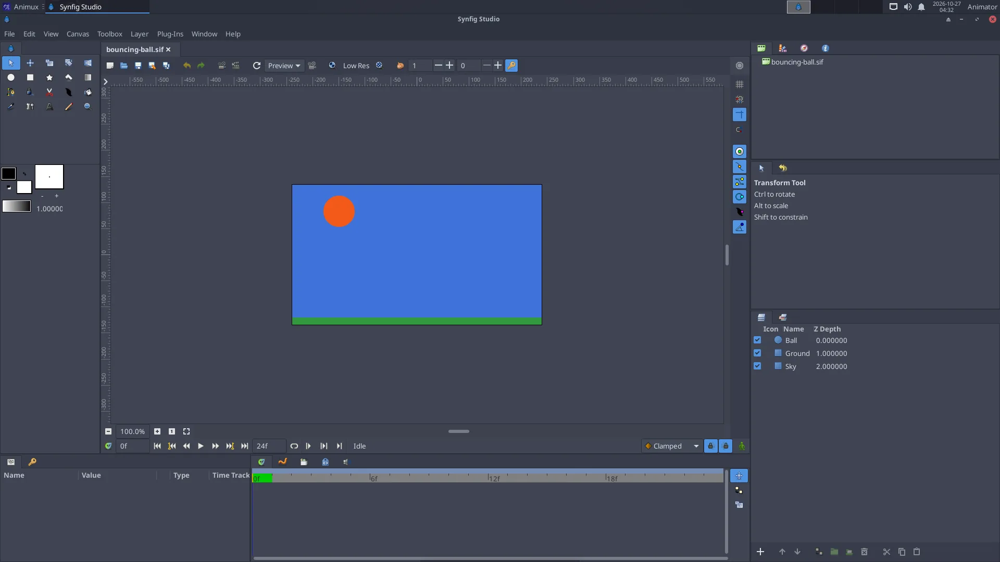

# Synfig Studio

> 2D vector animation with automatic in-between frames and bone rigs. Ideal for cut-out characters, motion graphics and explainer films.

<div class="factbox" markdown="1">

| Synfig Studio | |
|---|---|
| Menu | 2D Animation → Synfig Studio |
| Version | 1.5.1 |
| Command | `synfigstudio` |
| Good for | Beginner |
| Files | .sifz, .sif; exports PNG sequences, GIF, video |
| Licence | GPL-3.0 |
| Website | [synfig.org](https://www.synfig.org/) |
| Self-test | `animux-selftest synfig` |

</div>


In **Synfig** you do not draw every frame. You set the important poses (**waypoints**) and Synfig calculates the frames in between (**tweening**). Characters are built from shapes and can be moved with **bones**, like a puppet.



## The window

| Panel | Use |
|---|---|
| **Toolbox** (left) | transform, circle, rectangle, spline (draw shapes), fill, text, bones… |
| **Canvas** (middle) | your picture; the **Animation mode** button at its bottom right (red when on) records changes as waypoints |
| **Params** | settings of the selected layer (colour, position, radius…) |
| **Layers** | every shape is a layer; group them to build characters |
| **Timetrack** | waypoints over time; drag them to change timing |

## Animate a ball in five steps

The sample `/usr/share/animux/samples/synfig/bouncing-ball.sif` is a finished example; open it with **File → Open** to look at it. To make your own:

1. **File → New**. Set the length in **Canvas → Properties → Time** (for example *End time* 48 at 24 fps = 2 seconds).
2. Choose the **Circle tool** and drag on the canvas to draw a ball.
3. Click the **Animation mode** button (bottom right of the canvas): the canvas gets a red frame.
4. At frame 0, place the ball at the top. Move the time slider to frame 12 and drag the ball to the bottom; at frame 24 back to the top. Synfig adds waypoints and fills in the frames.
5. Press **Play**. Turn animation mode off when you are done.

Make it look natural: right-click a waypoint → **Both → Ease In/Out** for slow-in and slow-out.

## Export

**File → Render**: choose the file name and **Target**:

- `png` (image sequence, best quality, for editing in Kdenlive),
- `gif` for the web,
- `ffmpeg` for a video file.

Or from a terminal:

```
synfig bouncing-ball.sif -t png -o ~/ball/frame.png        # all frames
synfig bouncing-ball.sif -t gif -o ~/ball.gif
synfig bouncing-ball.sif -t png --time 12 -o ~/frame12.png  # one frame
```

## Learn more

- Synfig's manual and tutorials: <https://synfig.readthedocs.io/>
- Tutorial on this guide: [A bouncing ball in Synfig](../tutorials/bouncing-ball-synfig.md)
