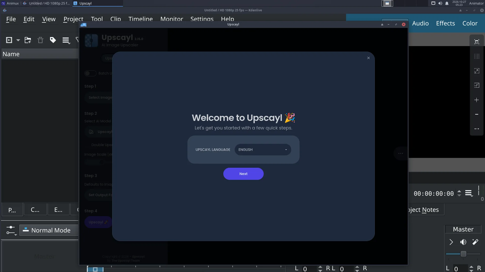

# Upscayl

> Enlarge images 2× to 4× and make them sharper with AI models that run on your own computer, offline.

| Upscayl | |
|---|---|
| Menu | 2D Graphics → Ancillary Tools → Upscayl |
| Version | 2.15.0 |
| Command | `/opt/Upscayl/upscayl` |
| Good for | Beginner |
| Files | PNG, JPEG, WebP |
| Licence | AGPL-3.0 |
| Website | [upscayl.org](https://upscayl.org/) |

**Upscayl** uses AI models (Real-ESRGAN and others) to make images larger **and** sharper, where normal resizing makes them blurry. Useful for:

- rendering at half resolution and upscaling, to save render time (check the result closely);
- old textures and reference photos;
- concept art and backgrounds.

Everything runs on your computer; no image is uploaded.

## Steps

1. Start **2D Graphics → Ancillary Tools → Upscayl** (or type `/opt/Upscayl/upscayl`).
2. **Select Image** (or a folder, with *Batch Upscayl*).
3. Choose an **AI model**: *Upscayl Standard* for photos and renders, *Digital Art* for drawings and anime.
4. Choose the **scale** (2×, 3×, 4×) and the output folder.
5. Click **Upscayl** and wait.

!!! note "Speed"
    Upscayl uses the graphics card through **Vulkan**. With a real AMD, Intel or NVIDIA graphics card it takes seconds. In a virtual machine or without a Vulkan-capable driver it falls back to the slow software renderer (*lavapipe*), and a large image can take many minutes.

For animation frames, upscale the whole **image sequence** folder with Batch mode, then build the video with FFmpeg ([video tools](video-tools.md#ffmpeg-the-five-most-useful-commands)). Check a few frames first: AI upscaling can make small details flicker from frame to frame.

More AI tools (subtitles, background removal, chat models, Stable Diffusion): [AI tools](ai-tools.md).
