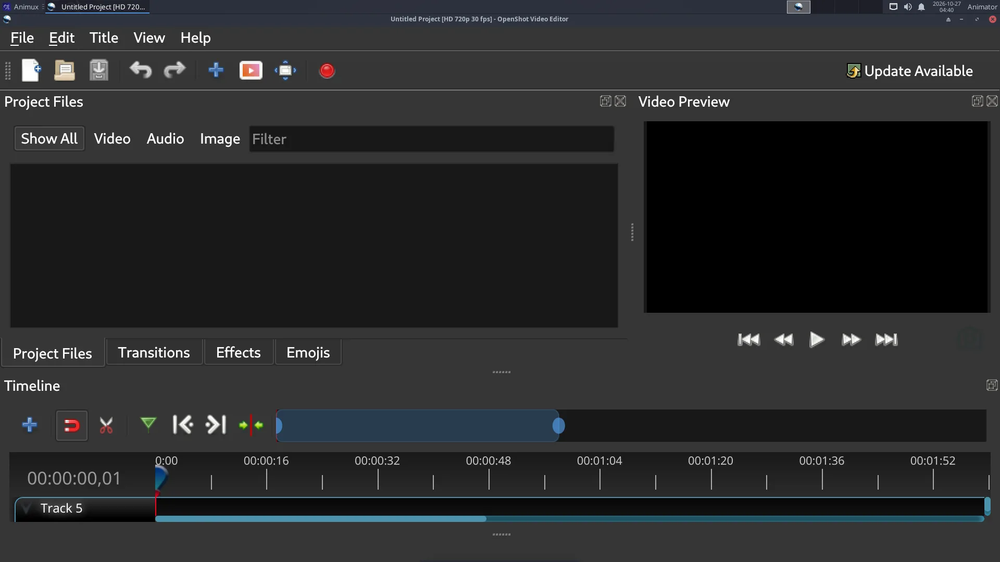
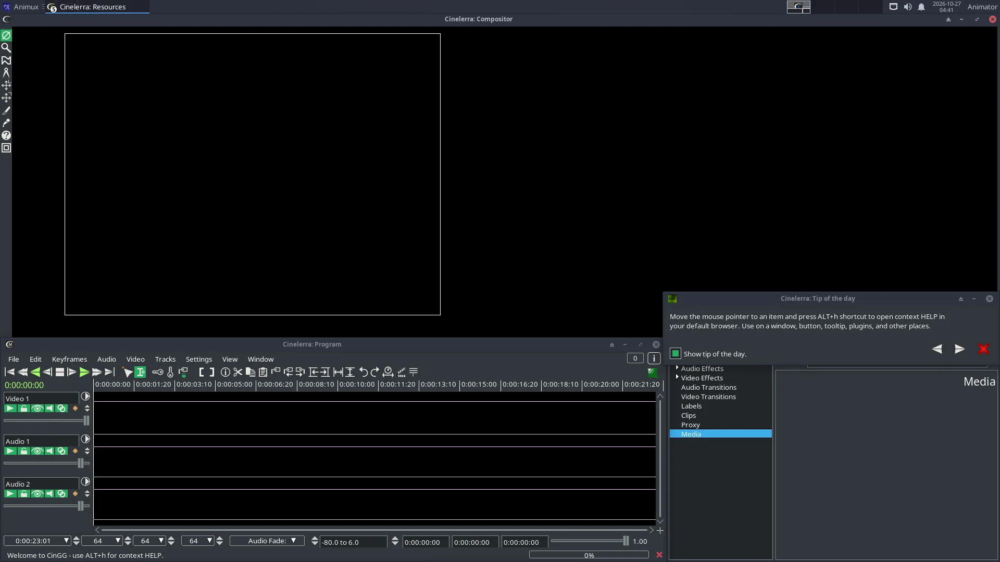
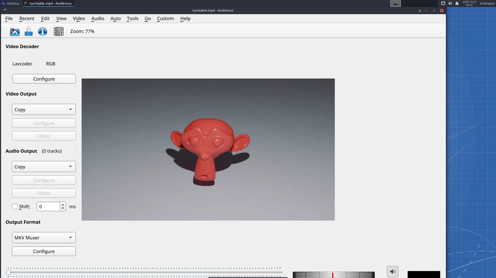
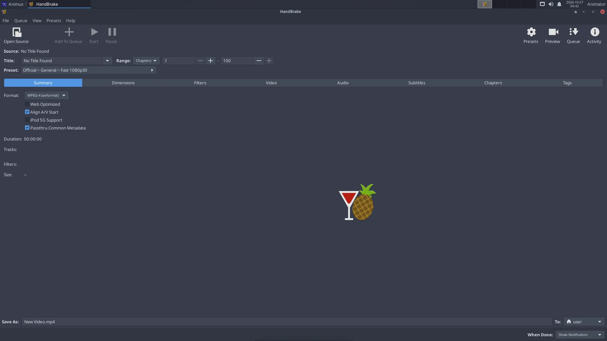
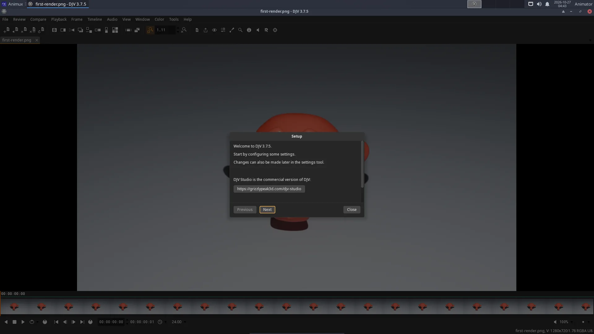

# More video tools

> OpenShot, Cinelerra-GG and Avidemux for editing, HandBrake and FFmpeg for converting, DJV for reviewing renders, VLC for playing, and screen recording.

| Program | Use it to | Start |
|---|---|---|
| [Kdenlive](kdenlive.md) | edit a film (recommended) | `kdenlive` |
| **OpenShot** 2.6 | edit very simply: drag, drop, export | `openshot-qt` |
| **Cinelerra-GG** | edit with professional colour grading, compositing, motion tracking | `cin` |
| **Avidemux** 2.8 | cut a single file quickly, filter, re-encode | `avidemux` |
| **HandBrake** 1.6 | convert a finished film with ready presets | `ghb` |
| **FFmpeg** 5.1 | convert anything from the terminal; image sequence → video | `ffmpeg` |
| **DJV** 3.7 | play image sequences and EXR renders at true speed, compare versions | `djv` |
| **VLC** 3.0 | play every video and sound file | `vlc` |
| **MKVToolNix** | combine video, audio tracks and subtitles in one MKV | `mkvtoolnix-gui` |
| **Subtitle Editor**, **Gnome Subtitles** | write and time subtitles | `subtitleeditor` |

## OpenShot



Import files (Ctrl+F), drag them to a track, press **Export Video** (the red button). Good for school projects.

## Cinelerra-GG



Cinelerra is very capable but different from other editors (several windows, many options). The manual is at <https://www.cinelerra-gg.org/download/CinelerraGG_Manual.pdf>.

## Avidemux



Open a video, set **A** and **B** markers to select a part, choose *Video Output* (for example *Mpeg4 AVC (x264)*) or **Copy** to keep quality, and **File → Save**. Copy mode cuts without re-encoding, in seconds.

## HandBrake



**Open Source** → choose your film → pick a **Preset** (for example *General → Fast 1080p30*) → **Start Encode**.

## DJV: review renders and image sequences



Studios check renders with a player like DJV: it plays **image sequences** (`render_0001.exr` …) at the correct frame rate, shows EXR channels and exposure, and compares two versions side by side (*Compare* menu). **File → Open** and choose the first frame; DJV finds the rest of the sequence.

## FFmpeg: the five most useful commands

```
# PNG image sequence → MP4 video (24 frames per second)
ffmpeg -framerate 24 -i render_%04d.png -c:v libx264 -pix_fmt yuv420p -crf 18 film.mp4

# add a soundtrack (stops at the shorter of the two)
ffmpeg -i film.mp4 -i music.wav -c:v copy -c:a aac -shortest film-with-sound.mp4

# make a GIF for the web (480 px wide)
ffmpeg -i film.mp4 -vf "fps=12,scale=480:-1:flags=lanczos" film.gif

# cut 10 seconds starting at 0:05, without re-encoding
ffmpeg -ss 5 -i film.mp4 -t 10 -c copy clip.mp4

# record the screen (stop with q)
ffmpeg -f x11grab -framerate 30 -i :0.0 -c:v libx264 -preset ultrafast screen.mp4
```

`%04d` means "four-digit frame number": `render_0001.png`, `render_0002.png`… Change it to match your files.

## Screenshots and screen recording

- **Print** key: screenshot of the whole screen; **Alt+Print**: the window (*Screen Casting → Screenshot* for options).
- Record the screen with the FFmpeg command above. **OBS Studio** and **SimpleScreenRecorder** are not on the ISO in r16; install them with `sudo apt install obs-studio` or `simplescreenrecorder` (see [Adding software](../desktop/add-software.md)).
