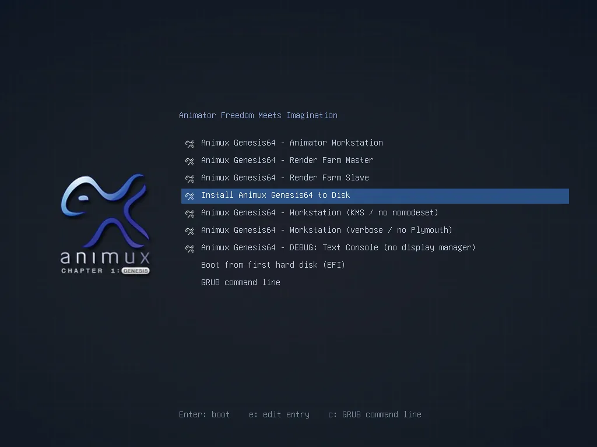
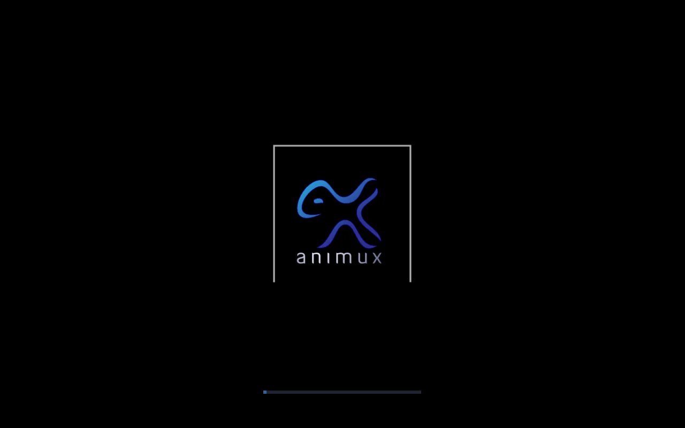

# The boot menu

> What each entry in the Animux start menu does, and which one to choose when the screen stays black.

When Animux starts from the ISO or USB stick you see this menu. Use the **arrow keys** to choose and **Enter** to start. If you press nothing, the first entry starts after 10 seconds.

| Entry | What it does | When to use it |
|---|---|---|
| **Animator Workstation** | Starts the full desktop and logs in the live user automatically. | Normally. |
| **Render Farm Master** | Switches on the services a render farm head node uses: DHCP server and NFS file sharing. Starts to a text login without a desktop (in r16 it still showed the desktop). | Only on a computer that will hand out render jobs. See [Render farm roles](../software/flamenco.md#animux-render-farm-roles). |
| **Render Farm Slave** | A render node, started to a text login (in r16 still with the desktop). | Only on extra computers that only render. |
| **Install Animux Genesis64 to Disk** | Starts the desktop and opens the **installer** by itself. | To [install Animux](install.md). |
| **Workstation (KMS / no nomodeset)** | Desktop with the graphics card's own driver from the first second. | If the normal entry gives a **black screen** or a very low resolution on a real computer. |
| **Workstation (verbose / no Plymouth)** | Desktop, showing all start-up messages. | To see where starting hangs. |
| **DEBUG: Text Console** | Text login only (user `user`, password `user`). | Repairs and fault finding. |
| **Boot from first hard disk (EFI)** | Leaves Animux and starts the system on the hard disk. | Shown only on UEFI computers. |
| **GRUB command line** | The boot loader's command prompt. | Experts only. |

!!! tip "Black screen?"
    1. Wait two minutes. The first start in a VM or from a slow USB stick takes time.
    2. Restart and choose **Workstation (KMS / no nomodeset)**.
    3. Still black: choose **verbose** and look at the last lines, or see [Troubleshooting](../help/troubleshooting.md#black-screen-after-the-boot-menu).

## Adding your own options

Press **e** on an entry to edit it for one start. You can add words to the line that begins with `linux`, for example `toram` (copies the whole system into memory so you can remove the USB stick; needs 16 GB RAM or more). Press **Ctrl+X** or **F10** to start. Nothing is saved.

## After installation

An installed Animux has a shorter menu with Animux and its recovery mode. It shows the Animux splash screen while it starts and then the login screen:

