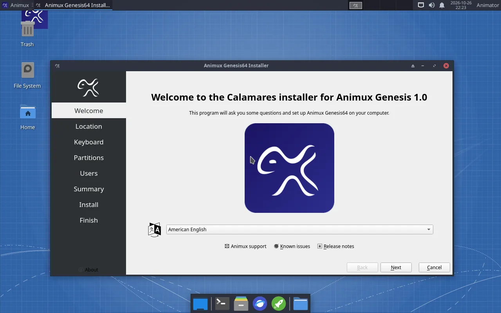
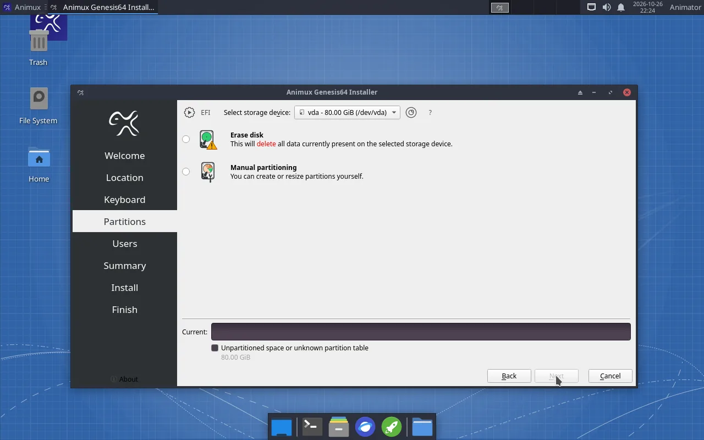
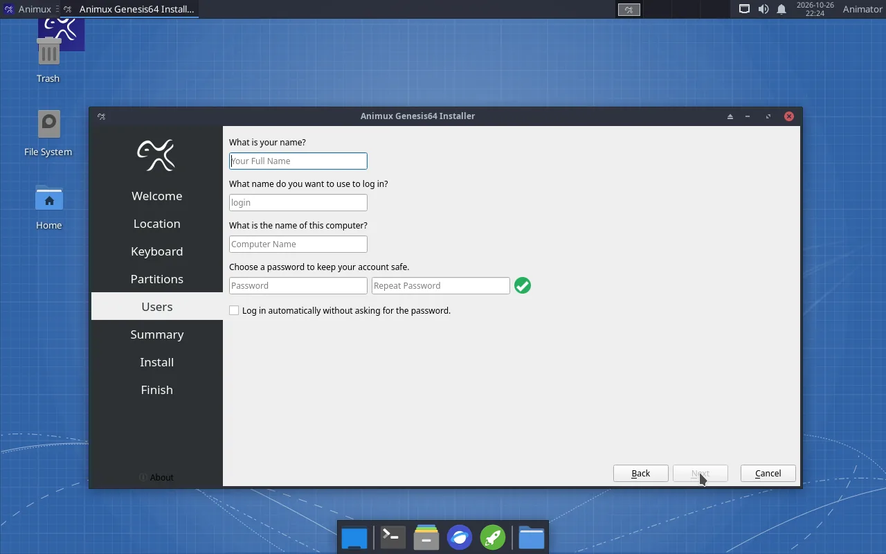
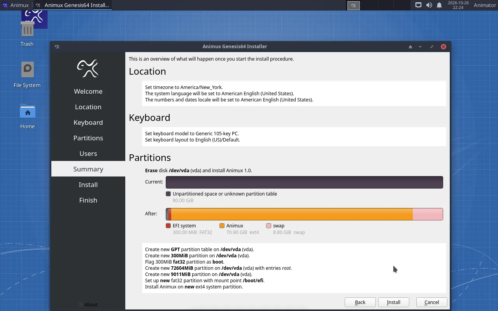
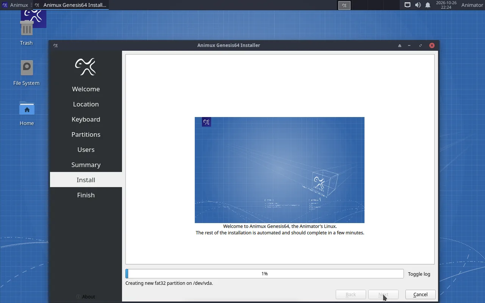
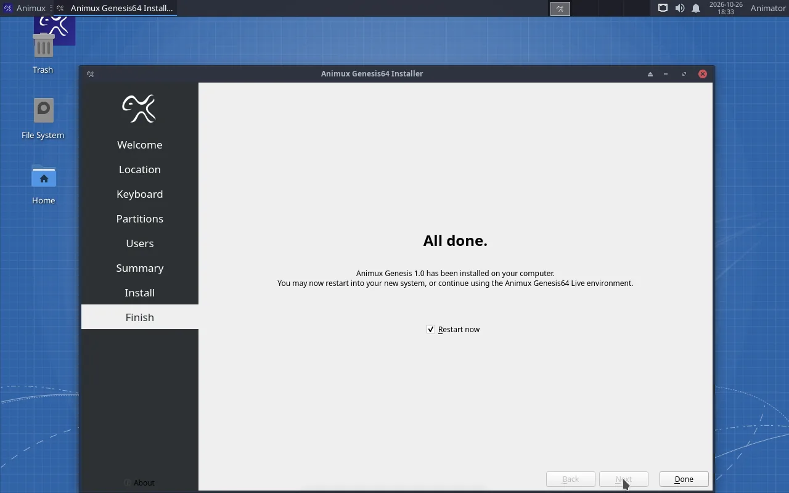
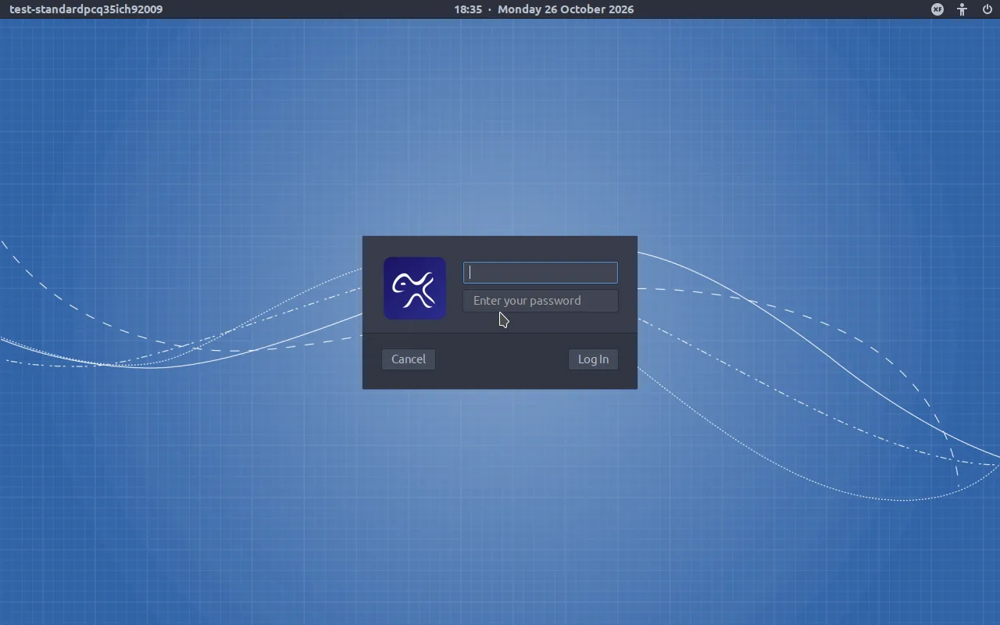

# Install Animux on a disk

> Step-by-step through the installer, with screenshots, for a whole disk, a virtual disk or next to Windows.

Installing copies Animux onto a disk, so it starts without the USB stick and **keeps your files and settings**. It takes 15–40 minutes.

!!! danger "Back up first"
    Installing can erase a disk. Copy everything important from the computer to another drive first. In a [virtual machine](virtualbox.md) this does not matter: the installer only sees the empty virtual disk.

## Before you start

- A disk (or free space) of **at least 40 GB**; 100 GB or more is better.
- The computer plugged in to power.
- For **dual boot with Windows**: shrink Windows first, in Windows: **Disk Management → right-click C: → Shrink Volume**, and free at least 60 GB. Also turn off Windows *Fast Startup* and, if it is on, *BitLocker* for the time of the installation.

## 1. Start the installer

Start from the USB stick or ISO and choose **Install Animux Genesis64 to Disk** in the [boot menu](boot-menu.md). The desktop starts and the installer opens by itself.

(The installer can also be started from a normal live session: open a terminal and type `sudo -E calamares`.)

## 2. Welcome, location, keyboard

- **Welcome**: choose your language, click **Next**.
- **Location**: click your region on the map, or choose region and city. This sets the clock and the date format.
- **Keyboard**: choose your keyboard layout. Type in the test box to check that the keys are right (especially `@`, `"` and `/`).

## 3. Partitions: where Animux goes

At the top, **Select storage device** shows the disk. Make sure it is the right one: check its size.

| Option | Use it when |
|---|---|
| **Erase disk** | The whole disk is for Animux (new disk, virtual machine). Everything on the disk is deleted. |
| **Install alongside** | Windows or another system is on the disk and you want to choose at every start. Drag the divider to give Animux its share. Only shown when there is room. |
| **Replace a partition** | You prepared an empty partition for Animux. |
| **Manual partitioning** | You know exactly which partitions you want. |

For **Erase disk** you can also choose **Swap** (extra memory on disk; *Swap (with Hibernate)* lets you hibernate) and tick **Encrypt system** to protect a laptop with a password at every start.

## 4. Users

| Field | Example | Note |
|---|---|---|
| What is your name? | `Ada Lovelace` | shown on the login screen |
| Login name | `ada` | lower case, no spaces |
| Computer name | `ada-studio` | how the computer is called on the network; use different names on render farm computers |
| Password (twice) | | You need it to log in and to install software. Write it down. |
| Log in automatically | | Tick it only on a computer nobody else uses. |

## 5. Summary and installation

Read the summary. **Nothing has been changed yet.** Click **Install**, then **Install now**.

When it says **All done**, tick **Restart now** and click **Done**. Remove the USB stick when the screen goes black (in VirtualBox: remove the ISO under **Settings → Storage**).

## 6. First start from the disk

Animux shows its splash screen, then the login screen. Type your password and press **Enter**.

Continue with [First steps after installing](first-steps.md).

## Dual boot: choosing Windows or Animux

With **Install alongside**, every start shows a menu where you choose **Animux** or **Windows Boot Manager**. If Windows starts straight away without a menu, open your computer's boot menu (F12 etc., see [USB stick](usb-stick.md#start-the-computer-from-the-stick)) or set **debian** first in the firmware's boot order.
