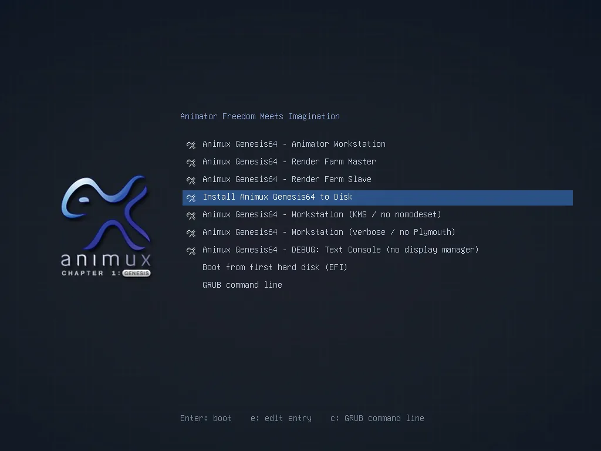
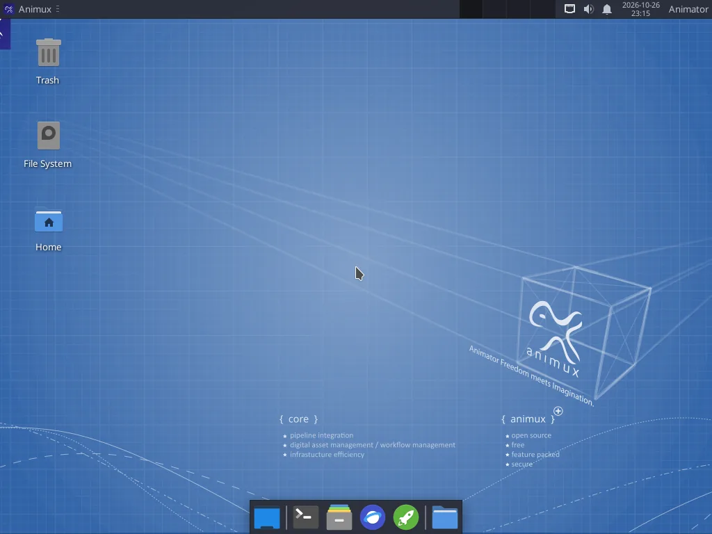
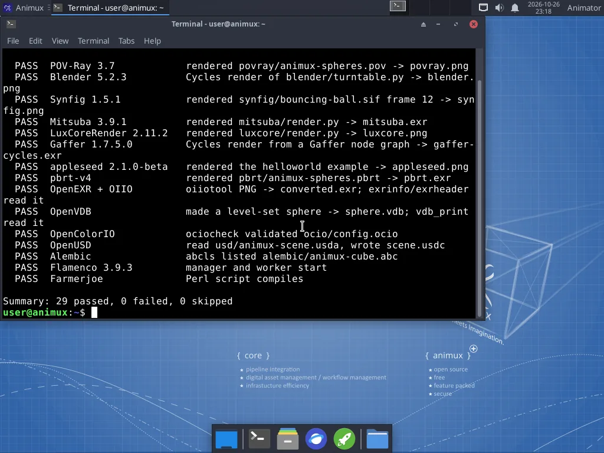

# Try Animux in VirtualBox

> Create a virtual machine with its own 80 GB virtual disk, start Animux from the ISO file and, if you like, install it, all without touching your real computer.

A **virtual machine (VM)** is a pretend computer that runs in a window on your real computer. Animux inside it cannot see or change your files. **VirtualBox** is a free VM program for Windows, macOS (Intel) and Linux.

You need:

- the Animux ISO file (`animux-genesis64-deb_28.iso`, 12 GB). See [Get the ISO](get-the-iso.md).
- **VirtualBox 7** from <https://www.virtualbox.org/wiki/Downloads> ("Windows hosts", "macOS / Intel hosts" or your Linux system).
- about **100 GB free disk space** on the real computer (the ISO plus a virtual disk that grows up to 80 GB), and at least **8 GB RAM**.

!!! tip "Fast way: let a script do steps 2 to 4"
    On Windows you can download [create-animux-vm.ps1](../../files/create-animux-vm.ps1), right-click it and choose **Run with PowerShell**. It asks for the ISO file and creates the VM with exactly the settings below. Then continue at [step 5](#5-start-animux).

## 1. Install VirtualBox

Run the VirtualBox installer and accept the defaults. On Windows it may warn that the network will be briefly disconnected; that is normal. Start **Oracle VirtualBox** when it is done.

## 2. Create the virtual machine

Click **New** (the blue star). Fill in:

| Field | Value |
|---|---|
| Name | `Animux` |
| Folder | where the VM files go. Pick a disk with 100 GB free (for example `D:\VMs`). |
| ISO Image | select `animux-genesis64-deb_28.iso` |
| Type / Subtype / Version | **Linux** / **Debian** / **Debian (64-bit)** |
| Unattended installation | **off**. In VirtualBox 7.1 and later leave **Proceed with Unattended Installation** unticked; in 7.0 tick **Skip Unattended Installation**. Animux has its own installer, and VirtualBox's automatic installation does not work with it. |

Click **Next**.

## 3. Memory, processors and firmware

| Setting | Value | Why |
|---|---|---|
| Base Memory | **8192 MB** (8 GB); 4096 MB is the minimum | Programs and the live session live in memory |
| Processors | **4** (or half of your real cores) | Rendering uses every core |
| Enable EFI | **leave off** | Animux starts with both, but "off" (BIOS) is the setting tested most. Tick it only if you want to test UEFI. |

Click **Next**.

## 4. The virtual hard disk (storage)

Choose **Create a Virtual Hard Disk Now** and set the size to **80 GB**. Leave **Pre-allocate Full Size** unticked: the file then starts small and grows only as Animux uses it.

!!! note "Do I need the disk to try Animux?"
    No. The live session runs without one. You need the disk if you want to [install Animux](install.md) inside the VM so your work is kept.

Click **Next**, then **Finish**.

### Recommended settings

Select the new VM and click **Settings**:

| Page | Setting | Value |
|---|---|---|
| **Display → Screen** | Video Memory | **128 MB** |
| | Graphics Controller | **VMSVGA** |
| | Enable 3D Acceleration | **off** |
| **System → Motherboard** | Boot Order | **Optical** first, then **Hard Disk** |
| **Network → Adapter 1** | Attached to | **NAT** (the default; gives internet access) |
| **Audio** | Enable Audio | on (default) |

Click **OK**.

## 5. Start Animux

Select the VM and click **Start**. After a few seconds you see the Animux boot menu:



Press **Enter** on **Animux Genesis64 – Animator Workstation**. Some text scrolls past for a moment, then the desktop opens by itself (about a minute in a VM). You are logged in as the live user **user** (password `user`).



To learn what each boot menu entry does, see [The boot menu](boot-menu.md).

!!! info "Using the mouse and keyboard in the VM"
    Click inside the window to use Animux. If the mouse gets "caught", press the **Host key** (right **Ctrl** on Windows and Linux, left **⌘ Command** on Mac) to release it.

## 6. Check that everything works

Open the menu at the top left: **Animux → Animux Tools → Animux Self-Test**. After a few minutes it lists every test:



See [The self-test](../help/self-test.md) for what the results mean.

## 7. Install Animux on the virtual disk (optional)

In the live session, everything you do is lost when the VM is switched off. To keep your work, install Animux on the 80 GB virtual disk:

1. Restart the VM. In the boot menu choose **Install Animux Genesis64 to Disk**.
2. Follow the [installation guide](install.md). Choose **Erase disk**: inside the VM this erases only the empty virtual disk, never your real one.
3. When the installer says it is finished, close the VM (**File → Close → Power off the machine**).
4. In the VM's **Settings → Storage**, click the disc under **Controller: IDE** and choose **Remove Disk from Virtual Drive**, so that it starts from the virtual disk next time.
5. Click **Start**. Animux now starts from its disk and asks for the user name and password you chose.

## Screen size, copy and paste, shared folders

Animux does not include VirtualBox's **Guest Additions**, so the screen does not resize automatically with the window, and copy and paste between your computer and the VM do not work yet.

- **Change the screen size** inside Animux: **Animux → Settings → Display**, then choose a **Resolution** and click **Apply**.
- **Scale the window**: VirtualBox menu **View → Virtual Screen 1 → Scale to 200 %** (or press Host+C for scaled mode).
- **Move files** in and out: use a USB stick (VirtualBox menu **Devices → USB**, then choose the stick), a cloud drive in Firefox, or e-mail.

On an **installed** Animux you can add the Guest Additions yourself. Everything they need (compilers and kernel headers) is included, and it takes about five minutes:

1. VirtualBox menu **Devices → Insert Guest Additions CD image…** A disc icon **VBox_GAs_7…** appears on the Animux desktop.
2. **Double-click that disc icon** so Animux opens it. (It is not opened by itself; the next step fails with "No such file" until you do.)
3. Open a [terminal](../desktop/terminal.md) and type:
   ```
   sudo sh /media/$USER/VBox_GAs_*/VBoxLinuxAdditions.run
   ```
   Type your password. A second window opens and shows the progress (*Building the VirtualBox Guest Additions kernel modules…*). Wait until it says **Press Return to close this window**, then press **Enter** in it.
4. Allow yourself to use shared folders:
   ```
   sudo usermod -aG vboxsf $USER
   ```
5. **Restart** Animux (menu **Animux → Log Out → Restart**).

Afterwards:

- The Animux screen **follows the size of the VirtualBox window** (and full-screen mode, Host+F).
- **Devices → Shared Clipboard → Bidirectional**: copy and paste between Windows (or macOS) and Animux.
- **Devices → Shared Folders**: add a folder of your computer, tick **Auto-mount**. In Animux it appears as `/media/sf_<name>` (for example `/media/sf_Projects`) and in the file manager. Files can be read and written from both sides.
- **Devices → Drag and Drop** works too.

This was tested with VirtualBox 7.2.6 on an installed Animux r16 (screen resize, shared folder in both directions, clipboard in both directions).

!!! note "After a kernel update"
    The Guest Additions rebuild themselves for a new Linux kernel when Animux starts. If the screen stops following the window after an update, run step 3 again.

## Webcam for stop motion

With the free **VirtualBox Extension Pack** installed (same download page), the VirtualBox menu **Devices → Webcams** passes your webcam to Animux, where [Stopmotion](../software/stopmotion.md) can use it.

## If something goes wrong

| Problem | Fix |
|---|---|
| "VT-x is disabled in the BIOS" or "AMD-V is disabled" | Switch on virtualisation (Intel VT-x / AMD-V / SVM) in your computer's BIOS/UEFI setup. |
| Black window after the splash | Restart and choose **Workstation (KMS / no nomodeset)**, or set the Graphics Controller to VMSVGA. |
| Very slow | Give the VM more memory and processors. Close other programs. 3D is always slower in a VM than on a real computer. |
| Blender or Mitsuba say "illegal instruction" | Your processor or VM hides SSE4.2/AVX. See [Requirements](requirements.md#does-my-processor-have-sse42-and-avx). |
| No sound | **Settings → Audio**: Host Audio Driver **Default**, Controller **Intel HD Audio**. In Animux check **Settings → PulseAudio Volume Control**. |

More in [Troubleshooting](../help/troubleshooting.md).

## Other virtual machine programs

Animux also runs in **QEMU/virt-manager**, **VMware Workstation Player**, **Parallels** (Intel Macs) and **Hyper-V**. See [Other virtual machines](other-vms.md).
