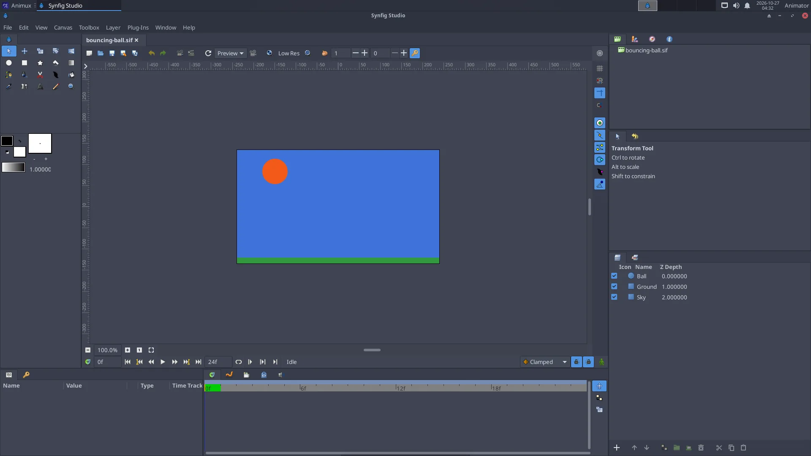

# A bouncing ball in Synfig

> The classic first animation exercise. Make a ball fall, squash and bounce with waypoints and ease in and out, then export a GIF. About 30 minutes.

The bouncing ball teaches three of the **twelve principles of animation**: **timing**, **slow in and slow out**, and **squash and stretch**. Animux has a finished version as a sample: `/usr/share/animux/samples/synfig/bouncing-ball.sif`.



## 1. A new document

1. Start **2D Animation → Synfig Studio**.
2. **Canvas → Properties** (or the *Canvas MetaData* button): on the **Time** tab set **End Time** to `24` (one second at 24 fps). Click **OK**.

## 2. Draw the ground and the ball

1. Pick the **Rectangle tool** and drag a long, thin rectangle at the bottom: the ground.
2. Pick the **Circle tool**, choose a colour in the toolbox's *Fill colour* box, and drag a circle near the top: the ball.

## 3. Animate the fall and bounce

1. Click the **Animation mode** button at the bottom right of the canvas. The canvas gets a **red border**: from now on every change is recorded.
2. **Frame 0**: the ball is at the top. Select the circle layer, and in **Params** right-click **Origin** → **Add Waypoint** (or simply move the ball a tiny bit).
3. Move the **time slider** to frame **12**. Drag the ball down until it touches the ground. A waypoint appears in the **Timetrack**.
4. Move to frame **24** and drag the ball back to the top.
5. Press **Play** (or drag the time slider). The ball goes down and up.

## 4. Make it feel heavy: slow in and out

A real ball is **slow at the top** and **fast at the bottom**. In the Timetrack, right-click the waypoints at frames 0 and 24 → **Both → Ease In/Out** (slow), and the one at frame 12 → **Both → Linear** (fast, sharp bounce). Play again: it looks much more natural.

## 5. Squash and stretch

At the moment of impact the ball squashes. Add this with a **Scale** or **Stretch** layer above the circle (*Layer → New Layer → Distortions → Stretch*):

- frame 10: amount `1.0, 1.1` (a little stretched while falling fast);
- frame 12: amount `1.3, 0.7` (squashed on the ground);
- frame 14: back to `1.0, 1.0`.

Set the stretch's centre at the ball's bottom.

## 6. Export

**File → Render**: file name `ball.gif`, **Target** `gif`, click **Render**. Or for editing in Kdenlive: target `png` (one image per frame).

From a terminal:

```
synfig ~/ball.sifz -t gif -o ~/ball.gif
```

Turn **Animation mode** off before you continue drawing, and save (**File → Save**, `.sifz`).

## Next

Make the ball bounce several times, lower each time; add a shadow that grows as the ball comes down. Then try a character with **bones** (*Skeleton layer*), see <https://synfig.readthedocs.io/>.
