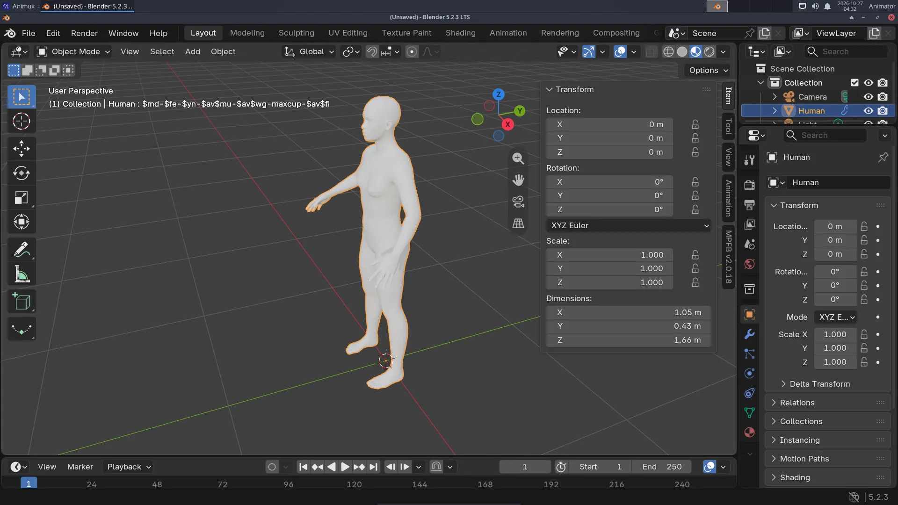
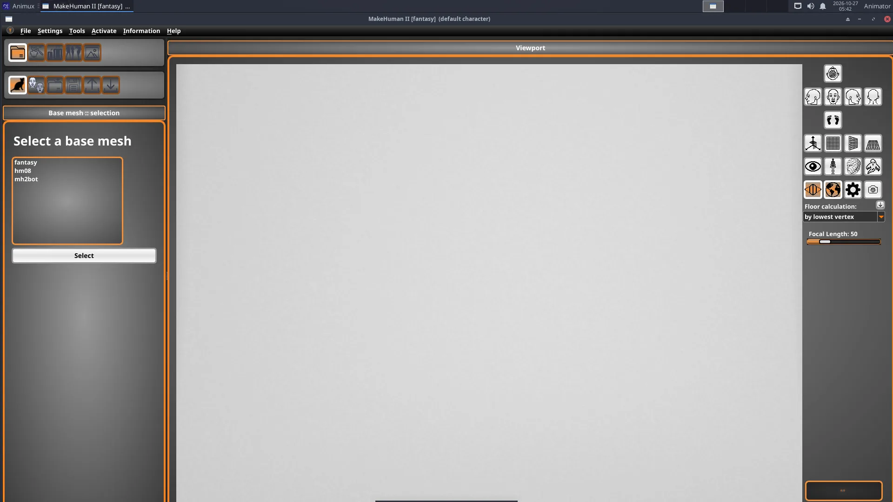

# A character with MakeHuman

> Create a human character with MPFB inside Blender, give it a skeleton, pose it and set a keyframe, or design it in MakeHuman II and bring it over. About 30 minutes.

Modelling a believable human by hand takes weeks. With **MPFB** (in Blender) or **MakeHuman II** (on its own) you get one in minutes, with a skeleton for animation. See [MakeHuman II and MPFB](../software/makehuman.md) for the background.

## Way 1: MPFB, directly in Blender (recommended)

### 1. Create the human

1. Start **Blender**. Delete the cube (**X → Delete**).
2. Move the mouse over the 3D viewport and press **N**: the **side panel** opens on the right. Click its **MPFB** tab.
3. Open the **New human** section, then **From scratch**, and click **Create human**.

Press **Numpad .** (period) to zoom to the selected human.

### 2. Shape the body

Open **Model** in the MPFB tab. The **Macrodetails** sliders change the whole body: **gender**, **age**, **muscle**, **weight**, **height**, **proportions**. The other groups (head, face, torso, arms, legs) change details. Move a slider and watch the body change.

### 3. Skin, eyes and hair

Open **Apply assets** and pick a **skin**, **eyes**, **eyebrows** and **eyelashes** from its lists. Hair and clothes come from asset packs (see the note on [asset packs](../software/makehuman.md#mpfb-inside-blender)).

Switch the viewport to **Material Preview** (Z → Material Preview) to see the skin.

### 4. Add a skeleton

1. With the human selected, open **Rigging → Standard rig** and click **Add standard rig**. An **armature** (skeleton) appears inside the body, and the body follows it.
2. For more animation controls use **Rigify** instead (*Rigging → Rigify*), then *Generate rigify rig*.

### 5. Pose and animate

1. Click the **armature** (in the Outliner it is called *Human.rig* or similar).
2. Switch to **Pose Mode**: **Ctrl+Tab** (or the mode menu at the top left of the viewport).
3. Click a bone, for example the upper arm, and rotate it: **R**, move the mouse, click.
4. Set a keyframe: press **I** with the mouse in the viewport.
5. Go to frame 24, pose the arm differently, press **I** again. Press **Space** to play.

MPFB can also load ready **poses** and **animations** (*Rigging → Poses* / *Animation*), including Mixamo-compatible animation (*Rigging → Snap to Mixamo*).

## Way 2: design in MakeHuman II, animate in Blender

1. Start **3D Animation → Modellers → MakeHuman 2**, keep the base mesh **fantasy**, and shape the character with the modelling sliders.
2. Save it: **File → Save** as `my-hero.mhm`.
3. In Blender's MPFB tab: **New human → From save file**, choose `my-hero.mhm`.

Or export from MakeHuman II as **GLB** and import it in Blender with **File → Import → glTF 2.0**. That brings the mesh and skeleton, but MPFB's sliders are then no longer available.

## Tips

- Keep characters at real size (a person is about 1.7 m in Blender).
- Save often: **Ctrl+S**.
- For lip sync, MPFB's **Face operations** offer *Load face shape keys* and *Assign Lip Sync shape keys*.
