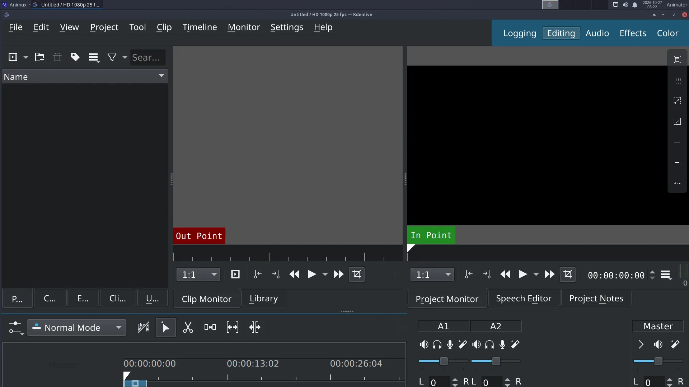

# Edit your film in Kdenlive

> Put rendered shots, a title and music together on a timeline and export an MP4 ready for YouTube. Uses the turntable video from the earlier tutorial. About 30 minutes.

You need some clips: the `turntable0001-0096.mp4` from [A turntable animation](turntable-animation.md) (or download [turntable.mp4](../../files/turntable.mp4)), and any music file (WAV, MP3 or OGG).

## 1. Project settings

1. Start **NLV Editors → Kdenlive**.
2. **Project → Project Settings**: choose a profile matching your animation, here **HD 720p 24 fps** (1280 × 720, 24 frames per second). Click **OK**.

!!! note "Always choose the profile first"
    If the profile does not match your clips, Kdenlive offers to change it when you add the first clip. Say **yes** if it suggests the clip's own format.

## 2. Bring in the clips

- Drag files from the file manager into the **Project Bin**, or right-click in the bin → **Add Clip or Folder**.
- For an **image sequence** (frames from Blender, Synfig or Krita), choose the first image and tick **Import image sequence**.

## 3. Build the edit

1. Drag the turntable clip from the bin onto the **V1** track of the timeline.
2. Drag it again so it plays twice in a row (two turns).
3. Click on the timeline to move the playhead; press **Space** to play in the **Project Monitor**.
4. To cut: put the playhead where you want the cut and press **Shift+R**. Delete a part by selecting it and pressing **Delete**.

## 4. A title

1. Right-click the Project Bin → **Add Title Clip**.
2. Type the title (for example *Suzanne Spins*), choose font and size, click **OK**.
3. Drag the title clip onto **V2** above the start of the video. It is shown on top.
4. Fade it: right-click the title on the timeline → **Add Effect → Fade → Fade In** and **Fade Out**.

## 5. Music

1. Drag your music into the bin, then onto the **A1** audio track.
2. Trim it to the length of the video by dragging its end.
3. Fade out at the end: **Add Effect → Fade → Fade Out**.
4. Too loud? Add the **Volume (keyframable)** effect and lower it.

## 6. Export

1. **Project → Render** (Ctrl+Enter).
2. Choose the preset **MP4-H264/AAC**.
3. Set the **Output file**, for example `~/Videos/suzanne-spins.mp4`.
4. Click **Render to File**. The *Job Queue* tab shows progress.

Watch the result in VLC. Upload it, send it, or show it.

## Save the project

**File → Save** writes a `.kdenlive` file. It only refers to your clips; keep the clips where they are (in your project folder) or Kdenlive cannot find them later.
