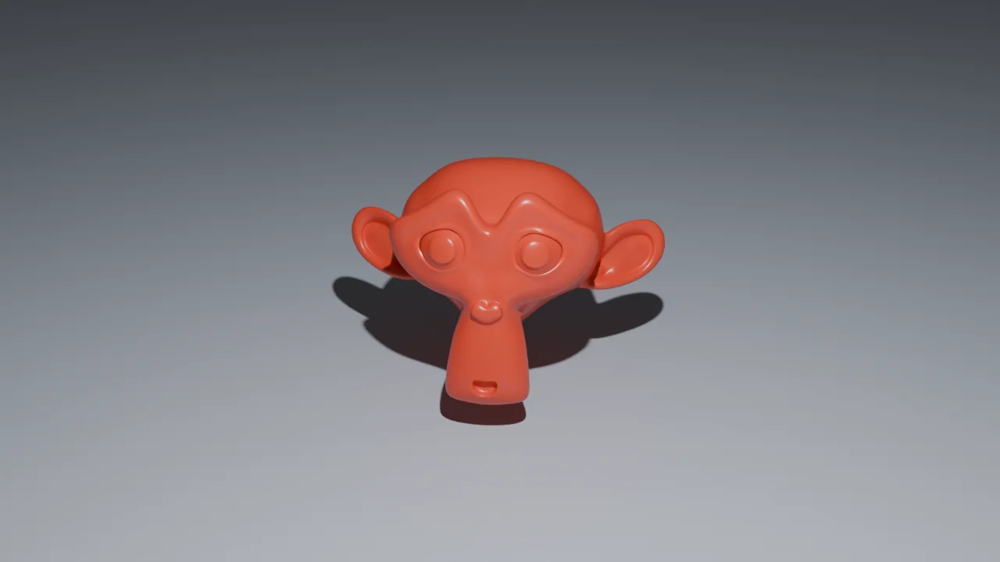
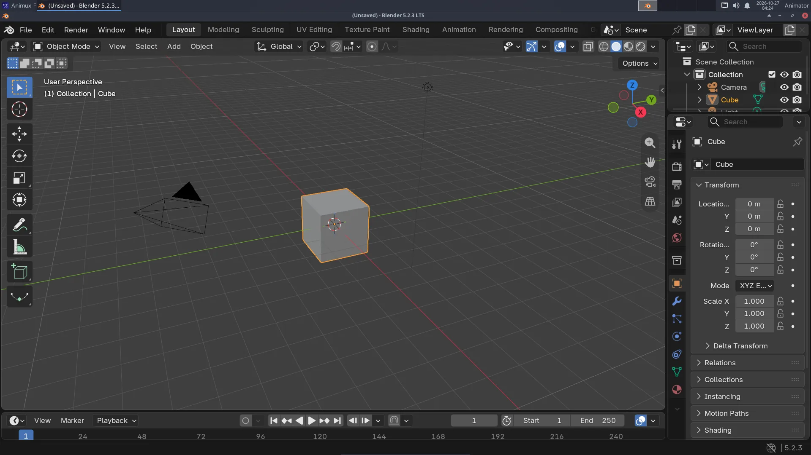
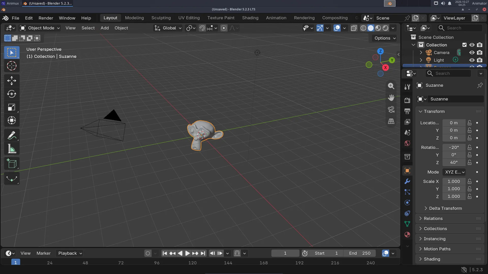
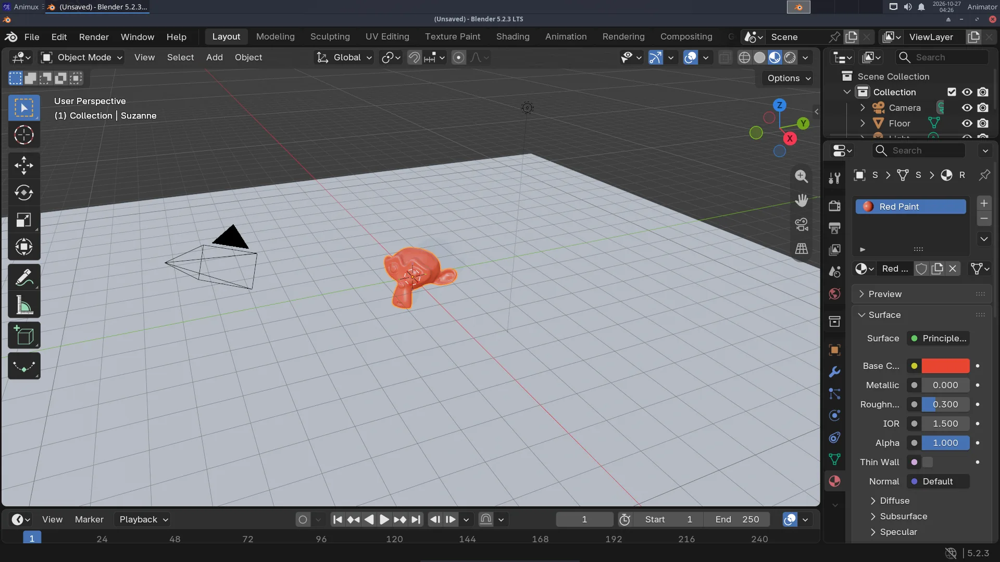
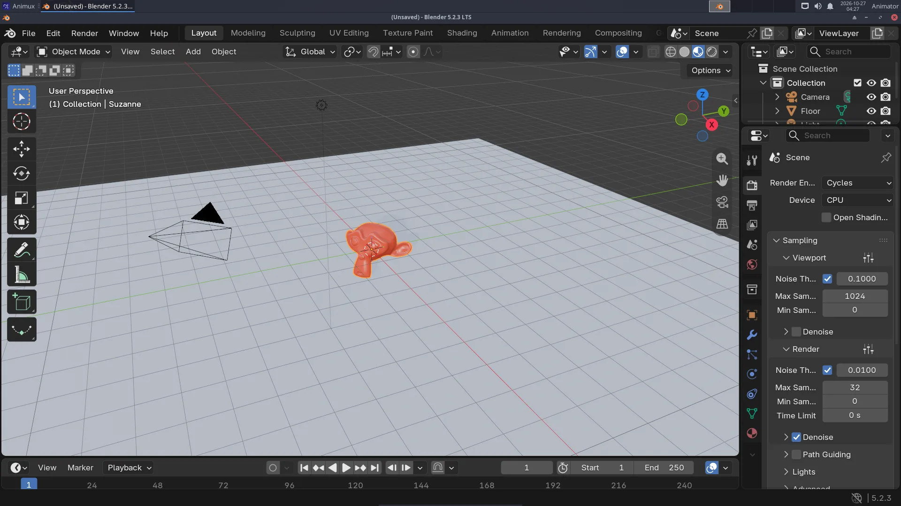
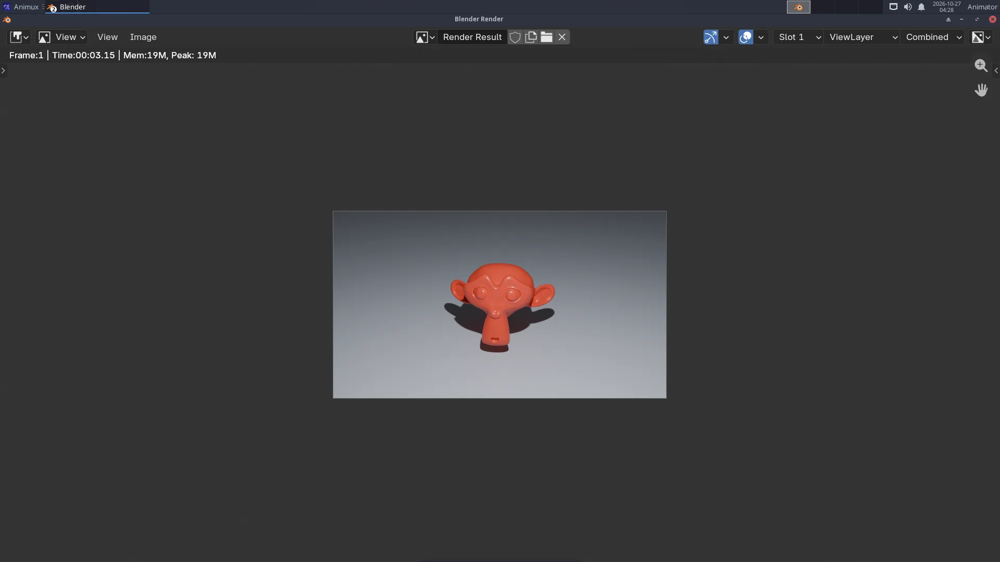

# Your first 3D render

> In Blender, replace the default cube with a monkey head, give it shiny red paint, add a floor, light it and render a picture. About 30 minutes, no experience needed.

At the end you will have this picture, made by you:

You will learn the basics every 3D program shares: **objects, the viewport, materials, lights, the camera and rendering**.

!!! tip "The finished file"
    If you get stuck, download [first-render.blend](../../files/first-render.blend) and open it in Blender (**File → Open**) to compare.

## 1. Start Blender

**Animux → 3D Animation → Modellers → Blender**. Click outside the welcome screen to close it. You see the default scene: a **cube**, a **camera** (the pyramid shape) and a **light** (the dotted circle).

Try moving the view (this does not change the scene):

| Do | Mouse |
|---|---|
| Orbit around | hold the **middle mouse button** (the wheel) and move |
| Pan | **Shift** + middle mouse button |
| Zoom | turn the **wheel** |

No middle button (laptop)? Use the small coloured axes at the top right of the viewport: drag them to orbit, and use the hand and magnifier icons below them.

## 2. Replace the cube with a monkey

1. **Click the cube** to select it (it gets an orange outline).
2. Press **X** and choose **Delete** (the mouse must be over the 3D view).
3. In the viewport's header click **Add → Mesh → Monkey**. Suzanne appears where the cube was.
4. Make her smooth: **right-click** on her → **Shade Smooth**.
5. Make her rounder: press **Ctrl+2**. This adds a *Subdivision Surface* modifier (you can see it in the **Modifiers** tab, the blue wrench).

## 3. Add a floor

1. **Add → Mesh → Plane**.
2. Make it bigger: press **S**, type `15`, press **Enter**.
3. Move it down under Suzanne: press **G**, then **Z**, type `-1`, press **Enter**.

The keys **G** (grab), **R** (rotate) and **S** (scale), followed by **X**, **Y** or **Z** and a number, are the fastest way to place things.

## 4. Paint it red

1. Click **Suzanne** again to select her.
2. In the **Properties** editor (right side), click the **Material** tab, the red-and-grey sphere at the bottom of the tab column.
3. Click **New**. A material called *Material* with a **Principled BSDF** is created.
4. Click the white bar next to **Base Color** and choose a red.
5. Set **Roughness** to `0.3` for a shiny paint (0 = mirror, 1 = matt).
6. To see colours in the viewport, switch the shading to **Material Preview**: the third of the four sphere buttons at the top right of the viewport (or press **Z** → *Material Preview*).

Give the floor a grey-blue material the same way (select the plane, **New**, pick a colour, Roughness `0.6`).

## 5. Light and camera

- **Light**: click the light in the **Outliner** (top right list). In the **Object Data** tab (the green bulb) set **Power** to `2500 W`.
- **Camera**: press **Numpad 0** to look through the camera (or **View → Cameras → Active Camera**). The scene is already framed. To change the view: **View → Navigation → Walk/Fly** or, easier, move the view where you like and press **Ctrl+Alt+Numpad 0** to move the camera there.

## 6. Render settings

1. Click the **Render** tab in Properties (the camera-back icon, second from the top).
2. **Render Engine**: **Cycles**. **Device**: **CPU** (always works).
3. Under **Sampling → Render**, set **Max Samples** to `32` and keep **Denoise** ticked. More samples = less noise but slower.

4. In the **Output** tab (the printer icon), check **Resolution**: `1280` × `720`, `100 %`.

## 7. Render!

Press **F12** (or **Render → Render Image**). A new window opens and the picture builds up tile by tile. In a VM or on an older computer it may take a minute.

## 8. Save the picture and the scene

- In the **render window**: **Image → Save As…**, choose `Pictures`, type the name `first-render.png`, click **Save As Image**.
- In the **main window**: **File → Save As…** (Ctrl+Shift+S), make a folder `Projects`, name `first-render.blend`.

!!! warning "Live session"
    In the live session, copy both files to a USB stick before you switch off. See [The live session](../start/live-session.md).

## What next?

- Change the colour, the light, or add a second object (**Add → Mesh → UV Sphere**), and render again.
- Make it move: **[A turntable animation](turntable-animation.md)**.
- Learn more: Blender's manual (*Help → Manual*) and the free courses at <https://studio.blender.org/training/>.
