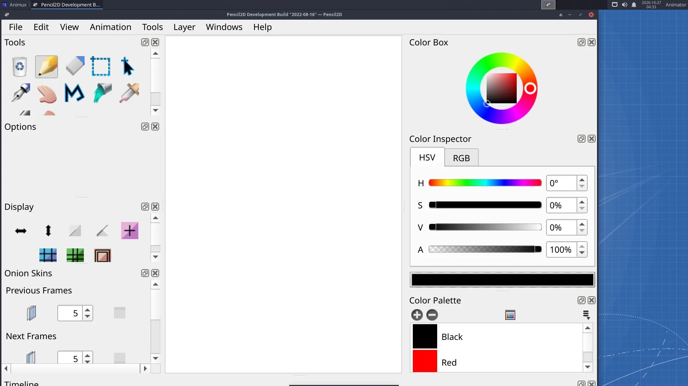

# Hand-drawn animation in Pencil2D

> Draw a short flip-book animation frame by frame with onion skin, play it back and export it as GIF or MP4. About 30 minutes, perfect for beginners and children.

Traditional animation is a series of drawings shown quickly. Pencil2D makes it as easy as a flip book.

## 1. Get ready

1. Start **2D Animation → Pencil2D**. A new project with a **Camera**, a **Vector** and a **Bitmap** layer opens.
2. Click the **Bitmap** layer in the timeline (that is where you draw like on paper).
3. Pick the **Pencil** tool (N) and a dark colour. With a drawing tablet, pressure works automatically.

## 2. Key drawings

Animators start with the **keys**, the most important poses. We will animate a ball jumping across the screen.

1. **Frame 1**: draw the ball on the left, on the ground.
2. Click **frame 7** in the Bitmap layer, then the **+** button (*Add Frame*) above the layers. Draw the ball high in the middle.
3. **Frame 13**: add a frame and draw the ball on the right, on the ground.

## 3. In-betweens with onion skin

1. Turn on **onion skin**: the onion buttons above the timeline (*previous* and *next*). The drawings before and after appear faintly in red and blue.
2. Click **frame 4**, add a frame, and draw the ball halfway between frame 1 and 7: a little lower than half the height (the ball is faster near the ground).
3. Do the same on **frame 10**.

Each drawing is held until the next one: frame 1 shows until frame 3, and so on. That is animating **on threes**.

## 4. Play it

Press **Play** (or **Enter**). Change the speed in the **FPS** box next to the play buttons: `12` is classic for hand-drawn animation. Switch on **Loop** to watch it repeat.

Too jerky? Add more in-betweens (frames 2, 3, 5, 6…) and animate on twos or ones.

## 5. Colour

Pencil2D's **Bucket** (K) fills closed areas. For clean colouring, draw lines on a **Vector** layer: its bucket fill follows the lines exactly, even after you edit them.

## 6. Export

- **File → Export → Movie**: choose **MP4** (for Kdenlive or sharing) or **GIF** (for the web) and the size.
- **File → Export → Image Sequence**: PNG files, the best quality for editing.

Save your project with **File → Save** (`.pclx`).

## Next steps

- Add a **Sound** layer (*Layer → New Sound Layer*) to animate to music or a voice.
- Use the **Camera** layer to pan across a wide background.
- The twelve principles of animation (Frank Thomas and Ollie Johnston, *The Illusion of Life*) are the best next thing to learn. The [bouncing ball in Synfig](bouncing-ball-synfig.md) teaches the first three.
