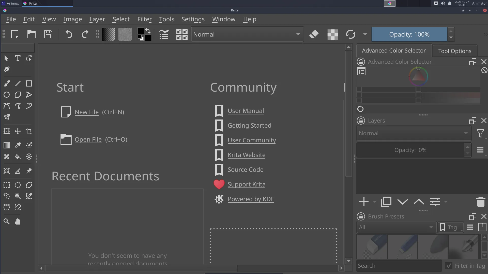

# Paint an animation in Krita

> Use Krita's animation workspace to paint a short loop, such as a flickering candle flame, with onion skins, then render it to a video. About 40 minutes.

Krita animates like Pencil2D but with all its painting brushes, so it is good for **painterly effects**: fire, water, smoke, magic. We paint a candle flame that loops.

## 1. A new animation document

1. Start **2D Graphics → Bitmap Editors → Krita**.
2. **File → New**: width `1080`, height `1080`, *Create*.
3. **Window → Workspace → Animation**. The **Timeline** (bottom), **Animation** and **Onion Skins** panels appear.
4. In the **Animation** panel set **Frame rate** `12`, **Start** `0`, **End** `11` (one-second loop).

## 2. Background and candle

1. Fill the background layer dark (bucket fill, **F**).
2. Add a layer (**Insert**) named *Candle* and paint the candle body. It does not move, so it needs no frames.

## 3. The flame, frame by frame

1. Add a new layer *Flame*. In the timeline, right-click frame **0** of *Flame* → **Create Blank Frame**.
2. Paint a flame with a soft brush (orange-yellow, brighter in the middle).
3. Turn on the **onion skin** (the light bulb icon on the *Flame* layer in the timeline).
4. Click frame **2**, right-click → **Create Blank Frame**, and paint the flame a little taller and leaning left. Continue on frames 4, 6, 8 and 10 with small changes. Each drawing holds for two frames (animating on twos).
5. Make frame 10 lead back to frame 0, so the loop is smooth.

## 4. Play and adjust

Press **Play** in the Animation panel, and switch on **looping**. Drag frames in the timeline to change the timing.

## 5. Glow

Duplicate the *Flame* layer, put the copy below it, apply **Filter → Blur → Gaussian Blur** (large radius) to each of its frames and set its blending mode to **Add** or **Screen**. The flame now glows.

## 6. Render

**File → Render Animation**:

- **Image Sequence** (PNG): best for editing in Kdenlive;
- **Video**: choose **MP4** and the output file. Krita uses FFmpeg (included). The first time, Krita may ask for the FFmpeg location: `/usr/bin/ffmpeg`.

Save the project as `.kra`.
