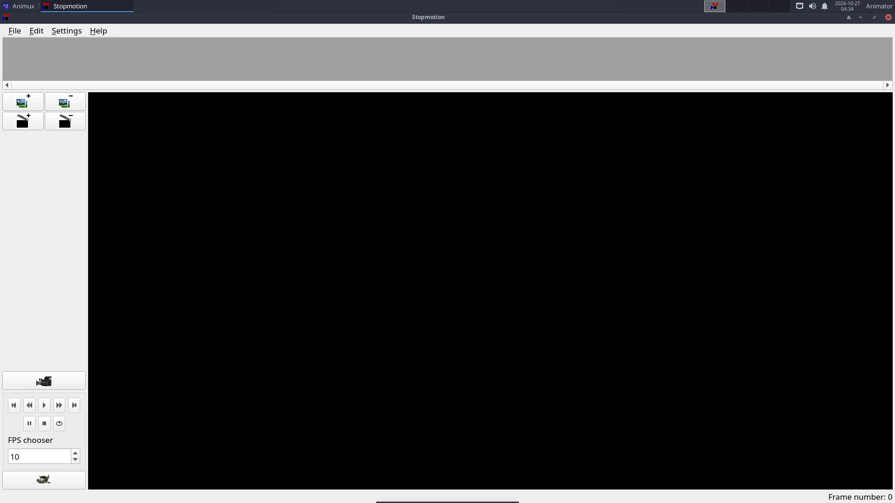

# Stop motion with a webcam

> Set up a tiny studio, capture a clay or LEGO animation with Stopmotion's onion skin, and turn it into a video with sound.

## Your studio in 10 minutes

| Need | Tip |
|---|---|
| A webcam | any USB webcam; test it first in VLC (*Media → Open Capture Device*) |
| Something to hold it still | a tripod, a clamp, or tape it to a pile of books. **It must not move at all.** |
| Light | close the curtains, use two desk lamps. Daylight changes and makes the film flicker. |
| A stage | a table against a wall; a sheet of paper as background |
| Characters | plasticine, LEGO, paper cut-outs, toys |

## Capture

1. Start **StopMotion Animation → Stopmotion**.
2. **Settings → Preferences → Video Import**: select your camera (`/dev/video0` for the first webcam).
3. Click the **camera** button: the live picture appears.
4. Set **onion skin** to show the last 1–2 frames (the slider in the camera bar).
5. Place your character. Take the first frame.
6. Move the character **a very small step** (a few millimetres), check against the onion skin, take the next frame.
7. Repeat. **12 frames = 1 second** of film at 12 fps.



!!! tip "Planning"
    A 10-second scene at 12 fps needs 120 photos. Plan the movement first; count the steps. Moving characters slowly at the start and end of a motion (small steps) and faster in the middle (bigger steps) makes it look natural.

## Check and fix

Press **Play**. Delete bad frames (a hand in the picture!) by selecting them and pressing **Delete**. Use the frame rate setting to change the speed.

## Export

**File → Export → Video**, or export the frames as images and make a video with FFmpeg:

```
ffmpeg -framerate 12 -i frame_%04d.jpg -c:v libx264 -pix_fmt yuv420p -crf 18 my-film.mp4
```

Add music and titles in [Kdenlive](edit-video-kdenlive.md).

## No webcam?

Use a phone camera on a small stand. Take the photos, copy them to Animux (USB cable or a card reader), and import them in Stopmotion with **Edit → Add frames** (or drag them in), or put them straight into Kdenlive as an image sequence.
