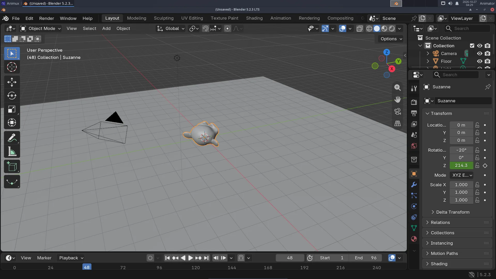
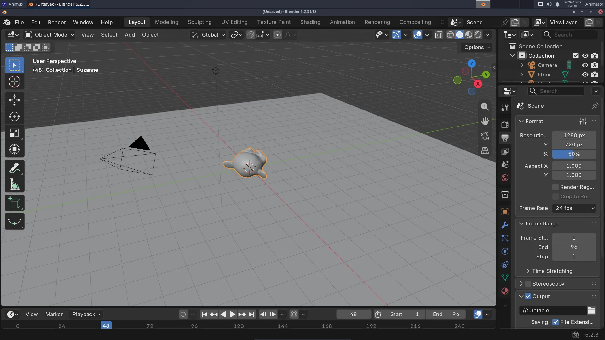

# A turntable animation

> Make Suzanne spin once around in four seconds with two keyframes, then render the animation straight to an MP4 video. About 20 minutes.

A **turntable** shows a model from every side: it turns once around. Studios use turntables to present models. You need the scene from [Your first 3D render](first-3d-render.md) (or download [first-render.blend](../../files/first-render.blend)).

This is the result (4 seconds, 24 frames per second):

<video controls loop muted playsinline width="640" poster="../../images/first-render.webp" src="../../files/turntable.mp4"></video>

The finished file: [turntable.blend](../../files/turntable.blend).

## Keyframes, in one sentence

You tell Blender where an object is at a few moments (**keyframes**), and Blender calculates every frame in between.

## 1. Set the length

At the bottom, in the **Timeline**, set **Start** to `1` and **End** to `96`. At 24 frames per second that is 4 seconds.

## 2. First keyframe: frame 1

1. Make sure the current frame (the blue number in the timeline) is **1**.
2. Select **Suzanne**. In the **Object** tab of Properties (orange square), look at **Rotation Z**.
3. Hover the mouse over the **Rotation Z** field and press **I**. The field turns **yellow**: it has a keyframe on this frame. A diamond appears in the timeline.

## 3. Second keyframe: one turn later

1. Type `97` in the current-frame box of the timeline (one frame after the end, so the loop has no repeated frame).
2. In **Rotation Z**, add 360 to the number that is there (for example `40` becomes `400`) and press **Enter**.
3. Hover over the field and press **I** again.



Press **Space** to play. Suzanne turns, but she starts slowly, speeds up and slows down again ("ease in, ease out"). For a turntable the speed must be even:

4. Move the mouse over the **timeline**, press **A** (select all keyframes), then **T** and choose **Linear**.

Play again with **Space**: an even, endless spin. Press **Space** to stop.

## 4. Render to a video file

1. Open the **Output** tab (the printer icon).
2. Under **Output**, set the path to `//turntable` (`//` means "in the same folder as the .blend file").
3. Set the **File Format** to **FFmpeg Video** (in Blender 5 first choose the media type **Video**).
4. Under **Encoding**: **Container** `MPEG-4`, **Video Codec** `H.264`, **Output Quality** `Medium quality`.



5. Lower the **Max Samples** in the Render tab to `16` to make it faster. 96 frames take a while.
6. **Render → Render Animation** (Ctrl+F12). Blender renders frame after frame. When it is finished, the file `turntable0001-0096.mp4` is next to your `.blend` file.
7. Watch it: double-click it in the file manager (it opens in VLC), or **Render → View Animation** in Blender.

!!! tip "Image sequences are safer"
    For real projects, render to **PNG** images instead of a video (File Format **PNG**, path `//frames/turntable_`). If Blender stops at frame 60, you keep frames 1–59 and continue from 60. Join the images into a video with FFmpeg or Kdenlive afterwards ([how](../software/video-tools.md#ffmpeg-the-five-most-useful-commands)).

## Render without opening Blender

Close Blender and render from a terminal; it is faster and you can keep working:

```
blender -b ~/Projects/turntable.blend -a
```

See [Command-line rendering](command-line-rendering.md).

## Next

- Animate other properties the same way: location (a jumping ball), scale, colour (hover over any field and press **I**).
- [A character with MakeHuman](character-makehuman.md).
